*A note on the hours: I didn't keep a time log while I was building, so the hours on each entry are my best reconstruction from the session evidence, photos, doc dates, and test durations, not a contemporaneous record. The work, the numbers, and the failures are all real and traceable to the project sources; the hours are estimates.*

# June 12: Studying an auger filler before designing mine

## What I'm doing

Ok so before i draw anything of my own i want to get how an auger filler works. Not kinda know. So I found a full 3D model of one and saved the STEP file tonight. Now I can open it up and look at teh real geometery instead of guessing from pictures finished machines. First thing I want is the the whole powder path laid out in front of me, not just the outside of a finished machine.

## What happened

ngl its simpler than I thought it would be tho. Powder sits in a tube on top. Drops down through a funnel into a horizontal barrel. And theres a screw inside the barrel that pushes the powder out the end. One motor at the back turns the screw. Thats the whole machine.

Cap, tube, funnel block, motor, screw, barrel. Like six things. Each one does its own job. The screw is the whole metering idea. Every turn moves a consistent amount of powder. Everything else is just holding powder abvoe it and catching what falls. So what im copying from this design is how it meters, not how its laid out.

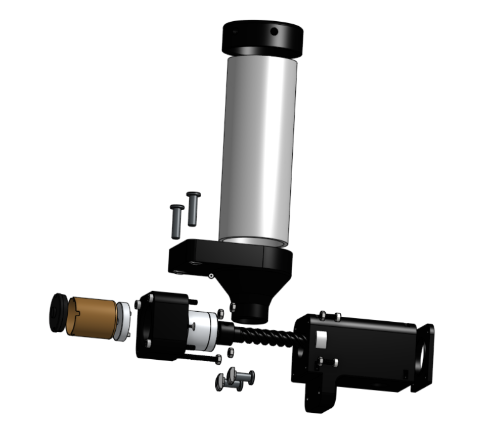

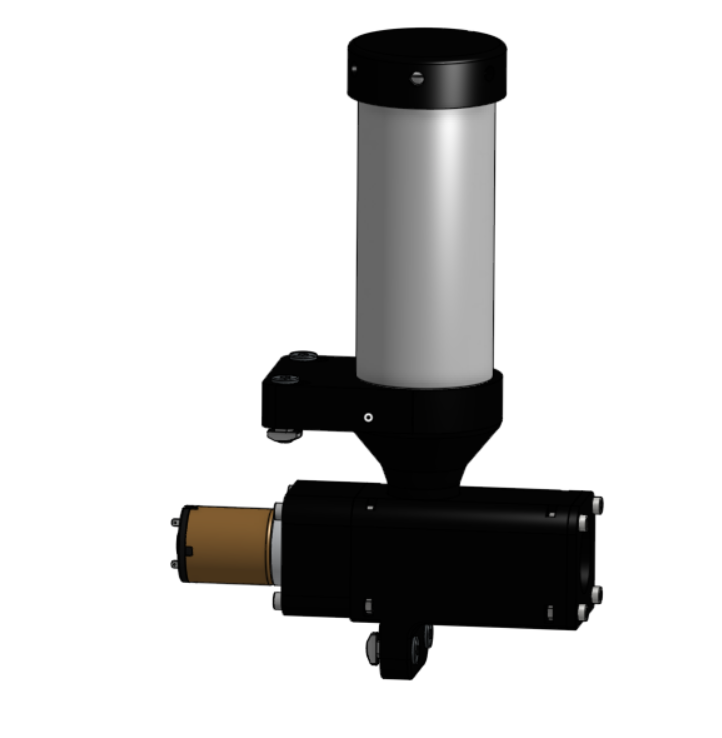


The part I keep thinking about is the corner. In this design the screw is horizontal, so powder falls down out of the tube and then has to turn ninety degrees to get pushed sideways out the barrel. And that corner is where powder is going to sit. And jam. And be a pain to clean. And for what im building the powder is going to be sitting in hoppers and dispensing straight down anyway. so why make it turn at lal. Put the auger vertical, inside the hopper, and let it push the powder down and out the bottom. Gravity is already going that direction. And it removes the corner completely instead of designing around it. Which is alot cleaner than trying to fix a corner that shouldnt be tehre in the first place.

Putting the auger vertical makes the rest of the machine simpler. Because the powder never has to change direction. It just falls, gets metered by the screw, and comes out the bottom. And thats the first real decision. And i havent drawn a single part of my own yet. I also made a doc called "Augur Mechanism Details" to write this up properly. And so far the only thing in it is "make short write up". So that still needs doing. And dont ask me why I started a doc just to put oen line in it lol. I wanted somewhere to put the writeup once I understood the thing.

## Today's results

I get the metering part now. And ive got the first design decision made. Vertical auger inside the hopper. Gravity doing the work instead of a corner. The reference model is saved and I can pull it open whenever I need to check how something was put together. And the componenets are only six parts, so theres not much to hide behind. If the metering works the machine works.

## What's still left to do next time

Set the actual targets for mine. How many hoppers. How much powder each one holds. How acurate it has to be. Taht kind of thing. Then start the first hopper in CAD. And write up the auger mechanism doc instead of leaving it as one line.

**Total time spent: 2 hours**

# June 15: Eight hoppers, but not sixteen motors

## What I'm doing

Starting the actual design today. The machine is a pill compounder. Basic shape is settled. A rotary disk with 8 hoppers in it. The disk turns whichever powder I need over the scale and dispenses from there. i started the CAD today too. What im figuring out now is how the hoppers get powered. Because thats where this design can get dumb realy fast if i dont think it through first.

## What happened

First idea was every hopper gets its own auger and its own agitator. Good for cross contamination since nothing is shared between powders. But then I counted motors. An auger motor and an agitator motor for each of 8 hoppers is 16 motors. Sixteen motors is expensive. Heavy. A wiring nightmare. And sixteen motor drivers. All of it, just too turn screws. And most of them would be sitting their doing nothing. Only one hopper dispenses at a tmie. So fifteen motors would be dead weight at any given moment. Pretty bad trade for a machine thats supposed to be simple.

so the plan lowk did a 180. Instead of a motor per hopper, two motors sitting above the one slot thats over the scale. They clip into whichever hopper rotates into that position and power its auger and agitator. Each hopper keeps its own auger and agitator, so powder never touches another powders parts. But the motors are shared. Two motors total doing the work of sixteen. The auger and the agitator touch powder, so every hopper needs its own. The motors never touch powder, so they can be shared. Cross contamination stays solved because nothing powder touches is ever shared. And the motor count stays sane because the expensive moving parts are the ones that get shared.

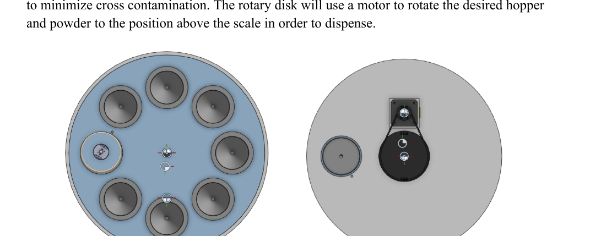

Picking teh dispensing mechanism wasnt really a debate. Im going with an auger. Every turn moves a consistent amount of powder. Which is what I need if this thing is going to hit a target weight instead of just dumping. A vibrating chute or a flap would be simpler too build and impossible to control. So the auger stays. Every turn moves a consistent amount and thats what hitting a target weight needs.

Why a rotary disk instead of eight fixed hoppers in a row. Theres one scale and one place powder comes otu. Eight fixed stations would mean eight scales or a moving scale. Both dumber than a disk that just turns the right hopper over the one scale. And the drive has to be pararell whith the hopper it clips into or the whole clip-in idea doesnt work. So the alignment matters even though there is only one drive position.

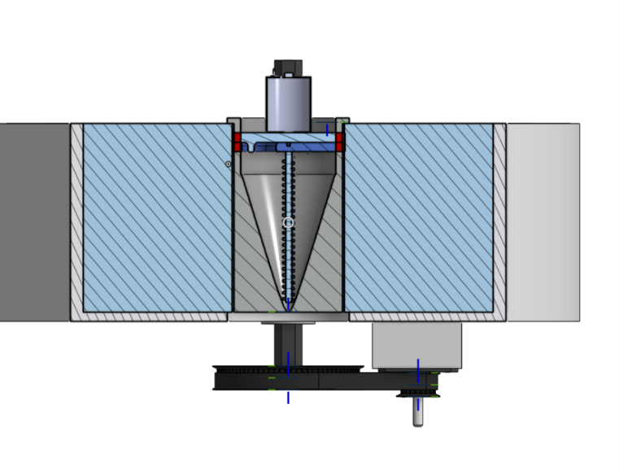

## Today's results

Concept is locked. 8 hoppers around a rotary disk. Each hopper with its own auger and agitator. One clip-in drive with two motors above the dispensing slot. Auger for metering. Teh motor math is what makes the rest of the machine buildable. 3 motors instead of 16. Cross contamination stil solved because the powder-touching parts are never shared. And the whole thing is alot more effecient than sixteen motors sitting idle. Three motors for eiight hoppers and 1 scale. Pretty clean split between the parts that touch powder and the parts that dont.

## What's still left to do next time

Prove one hopper works before printing disk. If a single hopper and auger cant dispense one powder accurately there is no point building eight of them. So first milestone is one hopper, printing and testing. And the agitator isnt in yet either. Thats planned for later once the basic dispensing works.

**Total time spent: 3 hours**

# June 18: First hopper in CAD: tube, funnel, screw

## What I'm doing

Designing the single hopper first, befor any disk. The whole machine depends on one hopper being able to hold powder and push it out the bottom in a controlled way. So if I get this one part right the disk is just eight copies of it arranged in a circle. 

## What happened

I am building the disk first, then the funnel. The first version is just the rotary disc. A blue cylinder with a ring of circular pockets cut into the top face. One pocket per hopper. And at this point the assembly hsa exactly one part in it, the disc. 

The funnel is with a thread cut into the stem. A 2 1/4-4 1/2 thread, 10 cm deep.. Powder sits in the tube and theres a Theres a funnel at the bottom. And the auger runs down the middle and pushes powder out through the funnel. The motor sits on top and turns the auger. and i did a section view and annotated it by hand so I could think through what connects to what. Bearing at the top where the shaft comes through. The thread where the funnel screws in. The funnel itself at the bottom. The thread is there becuase the whole M1 idea is that this thing has to come apart for cleaning with minimal tools. Powder gets everywhere, and if you cant take the hopper off the funnel and wipe it down, the machine is useless after one powder. A thread means no tools, just unscrew it. That was the reasoning, anyway. And it wont survive contact with a real printer, but that is a problem for later.

I also tried a different motor that afternoon, a GF7, plus an idea called "Spinning Big Arm". And it went nowhere. First dead end of the project, day one lol. 

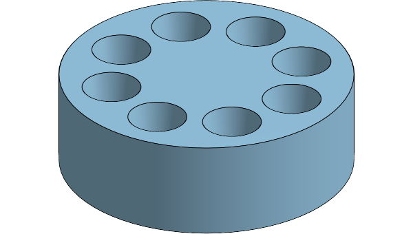


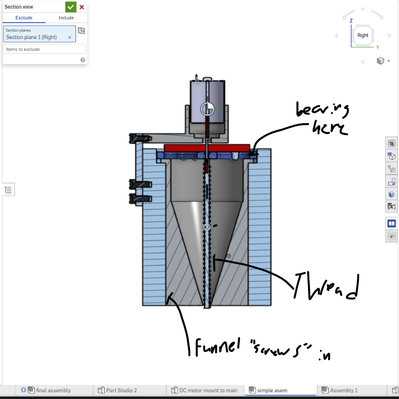

The auger is a profile swept along a spiral path. The shaft is a circle wtih a 2.5 mm radius, so the auger is a long screw with a 5 mm shaft and a spiral flight wrapped around it. And the flight is the part that moves teh powder. The shaft is just the spine it hangs off.

And the same day brings in the NEMA 17 stepper (a 17HS4401) and a DC motor mount. Plus a 160T 3M belt and a robot shaft. And a first build that puts a small DC motor and the auger together. So there are two motor ideas in one day. A stepper, which can count turns and stop exactly where you tell it. And a small DC worm-gear motor, which is cheap and simple and already on hand. And the DC motor is the experiment. A DC motor cant count turns the way a stepper can, so it was never going to be the dispensing motor. But i researched online and the reason I thought a dc motor could work is that the gear ratio would make it accurate emnough for our needs.

And an hour later, another change adds the motor adapter. A disc about 60 mm across with three posts on it that the motor sits on. And the Lower plate. And the adapter is the piece that connects the motor to the auger. Motor on top, adapter disk, long screw underneath. And it looks simple sitting in CAD. Everything looks simple in CAD. And a few milimeters of error in the adapter would throw the whole shaft off. Which is the kind of thing I only notice once I try to fit it together.

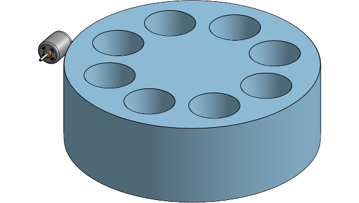


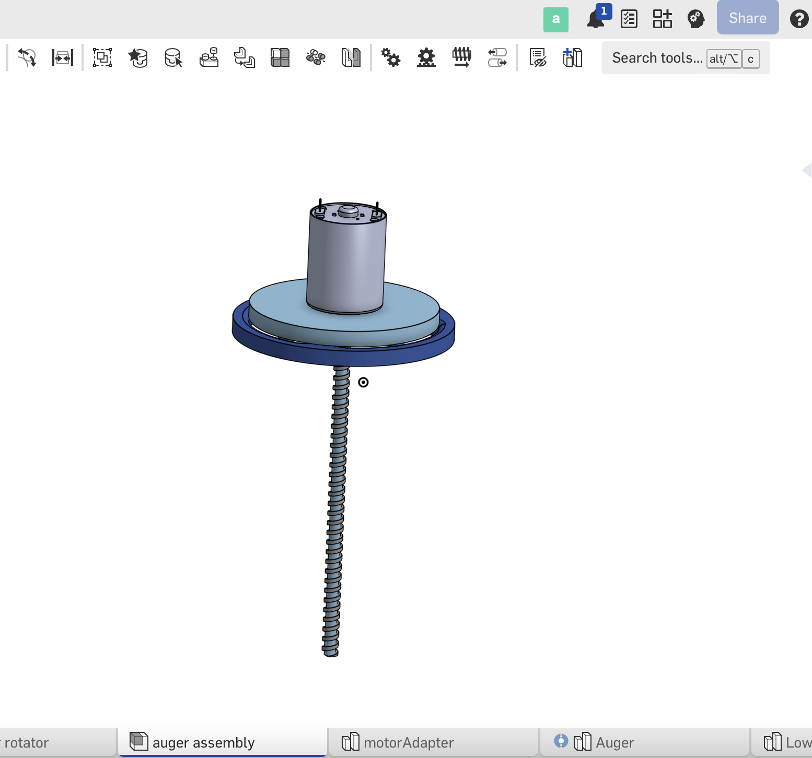

The last day is cleanup. And by then the document was a total mess. Half of it old imports and dead ends. And I couldnt find anything. so i cleaned up the onshape document. The disc copy got renamed. A dead part got deleted. A "stationary disc" folder got made. And a couple of dead parts got deleted. And I also did a cleanup pass that deleted the old imports and sorted the rotary disc and funnel into folders. And there was alot of junk in there. Boring work. But the Doc went from unusable to navigable. Which is what the next three days needed And the parts arent diagnal or anything clever. It is just a pile of parts that needed sorting. 

## Today's results

One hopper design exists in CAD now. Tube, funnel, auger, motor mount. And a section view that shows the whole powder path from top to bottom. The auger is a real spiral screw, not a placeholder. The disk has its pockets. The motor question is still open, stepper vs DC. But both are in the doc now. And the connection I am least sure abotu is the thread between the hopper and the funnel. Because the hopper has to come apart easily for cleaning. 

## What's still left to do next time

Print it. The auger is the frist print and I already know long thin screws are annoying to print. So that is the first test. Then the threaded hopper and funnel pair, to see if the screw-in connection works in plastic the way it works in CAD.

**Total time spent: 8 hours**

# June 21: The thread fails and the latch replaces it

## What I'm doing

Two things so far. Restructuring the CAD document. And settling how the hopper connects to the funnel, thread or latch. The thread was the original plan. The latch is the alternative. i researched the latch by looking at how a blender locks its jar on. Because I wanted a connection a printer coudl hold tolerance on, not another pretty CAD thread.

## What happened

 The cleanup got rid of the old imports and the old assembly and left the doc cleaned up so it makes sense. And the disc got hole and thred work. 3 1/4-4, 1/4-20, and Ø 6 cm holes, all 10 cm deep. Plus an external thread. And a few dead parts got deleted.

But the real change is in the final assembly. It went from 2 loose parts with nothing holding them together to 7 parts fastened together. The disc plus the auger fastened together. And the model looks completly different. The disc is a tall grey drum now with the auger and motor unit sitting on top and one circular recess on the top face. Instead of the flat blue disc from the start. Same parts. Completely different machine on screen. Half an hour later the disc gets reworked again. The angles adjusted. The auger spiral edited. And the top recess gets shallower. Same drum, slightly different.

And then the latch. I looked at how a blender locks its jar on and copied the geometry. The funnel gets two slits cut into its sides and the hopper end gets two extruding slabs, tabs, that line up with the slits. And the hopper drops in flush, twists, and the tabs catch behind the slits so it is locked in position. And and pulling it back out is the same move in reverse. A slot is a slot. It either fits or it doesnt. And if it is loose I change one number instead of re-cutting a whole thread profile and hoping. Because a thread needs the printer to hold a precise helical groove that has to turn with almost no tension. And that is exactly the kind of thing a printer is bad at. And the latch also keeps the thing I wanted from the thread in the first place. The hopper comes off with no tools so it can be wiped clean. Which is what I wanted the thread for anywyas.

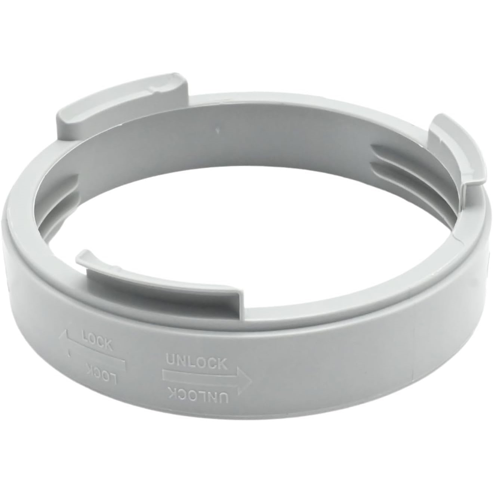

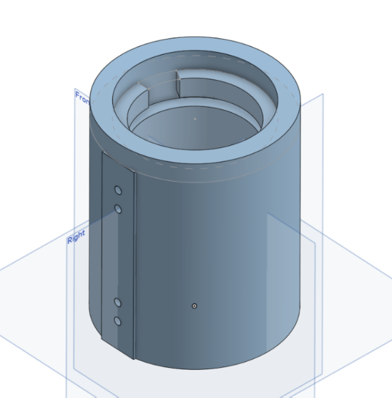

But designing it made me stop and think about whether the hopper needs to come off at all. The latch works. But it is still two parts with a seam between them. And seams are exactly where powder hides when you are cleaning. And either way the same pocket has to be wiped down. And a detachable hopper just creates more surfaces that need rigorous cleaning. And the next step might be combining the funnel and the enclosure into one part. Or just carving the hoppers straight into the rotary disk so there is nothing to take apart. But right now I am still trying to mkae the detachable version work.

the thread was not dead yet. I was still working it in cad. There is a screenshot of the thread settings on my phone from that day. Me going through the thread profile for the hopper stem. And the thread in the model was the 2 1/4-4 1/2 cut from the first version, 10 cm deep. i wanted to believe it would work. But the plan was to stop arguing about it in CAD and test it for real. Print both halves and screw them together. And I kept the latch in CAD untill the test. Because I didnt want to throw away the backup before I knew the thread was dead.

today is the test. Both parts printed, blue filament, threads on both. And the prints themselves came out fine. That is the annoying part. The problem starts when I screw the hopper into the funnel. It goes in ok for the first bit and then gets progressively harder to turn. And the thread starts to crumple and fray apart instead of sliding. And you can see it in the photo, the top of one has the thread peeling up in a spiral where it got chewed. And the real issue is I can't print grooves accurate enough for a thread that needs to turn with very little tension. A printed thread isnt a machined thread. The tolerances are too sloppy. So instead of screwing smoothly it binds. And once it binds the plastic just destroys itself. And more retries with slightly different sizing isnt going to change that. It is the wrong mechanism for a 3D print, not the wrong size.

And I don't want to spend a week tuning thread clearances and end up in the same place. Because the printer is the limit, not the numbers. And the thread was the whole reason the hopper was designed to come apart in the first place. The M1 idea was minimal tools, easy cleaning, unscrew and wipe. And a connection that gets harder to unscrew every time and damages itself doing it fails the one job it had. And that stings a bit. Becuase I spent three days on a connection that was never gonna wrok in plastic. And the latch was sitting there the whole time. And the accomodate-the-thread approach would ahve just been more of the same. so i stopped

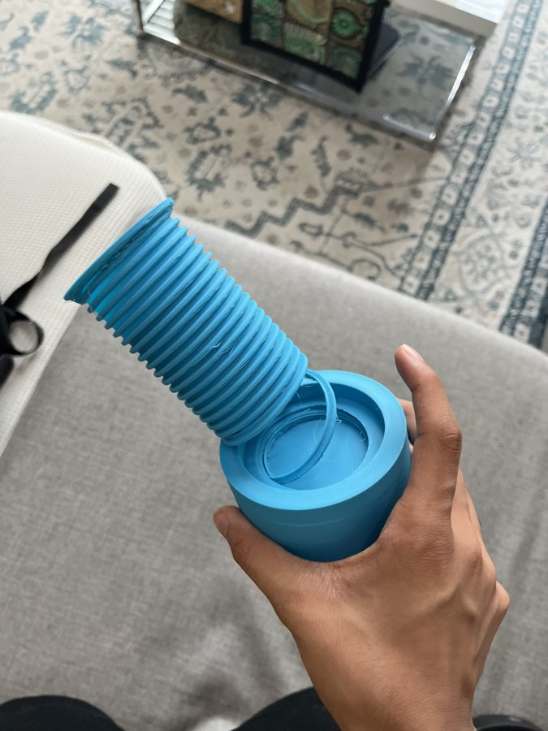

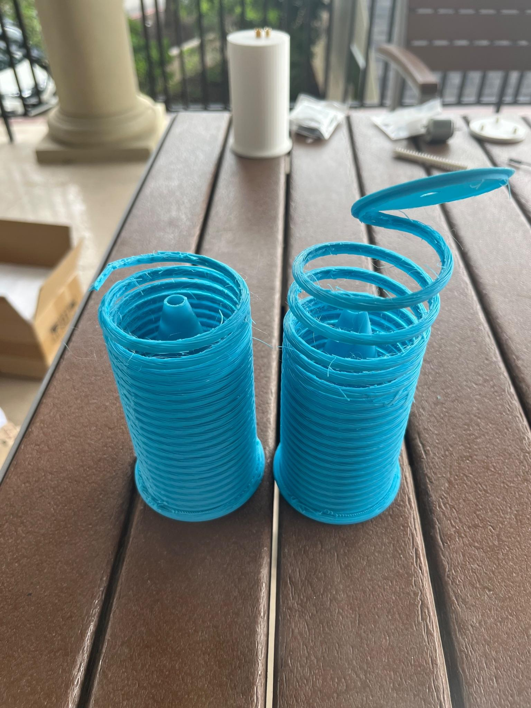

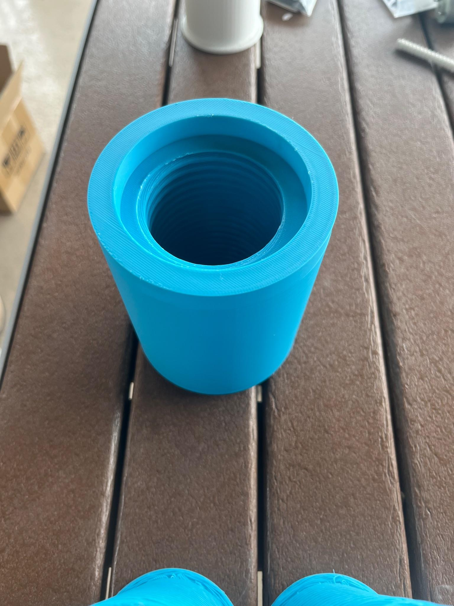

## Today's results

Threaded hopper connection is dead. The latch wins. Two slits, two tabs, twist to lock, no thread involved. And the document is restructured and the assembly is fastened together for the first time. And the bigger question is still open. If the hopper has to come apart at all? And either way the same pocket has to be wiped down. And a detachable hopper just creates more surfaces that need rigorous cleaning. And the next step might be combining the funnel and the enclosure into one part. Or just carving the hoppers into the disk itself so there is nothing to take apart. And the latch doesnt fix the seam problem. It just makes the seam easier to open. Which is not the same thing. And I need to remember that before I build the latch version. Because building it might be building the wrong thing twice.

## What's still left to do next time

Build the latch version and test it. The slits and tabs are already in CAD. So print the funnel with slits and the hopper with tabs and see if it locks and unlocks cleanly. And also the auger still needs to print reliably. And nothing has had powder in it yet. So far everything has just been plastic spinning in air. And then powder tests. Sugar first, because sugar flows easily and will show me if the auger geometry itself is right before I fight with harder powders.

**Total time spent: 8 hours**

# June 24: The auger print won't stick, glue fixes it and a brim

## What I'm doing

Printing the auger. It is the part everything depends on and it is also the worst shape to print. Tall, thin, with a screw thread wrapping around it. so the contact patch on the build plate is tiny compared to how tall it gets. And im already expecting trouble because a tall thin screw is a lever that wants to peel itself off the bed the higher it goes.

## What happened

The adhesion kept failing. A print that tall on that small a base wobbles as it gets higher and eventually lets go or shifts. And then the rest of the screw prints into air or into into a leaning mess. And i lost prints to this before I got clean ones. Every failed auger is a couple hours of printing gone. And it is kinda the same failure every time. The frist layers look fine. The print gets taller. It starts to wobble. And then it is done. And the worst part is how normal the first layers look. Their is no warning. It just lets go halfway up.

The thread does'nt help at all. It sticks out sideways and catches on nothing. It just adds overhang and weight up high while the base stays tiny. So the taller it gets the worse the leverage gets. And the print was'nt failing because of the thread geometry. It was failing because a tall thin thing on a tiny base is'nt stable unless the base is stuck down.

The fix turned out to be boring. Glue on the build plate with a big brim. With the base stuck down properly the auger prints clean all the wya up. Just glue lol. And i spent time asuming the problem was something interesting. Temperature, speed, the thread geometry. And it was just that a tall thin screw needs its base glued dwon like everything else tall and thin. And the quanity of glue does'nt need to be much. A thin layer is enough. It just has to hold the first layers while the rest of the screw goes up. And im annoyed at myself for not trying it first, because the neccessary fix was sitting on my desk the whole time.

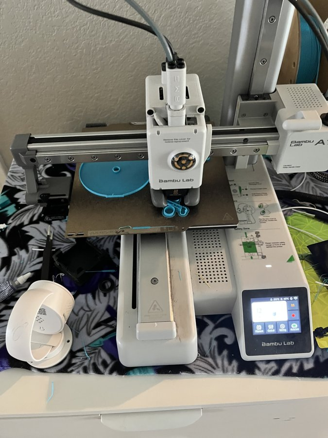

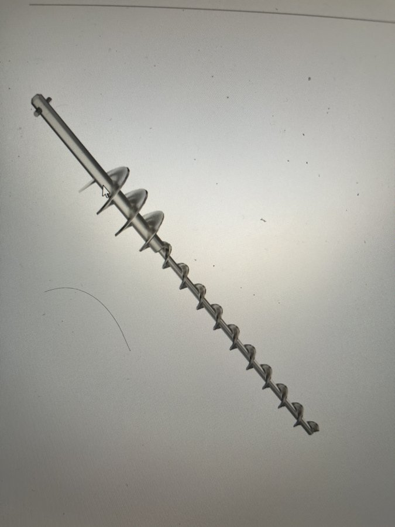

## Today's results

Auger prints reliably now with glue for adhesion. Small thing but it was quietly eating hours. And it is worth writing down because future me will definitely forget and wonder why prints are failing again. It is the glue. It is always the glue lmao. And im writing it here so I dont have to relearn it on the next tall print.

## What's still left to do next time

The auger is only half the hopper. And the thread is already dead as of yesterday. So the latch version is next. The agitator still does'nt exist. And also the prints I do ahve need actual powder in them. So far everything hsa just been plastc spinning in air. And sugar is the first test becuase it flows on its own.

**Total time spent: 3 hours**

# June 27: Seven versions in one day

## What I'm doing

Auger prints are running so im stuck in CAD all day. seven rounds of changes. The disc kept changing shape every time I changed something and honestly most of the day was just me stairing at it trying to figure out what I even did.

## What happened

The motor stuff is the big thing. A whole micro-metal motor set showed up at once, motor assembly, straight gears with Portugese names on them, the motor parts, the STEP file, plus a new housing tube and a DC motor mount. And a simpler assembly around the auger. So the old DC worm gear motor is out, auger and its parts go in instead.

And then the disc just changes. It was the tall grey drum, now its a flat blue disc with 8 grey pocket containers on top and the black auger and motor unit sitting on it. Same parts underneath. Completely different machine on screen. I cant tell you which change did it because tehre wree lkie fifty of them and I didnt track each one. All I knwo is the part list and the render lol. Flat disc, eight pockets, auger on top.

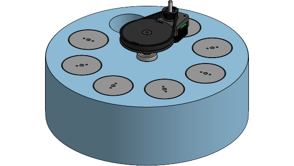

Two of the saves are just checkpoints with nothing in them. I save like that when working, it pays off once and then you just keep doing it forever. Then some small stuff on the rotary disc, a hole and a thread, hiding and showing things. Assembly looks the same, and then- Then the auger, which took forever, the profile and the spiral just reworked over and over, edits, deletes, put it back in. 

Then the housing tube. First circle is 57.8 mm across, thats the tube the powder sits in. Parts keep disapearing and reappearing while I shuffle things around, I stopped tracking why and just read the part list each time. few undos, some parts deleted, some shown again. Auger ends the day as a finished screw, Spiral flight and all, rounded edge on the end. Disc is a flat plate with eight pockets. Motor adapter is just a single 60 mm circle now, simpler than when I built it.

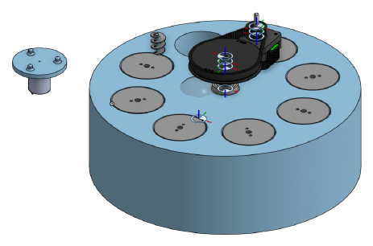

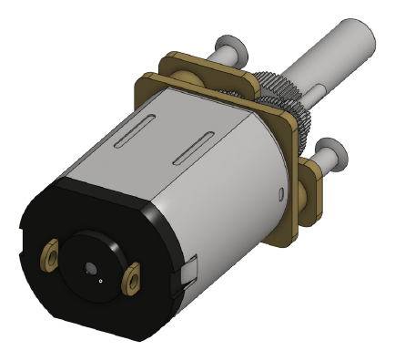

## Today's results

Doser is a real assembly now. Flat disc, 8 pockets, auger and motor unit on top, housing tube sized, auger actually built out. Seven rounds in about eight and a half hours. The thing on screen finally looks like the thing in my head. At least the M1 half of it.

## What's still left to do next time

Powder tests. CAD is way ahead of the actual machine rigth now. Sugar first through the printed hopper, see if any of this works outside the screen. Tomorrow is plastic and powder

**Total time spent: 5 hours**

# July 1: Sugar falls out before the motor even starts

## What I'm doing

First real powdre test. Sugar. Because it flows easily and should be the friendliest possible case. Hopper loaded, auger in. Time to see if the metering idea form the reference design works in mine. 

## What happened

Sugar went in the top and some of it came straight out the bottom... Not while dispensing. Just while pouring it in. And the auger is supposed to be the thing controlling when powder moves. But sugar flows so freely that it just runs through the gaps around the screw and out the exit on its own. And a a dispenser that dispenses when it feels like it is not a dispenser. The problem is the exit, not the screw. The screw meters powder while it turn. But when it is standing stil the gaps around it are just open channels. And sugar is happy to flow through an open channel under gravity alone. So the fix is at the exit. the screw cant hold powder bakc when its not turning. Because the gaps are gaps whether the screw is spinning or not. And the exit is the only thing that can say no to gravity when the motor is off.

so i made the auger with a narrowr opening at the end. So there is resistance at the bottom of the screw. And the sugar can't just free-fall through anymore. It needs the auger turning to push it past the tight part. The tight exit is a gate. It holds the powder back when nothing is pushing. And lets it through when the screw pushes. The screw pushes, the exit resists. And the balance between them is what makes the dispense controllable. And the exit wasnt the part I was thinking about when I designed the screw. i was thinking about the flight and the shaft. But the exit turned out to be just as important. And the screw and the exit have to work together. The screw meters and the exit holds. And if either one is wrong the whole thing leaks or jams. And im glad sugar showed me that now, on the easy powder, instead of on cornstarch later.

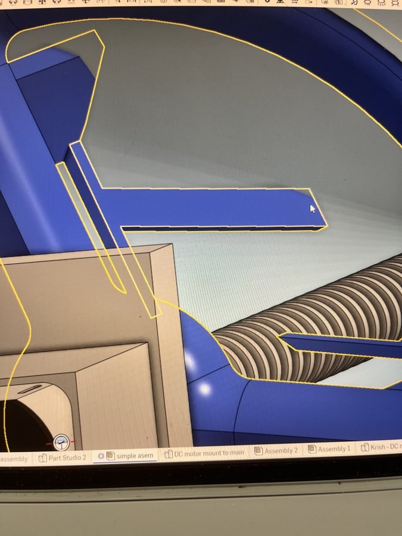

It also taught me the exit geometry matters as much as the screw itself The screw meters the powder but the exit decides whether gravity gets a vote. And every powder after sugar is going to need its exit thought about, not jsut its screw. And the machine that works is the one where the screw and the exit agree wtih each other. And sugar is the powder that proved that. Because sugar is so free-flowing it finds every gap you leave it. And if the exit holds sugar, it will probably hold the rest.

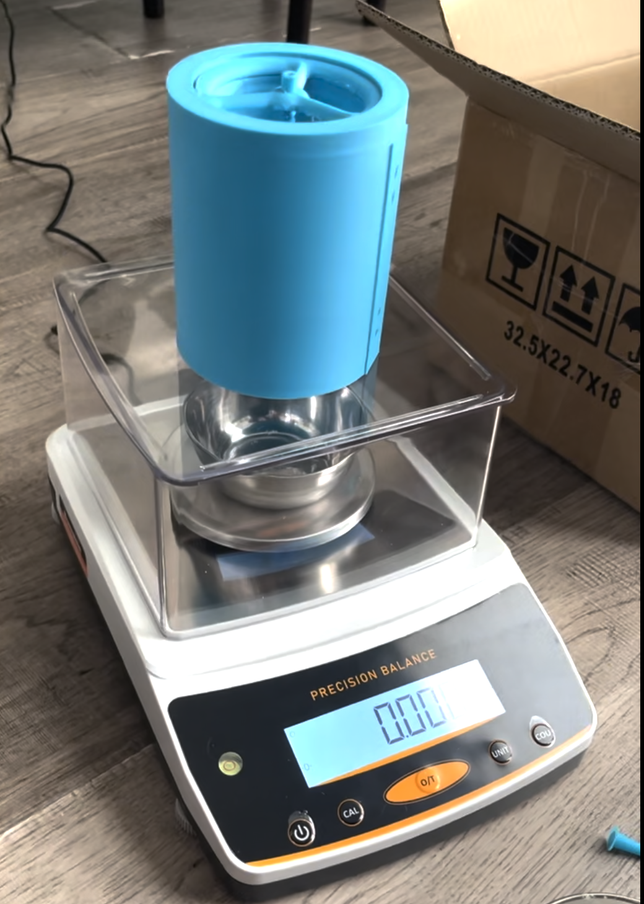

## Today's results

Leak fixed. Sugar stays in the hopper when I pour it in and only comes out when the auger turns. So that is a relief lol. And the hopper on the scale is how I know, not by eyeballing it. Every powder test from here on is weighed, not eyeballed. And the scale is going to be in every test from now on.

## What's still left to do next time

Measure it. Run the auger in consistent turns and check what comes out each time. Me and the scale will figure out if "consistent turns" really means consistent amounts.  i need the numbers to back it up.

**Total time spent: 3 hours**

# July 4: Sugar is dispensing consistently

## What I'm doing

Ok so M1 comes down to one question. If I turn the auger the same amount, do I get the same amount of sugar otu every time. Hopper on the scale, turn, wiegh, do it again. That is the test. And the first thing I needed was a way to know the answer that was not just eyeballing a pile of sugar. So the scale is the judge here, not me.

## What happened

It works!!! wtih the narrower exit on the auger, sugar comes out in the same amounts for the same turns of the screw, over and over. Turn it this much, get this weight. Turn it again, same weight agian. And it worked better than I though it would on the first real try. And that is the whole metering idea from the reference auger filler I looked at back at the start. Just vertical and in my hopper this time. The screw meters, the exit holds, and the weight repeats. The screw moves a fixed volume per turn, so teh same turns move the same powder. And the exit keeps gravity out of the eqation. So the only thing deciding the amount is how much I turn the screw.

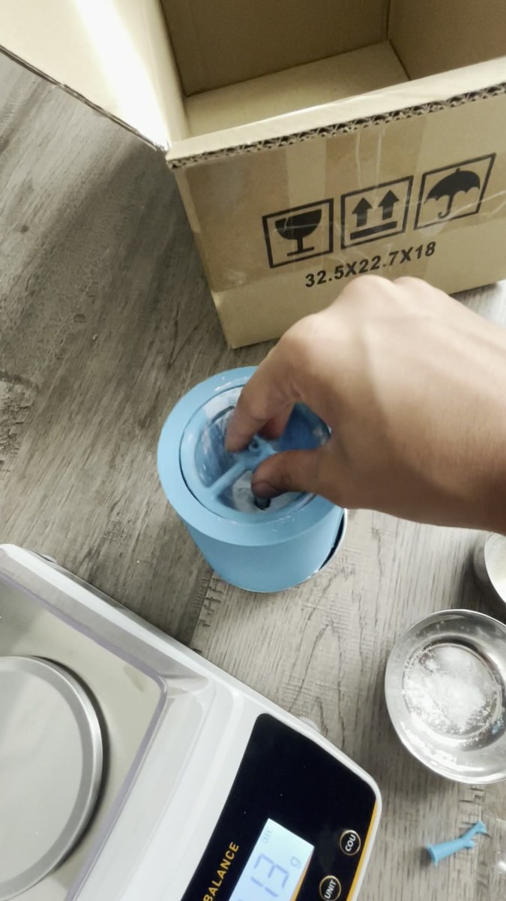

The other thing sugar proved is it doesn't need an agitator at all. It just flows. There is always sugar falling into screw so the auger never starves. And so for sugar at least the simplest version of the design is enough. Which felt great after all the printing, tho. And i should enjoy that while it lasts because I already know not every powder is gonna be like this. And a a lot of the later work is going to be about powders that do not flow. So sugar being easy is a gift, not a guarantee.

And this test matters because everything after it kinda depends on it. The motor, the scale loop, the whole closed-loop idea. All of it assumes the auger is a reliable metering device. And if the same turns gave different amounts every time, no amount of software could fix that. Because the software would just be correcting something random. And sugar says the process isn't random. Same turns, same weight, over and over. And the componenets all agree with each other for once. Which is not something I get to say very often in this project.


## Today's results

First powder officially working. Sugar. Same dispense per turn. No agitator needed. And the single-hopper design is validated for a free-flowing powder. Which means the concept is real and M1 is most of the way tehre. And the test isnt a fluke. It repeated. Turn after turn, same weight, same result.

## What's still left to do next time

Cornstarch next. It is the opposite of sugar in every way that matters. Clumpy, sticky, doesn't flow. And the original plan was one hopper and auger design for every powder with only the motor movement changing. And cornstarch is about to test that plan hard. Adn I already know sugar was the easy one. so i am not expecting cornstarch to be easyaswell

**Total time spent: 2 hours**

# July 7: No detachable hopper at all: carving them into the disk

## What I'm doing

Making the call on the hopper conection for real this time. Thread failed. Latch works but I am not convinced. And i have already been modeling the disk with the hopper pockets in it while I test all this. First thing I need is to stop designing connections and decide whether the hopper needs to come off at all.

## What happened

The more I think about cleanig, the less the detachable hopper makes sense. It was detachable for cleaning. But either way, the same divot has to get wiped dwon. And a detachable hopper doesnt remove the cleaning. It just adds a second part and a seam between them. And the seam is exactly where powder is going to hide and need the rigorous cleaning I was trying to avoid. And thats teh part that kept bothering me. Because I was designing a solution that made the problem worse.

And the seam is not a small detail. It is the whole cleaning problem in miniature. A crack where powder collects and never comes out. And it is worse than just cleaning. This machine compounds pills, which means different powders go through it. And cross contamination is the whole reason the hoppers have their own augers in the first place. And a seam between two parts is a place powder collects and doesnt come out. And that leftover powder is the wrong ingredient in somebody's later dose. And a detachable hopper doesnt just add cleaning. It adds a contamination risk that the fixed version doesnt ahve. And that is alot worse than a cleaning annoyance. A cleaning annoyance wastes tmie. A contamination risk wastes a dose.

So. Final design. The hoppers are carved into rotary disk. One part. Nothing to unscrew. Nothing to latch. No seam. Less to clean. Less filamnet. Faster prints. And the disk CAD has been heading this way for days. The pockets was already in it. The first render is a disc with a ring of pockets. And every change since has kept them. The pockets were the design all along. i just spent three days arguing with myself about whether tehy needed a connection on top of them. And they dont. They never did.

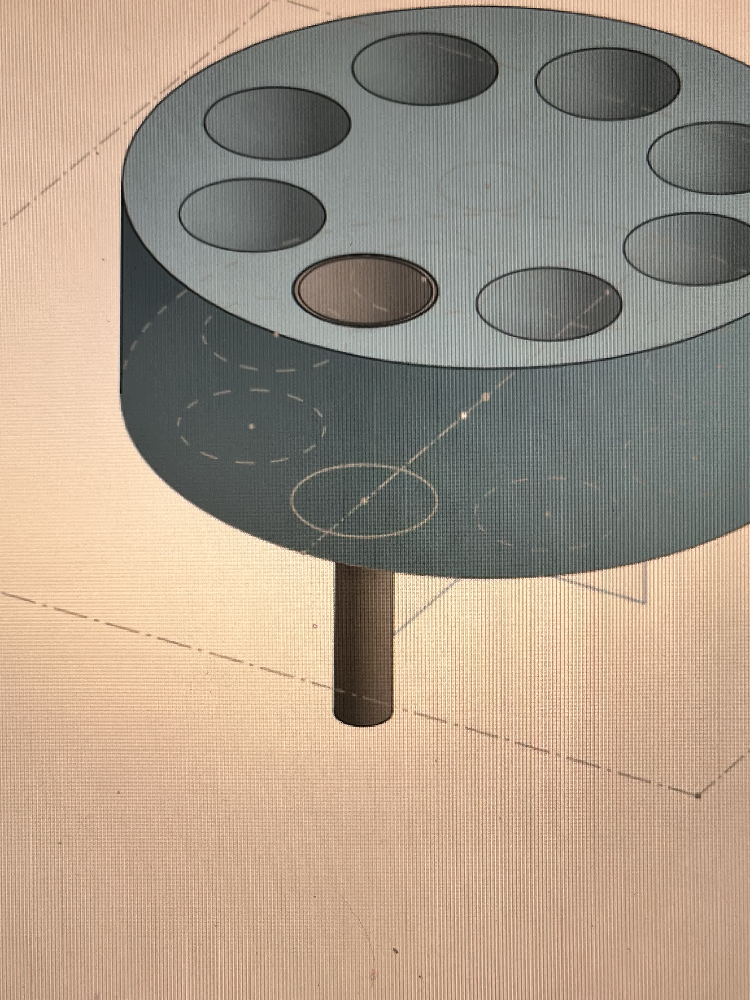

The thread and the latch both go in the bin of ideas that worked on paper. The thread failed in plastic. The latch works, but it solves a problem I no longer have. If nothing detaches, nothing needs a latch. And that is the part that is easy to miss. I spent three days designing ways to take the hopper apart. And the right answer is to stop taking it apart. And the latch is a goood design for a problem I dont have anymore. Which is a weird thing to say about your own work lol. But it is true. And a seperate latch version would just be more parts to clean. More seams to hide powder in. And more filament for nothing.

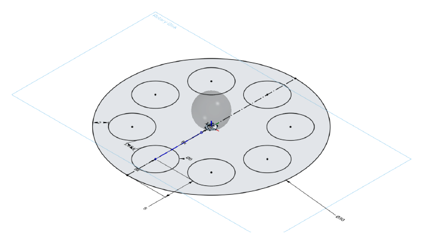

## Today's results

M1 design is settled. Rotary disk with all 8 hoppers carved into it. Auger in each hopper. Shared clip-in drive from the concept. And this is the design I am building. And it is alot simpler than the version I started the week with. One part instead of two. No seam. No latch. No thread. And the disk sketch already had it. Ø30 disc, Ø6 pockets, eight of them in a ring. Which is the drawing the disk was built from. And I lowkey should have trusted the sketch sooner.

## What's still left to do next time

Powder. Everything so far is plastic and CAD. The design only counts once powder moves through it the way it is supposed to. Sugar already works but now we need to test on cornstarch, which I already suspect is going to be a problem because it clumps if you look at it wrong. And the disk wont prove itself until powder goes through it.

**Total time spent: 2 hours**

# July 10: Cornstarch jams the auger solid

## What I'm doing

Running cornstarch through the exact same hopper and auger setup that just worked for sugar. And the plan was one design for every powder. And this is where that plan goes to die. And the frist thing I needed was to see if sugar being easy meant anything at all. Or if it just meant sugar was easy.

## What happened

Cornstarch dose not flow. It clumps. And instead of falling into the screw and getting carried down, it packs together. The auger ends up trying to push a solid plug of powder instead of loose powder. And it jams. Repeatedly. And sugar falls inot the screw on its own. Cornstarch has to be convinced. And the sugar auger has nothing in it that does the convincing. The screw only moves the powder directly above it. So the clumps that pack together above the screw just sit there and get pushed as a plug. The threads are to tight and too shallow for a powder that sticks to itself. The clumps need room to grab onto the screw. And the sugar screw doesnt give them any. It just squashes them tighter. And the the jam is not a one-off. It happens every time lmao. Because the Geometry is wrong for the powder. Not because i loaded it wrong.

And there is a second problem hiding behind the first one. Even where it doesn't jam, there is cornstarch sitting in the hopper that the auger never touches. Out at the edges. Just stagnant. And the screw only moves the powder directy abvoe it. so part of the hopper is dispensing and part of it is just storage that never empties. Which for a compounding machine is a real problem. Because that leftover powder is the wrong amount of an ingredient sitting in a later dose. And the auger can't fix that by itself no matter how good the screw is. Because the screw's reach is the screw's width. And the hopper is wider than the screw. And that was annoying to figure out, tbh. Because it means the screw was never going to be enough on its own. And the edges are a few milimeters away form the screw at the closest point and a lot further at the far side. And no amout of turning the same screw is going to reach them. Because the screw is in the middle and the powder is at the walls. And that distance is the problem.

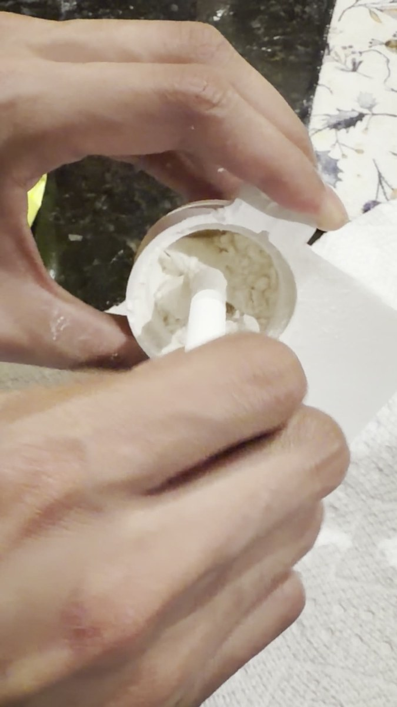

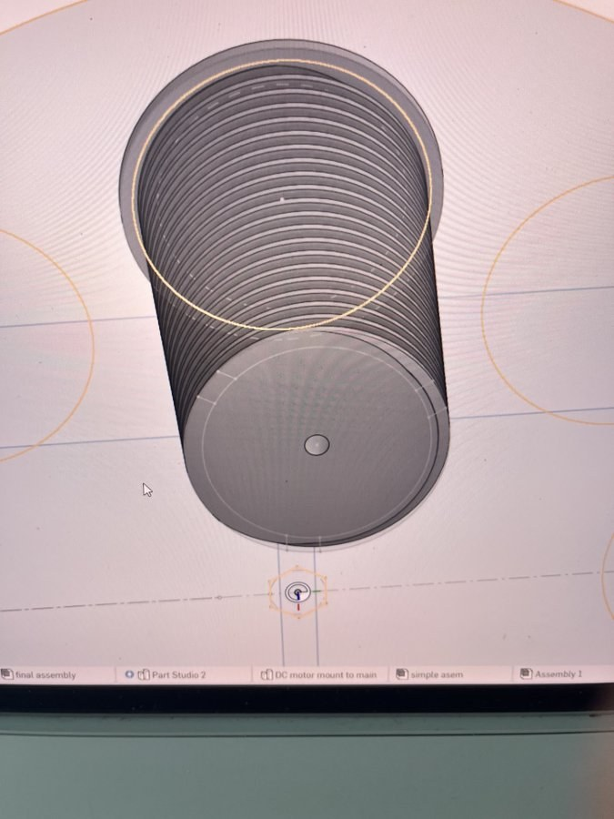

## Today's results

Cornstarch in the sugar setup. Jams. And leaves stagnant powder the auger can't reach. Two separate failures. And the screw geometry is wrong for clumpy powder and there is no mechanism keeping the whole hopper moving. And the one-design-for-every-powder idea is officially dead lol. Different powders are going to need different augers at minimum. And the auger arent the problem in the abstract. It is the problem for this powder, in tihs hopper, with this thread spacing. And that tells me what to change.

## What's still left to do next time

Two fixes to try. A wider auger with bigger threads for cornstarch specifically. So the clumps have something to grab onto and room to move. And an agitator that keeps the whole hopper cycling. Which i already know is coming because it is on tonight's fix list. And the agitator attempt so far has its own problem, next entry. And the wider auger wont fix the edges either. It will just jam less. So both fixes are needed, not just one.

**Total time spent: 3 hours**

# July 13: A wider auger with bigger threads for cornstarch

## What I'm doing

Making a cornstarch-specific auger insteed of forcing cornstarch through the sugar one. Wider screw, bigger threads. And if clumpy powder jams because it gets compressed too tight and can't grip the screw, giving it room and grip is the obvious direction to try. And the first thing I needed was a screw that treats clumps like something to carry, not something to squash.

## What happened

It worked, mostly lol. And the wider auger with bigger threads lets the cornstarch grab the surface of the screw and get carried instead of packing inot a plug. Because the threads receive the clumps and pull them down instead of squashing them together. And the bigger thread spasing also means the powder isnt compressed as tightly in the tube. so it flows more smoothly and the jamming mostly stopped. And it felt great after yesterday. Because yesterday was just jam after jam and today the powder moves.

The spacing is the trick here. A clump needs a gap it can sit in. And the wider threads give it that gap. So the screw carries the clump instead of fighting it. And the powder moves down the tube instead of packing into a plug at the top. And dont underestimate how much of a difference a few millimeters of thread spacing makes. Because the sugar screw and the cornstarch screw look almost the same until you put powder in them. And than tehy behave like completely different machines.

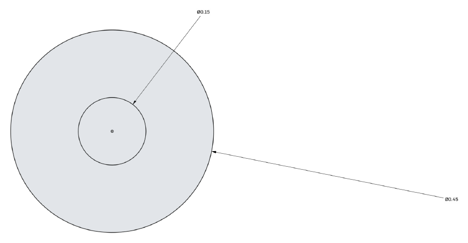

Not perfect though. It is relatively consistent with an acceptable error margin. pretyt much it dispenses and the amounts are close enough for now. But cornstarch is never gonna behave like sugar no matter what screw I put udner it, and- And the design needs streamlining too. Right now there are just multiple augers floating around for different powders and i need a system for that. Which auger goes with which powder. And how the machine knows. And that is a problem for the sofware side later. But the physical answer is already decided. The machine carries different screws for different powders. Full stop. And the quanity of augers is going to keep growing if I dont get a system for it. Because every new powder is going to want its own screw. And a seperate screw for every powder is fine as long as I know which one is which. Which i dont yet. Not properly.

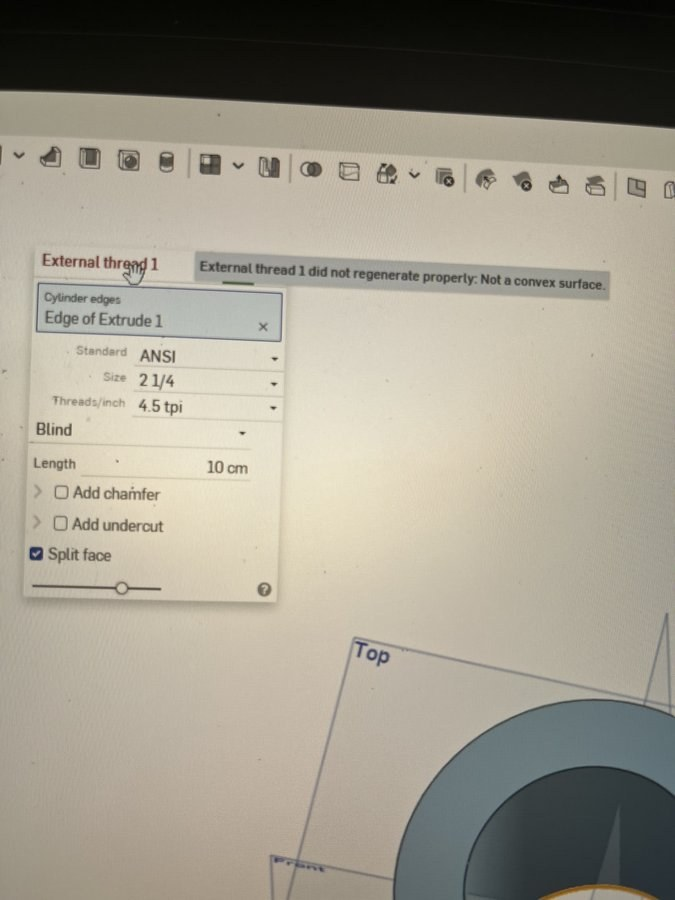

## Today's results

Cornstarch dispenses without jamming on the wider, bigger-thread auger. Acceptable error margin. And M1 now hsa two powders working, but on two different auger geometries. So "which auger for which powder" is a permanent part of tihs design from here on. And the wider screw isnt a universal fix. It works for cornstarch. And sugar still wants its own screw. Different powders, different screws. And the machine has to carry both.

## What's still left to do next time

The stagnant powder problem is still unsolved. A wider auger doesn't reach the edges of the hopper either. And that is the agitator's job. And my first agitator attempt already failed for a dumb reason. And also tonight's fix list has a tapered-thread auger and double agitators on it. So the auger experiments aren't done. And the edges are still sitting there full of powder the screw cant reach. Which is the next thing to fix.

**Total time spent: 3 hours**

# July 16: The agitator print fails, it doesn't reach the walls

## What I'm doing

Trying to fix the stagnent powder problem with an agitator. Something inside the hopper that keeps all the powder moving toward the auger instead of just the powder directly abvoe the screw. and i CADed one and printed one. And the first thing I needed was something that reaches the walls. Because the middle of the hopper was never the problem. The edges were.

## What happened

The print failed. And looking at it, the design failed frist. And the agitator doesnt account for the full width of the hopper. It stirs the middle and leaves a ring of powder around the edges completly untouched. Which is exactly the powder that was stagnating in the cornstarch test. And an agitator that misses the edges is decoration lol. The agitator has to be shaped to hopper, not just roughly the right size. Because the job is the whole hopper, edge to to edge. And a paddle that roughly fits is what I printed. And it roughly works. Which is to say it doesnt. and im nto surprised it failed in print. Because the design was wrong before the printer even started. And the print jsut made the wrongness visible.


What the agitator has to do is scrape the edges of the hopper as it turns. Physically push the wall powder back into the middle where the auger can grab it. And that means it has to be designed to the hopper's exact inner shape. Not just be a paddle that roughly fits. The wall powder is the powder that never moves. so the agitator has to go to the wall. It can't just stir the middle and hope the edges follow. Because they wont. They just sit there. And the agitator has to track the wall all the way around as it turns, scraping as it goes. And if it is a few millimeters short it leaves a rign. And that ring is the problem again, just in a different shape. And this is the part of the build where the fix is annoyingly simple and i still had to print the wrong thing to figure it out. Because the agitator is not a separate little part you drop in. It is a part of the hopper's shape. Its job is the whole hopper, edge to edge, or the edge powder stays put. And alot of the design work in this project is kinda like that. The simple lesson you only learn by printing the wrong version first.


## Today's results

Agitator attempt oen. Failed print. Wrong size anyway. And the next one definitely scrapes the walls or it is not worth printing. And this also settles that the agitator isn't a small add-on. It is a real part that has to be designed per hopper. And im going to shape the next one to the hopper itself, not to a guess about the hopper. Because the guess is what failed me unfortuantly

## What's still left to do next time

The fix list I wrote tonight covers it. Mount two agitators on the bottom of the auger so they spin together off the same drive. Shaped to cycle the whole hopper. And that is the version to build next, along with the tapered auger. And M1's milestone write-up is due with what I have. Two powders working, a list of exactly what still doesnt. And the agitator is at the top of that list. Because without it the edges never empty.

**Total time spent: 2 hours**

# July 19: Tonight's fix list: two agitators and a tapered auger

## What I'm doing

Writing myself a fix list before I foregt what the powder tests showed. And I literally made a doc called "STUFF TO FIX TONIGHT" so future me cant pretend he didn't know. And there are two changes. Both about the same problem. Powder that sits still doesn't dispense. And the first thing I needed was to get the list out of my head and onto a page. Because the tests gave me three separate answers and they all point at the same thing.

## What happened

First, the agitator situation. And right now their is no working agitator. The one print I tried didn't span the hopper so powder around the edges just sat there. And the fix I am going with is attaching the agitator to the botom of the auger itself. So when the auger spins the agitator spins with it. Same motor, no extra drive to sync, less wires to deal with later. And not one agitator arm, two. So the powder gets "agitgated" all the way around instead of one blade pushing a trench through it. And that is how the doc says it, typos and all. And it is still the plan lol. Two arms means the powder gets worked from both sides as the auger turns. One blade just pushes a trench and leavs the rest. While two blades keep the whole hopper cycling. And thats the difference between stirring the middle and moving the edges. And a a single arm was never going to be enough. i just didn't ssee it until I wrote the list down.

Second, a whole second auger configuration. And the current auger has uniform threads the whole way down. And the new one will have threads that funnel down, tapered, so the spacing changes along the screw. And different powders are clearly gonna want different screws. Sugar already proved it doesn't behave like cornstarch. So instead of one perfect auger I am gonna have two configurations. The uniform one with agitators attached. And the tapered one, also with agitators. And i have been reading up on auger types too. There is a whole thing about self-feeding augers I had open on my laptop yesterday. And the research page is the one I keep coming back to. Because there is mroe auger theory there than I expected there to be. And the agitator is part of it, not a separate topic. Which is the part I kept missing.

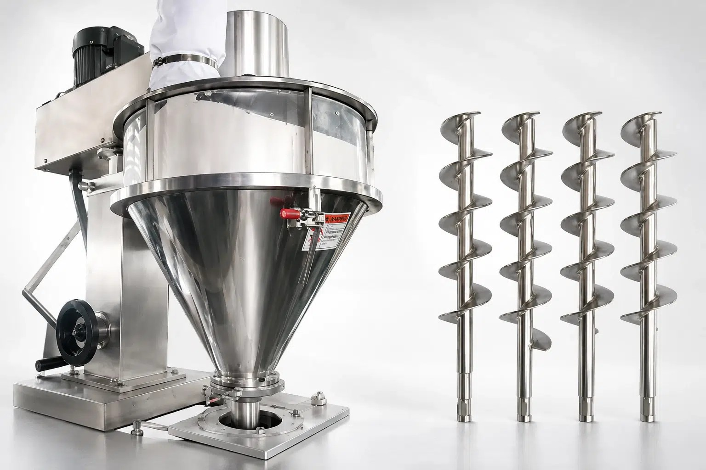

The powder tests gave me three separate answers and they all point at the same thing. Sugar works on the plain auger. Cornstarch works on the wide auger. And nothing works without something moving the edge powder. So the next build is two auger configurations, both wtih two agitators attached to the auger bottom. And then rerun sugar and cornstarch against both to see which powder wants which screw. And the list is a print queue now, not just a note. Because every item on it is a part I have to print before M1 is done. so tomorrow i print instead of remembering, lmao


## Today's results

Fix list is written down and specific. 2 agitators mounted on the auger bottom so they spin together. And a second tapered-thread auger configuration. Two auger setups total, not one. And the doser cad is also in the middle of a change sprint rigth now. A lot of auger changes landed in the last two days. And that is its own entry. And the list cant be much clearer than that. Two screws, two agitators each, rerun both powders. And tehn I will know which powder wants which screw.

## What's still left to do next time

Build both. Print the tapered auger. Print agitators that reach the hopper walls this time. And rerun sugar and cornstarch against both configurations to see which powder wants which screw. And then M1 is done and the scale/motor work starts. And the fix list is the whole next session, not a side quest. Because without it the edges never empty and the powders never behave.

**Total time spent: 2 hours**

# July 22: Starting a second CAD document: newauger

## What I'm doing

The doser document is geting crowded. It has the disk, the auger experiments, motor imports, all of it in one place. And i am starting a clean document for the next phase of the design. It is called newauger. Which tells you exactly what my priorities are lol. And the first thing I needed was a doc that only has the parts going into the machine. Not every experiment I ever tried.

## What happened

The single doser is getting mroe real in this document. And the version I am working on today has the motor mounted on top of the tube with the auger under it. Blue printed parts for the bottom feeder. The whole powder path in one assembly instead of pieces floating around. And tehre is even a breadboard modeld next to the motor mount in one of the studies. Which is me starting to think about where the electronics physically go instead of treating them as a later problem. And they are a later problem. But a soon later problem. The single doser in the new doc is one complete unit. Motor on top, tube, blue bottom feeder. The doser doc was doing two jobs and doing neither cleanly. It was the M1 archive of every auger experiment and also the place the real machine was supposed to come together. so splitting it means the new doc only has the parts that are going into the machine. And the old doc keeps the history.


Why a second document at all. Because the doser doc was doing two jobs and doing neither cleanly. And the risk is the two docs drift apart and I lose track of which one is true. Which is a real risk. But the doser doc was already unreadable. So it is the better trade. And the new doc doesnt have to carry the history. It just has to carry the machine. And a a seperate doc for the real machine is more effecient than one doc trying to be both an archive and a build. Because every time I opened the doser doc I had to wade through dead ends to find the parts that mattered. And that wasnt going to get better. It was only going to get worse as M2 added electronics.


## Today's results

newauger document created. Single doser assembly is coherent in it. And the design is shifting from "does a hopper wrok" to "how does this become a machine wtih motors and electronics attached". And the doser document stayed as the M1 archieve. And the new doc is where the machine lives now. Which is a cleaner split than trying to keep both jobs in one place.

## What's still left to do next time

Electronics. The motor on top of that CAD doesn't turn itself. And I need a driver, something to control it, and the scale in the loop. And honestly I should sketch the whole system otu on paper before I wire anything bc the parts list in my head keeps changing. And the breadboard in the CAD is a hint, not a plan. And the plan is the next thing to draw.

**Total time spent: 3 hours**

# July 25: Sketching the whole system on paper

## What I'm doing

Before I wire anything I need the whole machine on one page. CAD is great for one part at a time and terrible for "wait, how does the scale talk to the motor". So paper. I need a picture where every piece exists at once, frame and disk and and drive and scale and Pi, arrows for what connects to what, instead of five CAD documents and a pile of intentions in my head. Thats what today was.

## What happened

I drew the whole system out by hand. Superstructure, thats the frame, labeled SS in the sketch because im not writing superstructure forty times. Rotary disk with the hoppers, motor and mount above the dispensing spot, scale underneath, Pi 4 off to the side running it. Arrows for what connects to what, a note abotu witch hopper is over the scale and how the drive reaches it. Its messy, my drawing skills arent the best lol but you get the idea. First time the entire machine is in one picture, mechanics and electronics and all, instead of five cad document and a pile of intentions in my head. A couple connections are just question marks in arrow form, mostly how the scale reading gets back into the dispensing decision. At least now the question marks are written dwon somewhere.

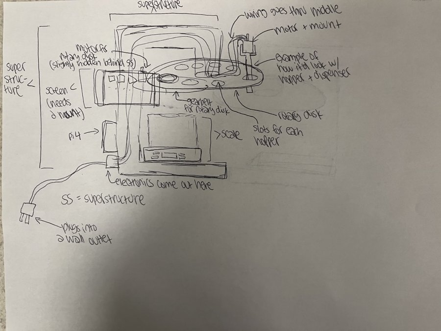

The sketch does something CAD cant do right now. It holds the whole system in one view while i still dont know half the answers. In CAD id have to decide the exact size of everything before I could even see the system. On paper I can put the Pi next to the scale wtih an arrow and a question mark and move on i dont have to loose track of which connection I was unsure about, its right there on the page. answers come later, in the wiring tho. The sketch's SS box already becomes a real part same day, an L-shaped plate for the superstructure. and the auger I drew in CAD, the screw inside a translucent tube, is one of the componenets the sketch has to hold together.

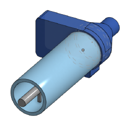
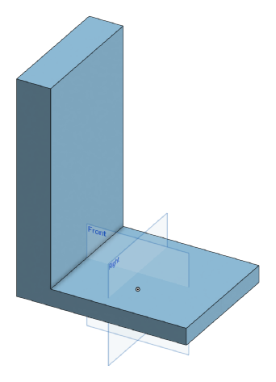

## Today's results

One complete system sketch. Frame plus disk plus drive plus scale plus Pi, connections mapped. So the M2 electronics shopping and wiring has an actual target now instead of vibes.

## What's still left to do next time

Wire it. Breadboard first, driver and motor, get a stepper turning udner control. Tehn bring the scale in. The sketch says the Pi runs the show, so the Pi has to run a motor and read a scale at the same time. Thats the next thing to prove, fr.

**Total time spent: 2 hours**

# July 28: Electronics start: breadboard, driver, and a lot of wires

## What I'm doing

Starting the electronics on the desk. Up to now the auger has only ever been turned by hand or in CAD. M2 is a motor turning it under closed-loop control with the scale, and step one of that is a stepper motor alive on a breadboard.

## What happened

Desk is covered. Power supply brick, breadboard with the driver on it, a stepper motor, rainbow jumper wires going everywhere in the way they do when youre still moving things around every two minutes. honestly there were to many wires to keep track of by the end of the day. I have photos from today taht are just escalating levels of wire mess lmao, which is how you can tell its a real electronics day and not a staged one.

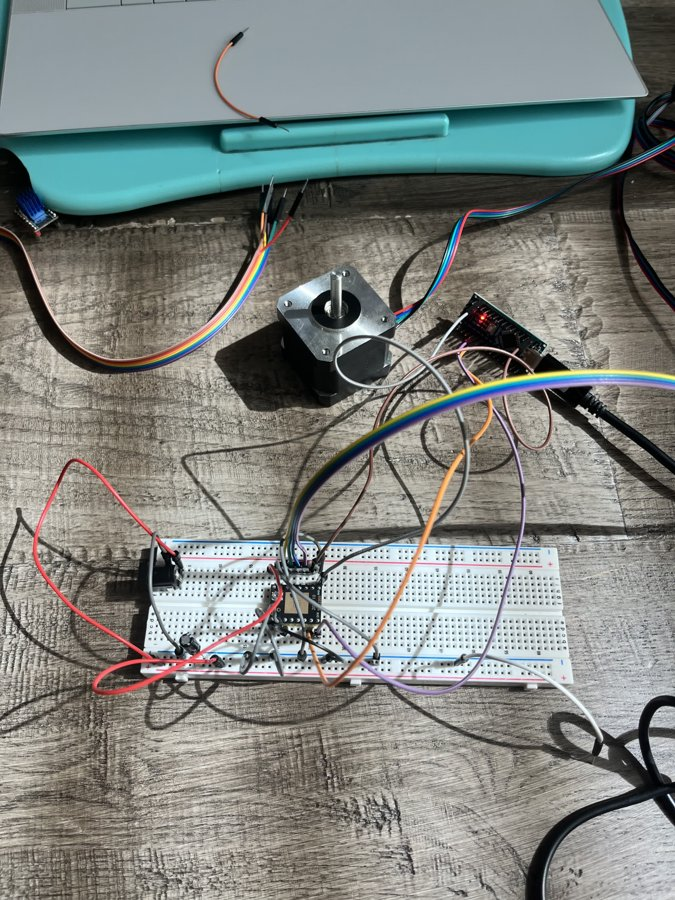

Progress looks kinda like nothing right now. Nothing is mounted, nothing is clean, half the work is figuring out which wire is which for the fourth time. Ubt the motor end of the system from my paper sketch exists on the desk nwo, physically. thats the jump from M1 to M2. I started on the breadboard instead of going straight to a PCB or a mounted board becuase nothing is decided yet. Driver choice, wiring, power arrangement, all of it is still changing every time I touch it. A breadboard lets me change it in seconds, a PCB woudl lock me into whatever I guessed on day one. My day-one guesses were not that good, so the mess stays for now. changing your mind is cheap on a breadbord, and doing it this way is just more effecient than redrawing a board every time I move a wire. The driver and the Pi meet on the desk today, and i wont pretend the the wiring looks good, it doesnt, but it doesnt have too yet.

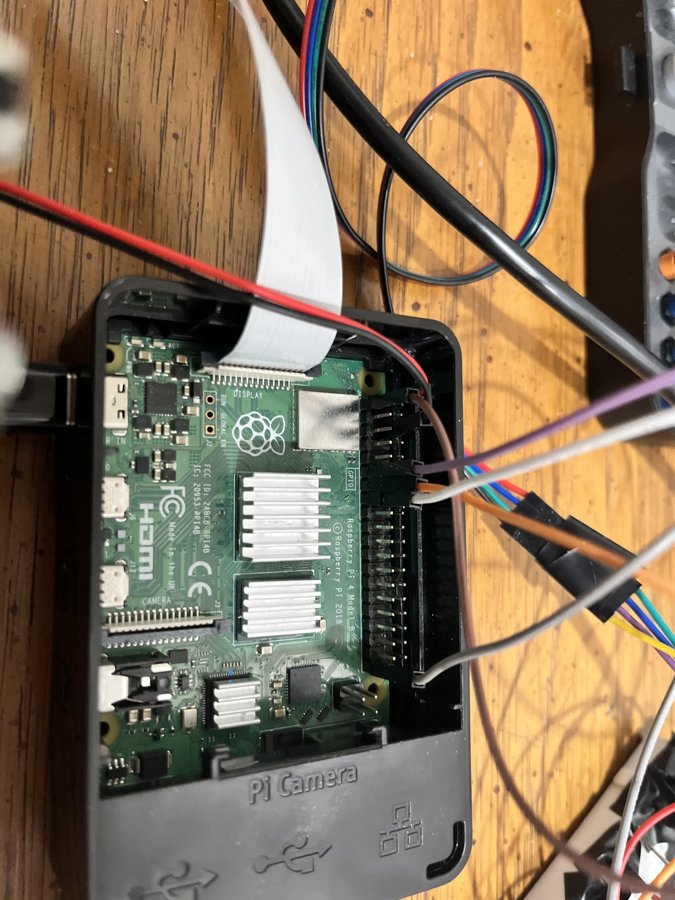

## Today's results

Electronics bench is live, no way. Power, breadboard, driver board, stepper motor, all on the desk and being wired together. The doser is no longer just printed plastic.

## What's still left to do next time

Get the motor turning under program control, than the scale. The scale connection is its own adventure since it talks serial, RS232, which means an adapter board and more wires. After that the two halves have to meet, a motor program that listens to the scale. Thats the actual M2 milestone

**Total time spent: 5 hours**

# August 1: Wiring the scale's serial adapter

## What I'm doing

Ok so the scale is the other half of the closed loop and it dont speak USB, it speaks RS232 serial like its 1995. So today was adapter boards and more breadboard time, getting the scale's readings into a from the Pi can read. Nto glamorous omg. Still has to happen.

## What happened

The adapter is a little serial board and now its got the rainbow cable treatment too. Most of todays close-ups are just me documenting which wire goes where before i unplug something and and forget, because your the one who has to figure it out later and that person is also me. its a system, technically.

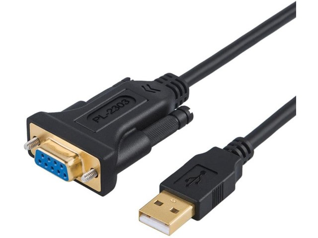

Without the scale readings getting to the Pi their is no closed loop at all. Hearing the scale turns out to be a hardware problem before its a software won. Once the readings land on the Pi, dispensing to a target becomes a program. Until they do its just a motor and a scale sitting near each other having seperate lives. This is also the frist time the scale stops being a lab tool I set a hopper on and starts being a component of the machine. The scale isnt for checking my work after the fact anymore, the scale, its the sensor the machine steers by. im starting to tihnk of it that way now.

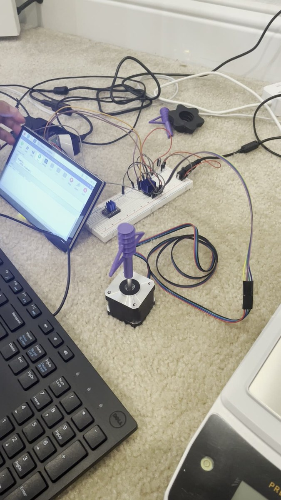

## Today's results

Scale interface wired. RS232 adapter connected into the breadboard setup. Both halves of the loop, motor control and scale reading, are sitting on the desk now waiting to be combined in code.

## What's still left to do next time

The combining. Two programs, one taht runs the touchscreen side and one that dispenses using scale feedback, and making them talk to each other. Plus the powder work keeps going in parrallel, the hopper still needs its agitator sorted. That has beeen running alongside the electronics all week, fr.

**Total time spent: 4 hours**

# August 4: Powder test with an agitator actually in the hopper

## What I'm doing

While the electronics come together Ive still got the hopper problem from M1 running in parallel, powder at the edges never reaching the auger. Tonight the hopper has an agitator in it, down in the powder. And there is cinnamon, or one of the brown powders, the photo doesnt label itself, dusted all thorugh it.

## What happened

Looking down into the hopper from the top you can see the difference the agitator makes. The powder is not sitting in a neat undisturbed layer, its worked through, coating everything. Its been getting moved around the whole hopper instead of jsut the column above the screw getting eaten away. That is the stagnant ring problem from the cornstarch test getting attacked properly.

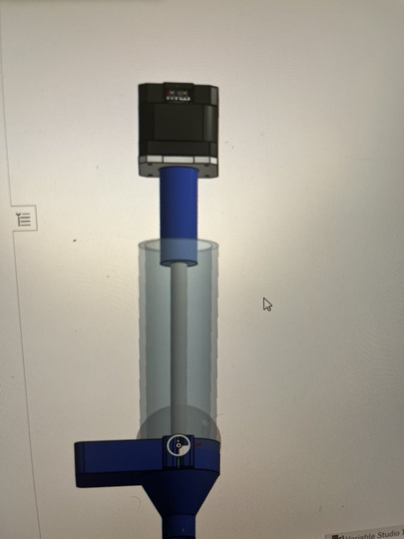

This is the fix list from the 17th turning into actual hardware. Two weeks ago the agitator was a failed print that didnt reach the walls, and honestly i should of tested the new one sooner. But now there is one in a hopper with powder in it doing the job. I cant tell you the dispense numbers were suddenly perfect, this was a does-the-powder-move test, not an accuracy test, but the Powder moves lols. Their is alot riding on that one question because if the powder doesnt move the auger has nothing to meter. And the two track are finally meeting. The electronics bench hsa a motor and a scale, the hopper has an agitator and a working auger. The only thing left is making the first one drive the second one while the scale watches. Taht is M2, and its this week.

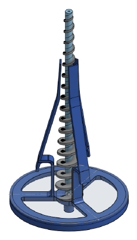

## Today's results

Agitator works in a real hopper with real powder. The whole hopper cycles, no stagnant ring, no way. Beteween this and the wider cornstarch auger, both cornstarch failures from M1 have working answers now.

## What's still left to do next time

Accuracy, with the motor and scale. that is M2 proper The mechanical side dispenses, now it has too dispense the right amount and stop itself. And the write-up for M2 is gonna be due soon to, so the closed loop needs to exist this week, not eventually.

**Total time spent: 3 hours**

# August 7: The motor system: NEMA 17 and a TMC2209 on a breadboard

## What I'm doing

Ok so M2 is doser plus scale, closed loop, one hopper, one auger, oen motor. The motor has to be a stepper so the Pi can tell it exactly how much to turn. The setup is a NEMA 17 stepper with a TMC2209 driver, wired on a breadboard, because everything lives on a breadboard until it works twice in a row.

## What happened

The early wiring sessions were me getting the pieces on the desk, and now it's an actual system. Pi wired to the TMC2209 on the breadboard, driver wired to the NEMA 17, motor ready to be coupled to the auger. The plan for the interface is in the write-up too. The user assigns powders to slots, types in how much they want, and machine dispenses it. Right now there is one slot and the user is me, but the shape of the thing is there.

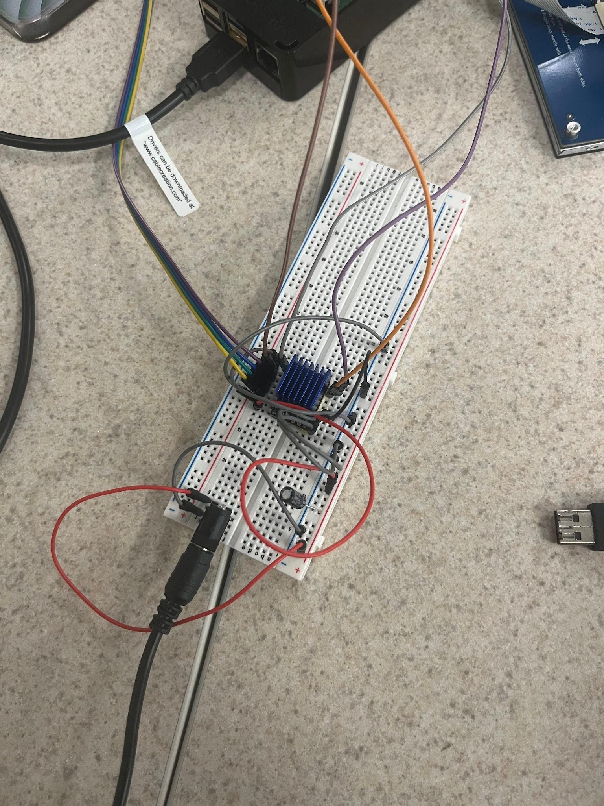

A stepper because of the whole metering idea from M1. Turn the auger the same amount, get the same amount out. A stepper is the only cheap motor that makes that true, because it moves in exact steps instead of just spinning until you cut teh power. The NEMA 17 is the standard size for this kind of thing, strong enough to turn an auger full of powder. The TMC2209 is the driver that tells it how to step, quietly and wtih current control so it doesnt cook it self. If the driver is nto wired right you couldnt get nothing to move at all. The motor itself is already in the CAD, mounted on the plate next to the breadboard.

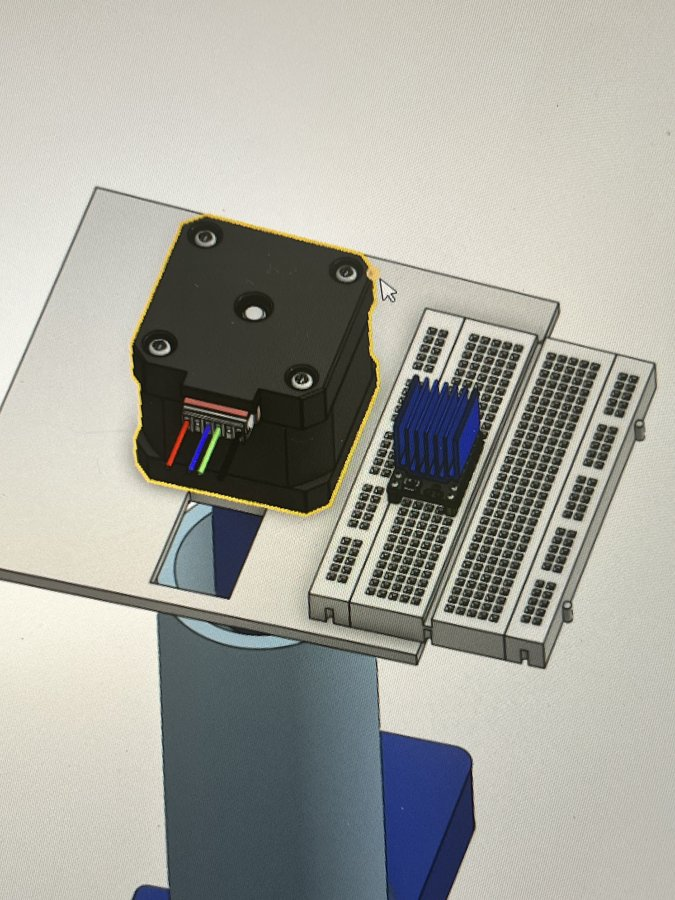

Breadboard becuase nothing is decided yet, and i already knwo im gonna hate it later lol. Driver choice, wiring, power arrangement, all of it is still changing every time I touch it. A breadboard lets me change it in seconds, a PCB would lock me into whatever I guessed on day one. so the mess stays for now, changing your mind is cheap on a breadboard. The motor arent coupled too the auger yet, that is a whole separate problem, the coupler, and it's coming in M4. Today the motor just has to turn when the Pi tells it too.

## Today's results

Motor system wired. NEMA 17 plus TMC2209 plus breadboard plus Pi, the doser has a drive now, omg. Whats left in M2 is the code and getting it to behave.

## What's still left to do next time

The scale side and the screen. The touchscreen arrived and needs wiring to the Pi, and the scale needs its RS232 connection finished so the Pi can read weights. Then the tow programs, the interface, and the one that dispenses.

**Total time spent: 4 hours**

# August 10: The scale and the screen join the Pi

## What I'm doing

Giving the Pi its two peripherals, eyes and hands. The touchscreen is the interface the user will touch, and the scale is suppose to be the sensor the whole closed loop depends on. Both nede to be talking to the Pi today.

## What happened

The touchscreen is wired too the Raspberry Pi 4. The scale connects thorugh one of the Pi's blue USB ports with the RS232 adapter in beteween, the serial setup from last week. The Pi polls it for weight readings continously.

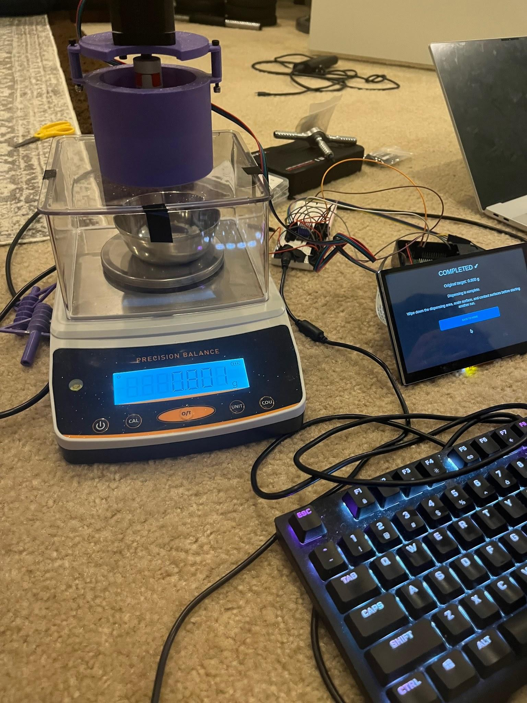

And now the test setup exists as a complete thing for the first tmie. Hopper over the scale, scale feeding the Pi, Pi running the screen and the motor. I have a photo of the whole arrangement on the desk, hopper on the balance, screen alive next to it, keyboard still plugged in because we're not animals lol, everything is still in development mode. The scale connection is the part that took the most thinking. The balance is a lab instrument, it talked RS232 serial, and the Pi speaks USB, so the PL2303 adapter sits between them translating. The Pi polls the scale continuously, cycling through readings, which means the weight the program sees is always a few milliseconds old. That lag matters later, its the the reason sugar overshoots at the end of a dispense, because the scale is still catching up while powder is still falling. But today the important thing is just that readings arrive at all. The Pi can hear the scale now, and thats what today was for.

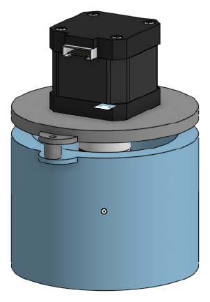

The screen is a 7-inch touchscreen, 800×480, the size the interface was designed for. Its the screen the user will stand in front of, assign a powder to a slot, type a number, and press start. Today its wired and alive, showing whatever the Pi shows. And the keyboard is still attached because the code is changing every ten minutes and im not desperate enough to start typing on a touchscreen yet

## Today's results

Pi plus touchscreen plus scale over RS232 plus motor driver, all connected. The hardware loop is physically closed, but the behavior is missing so far. Nothing yet decides keep dispensing, now stop.

## What's still left to do next time

Write the tow program. One with the visual interface where amounts get entered, and a seperate motor/scale program that takes the target, spins the motor, watches the scale, and stops at the target. The interface calls the dispenser. If that works even once, M2 is real

**Total time spent: 4 hours**

# August 13: The speed problem isn't software

## What I'm doing

M3's goal is one doser running smoothly without human interference. First thing on the list is speed, because M2 dispenses accurately, but slowly. A machine that takes five minutes to dispense 5 grams of cornstarch is a demo, not a product. Eight powders at that pace would take all day.

## What happened

At first I figured it was a software problem. So I spent time in the code adjusting motor speeds, acceleration values, and powder profiles, trying to squeeze faster dispenses out of the same hardware. Nothing moved the needle much, the dispenses got slightly less slow and stayed slow Honestly their was nothing left to squeeze out of the code, i just didnt want to admit it yet, bruh.

That is wehn the real answer showed up. Its not the code, the NEMA 17 is the limit. Its a small motor doing a job that needs more torque and better control, and no amount of tuning acceleration curves is going to give a 17 the strength of a 23. The motor can only turn the auger so fast against a hopper full of clumpy powder befor it starts missing steps or crawling. The code cannot fix a motor that does not have the the torque. So the fix is hardware, switch too a NEMA 23, which has the torque and control to dispense faster while still moving accurately.

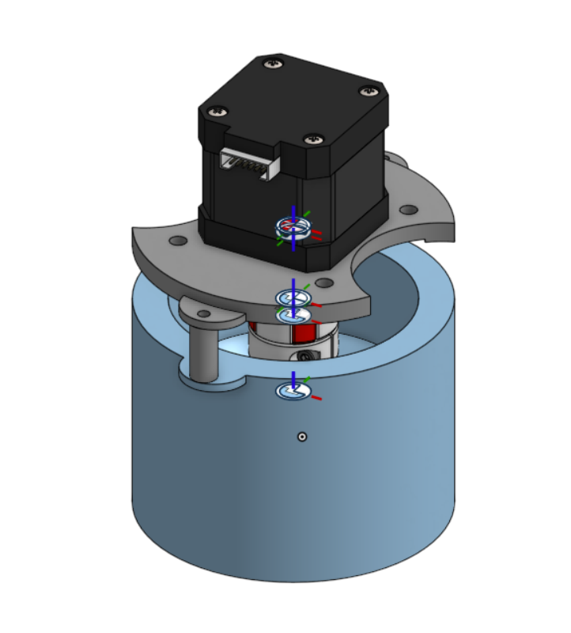

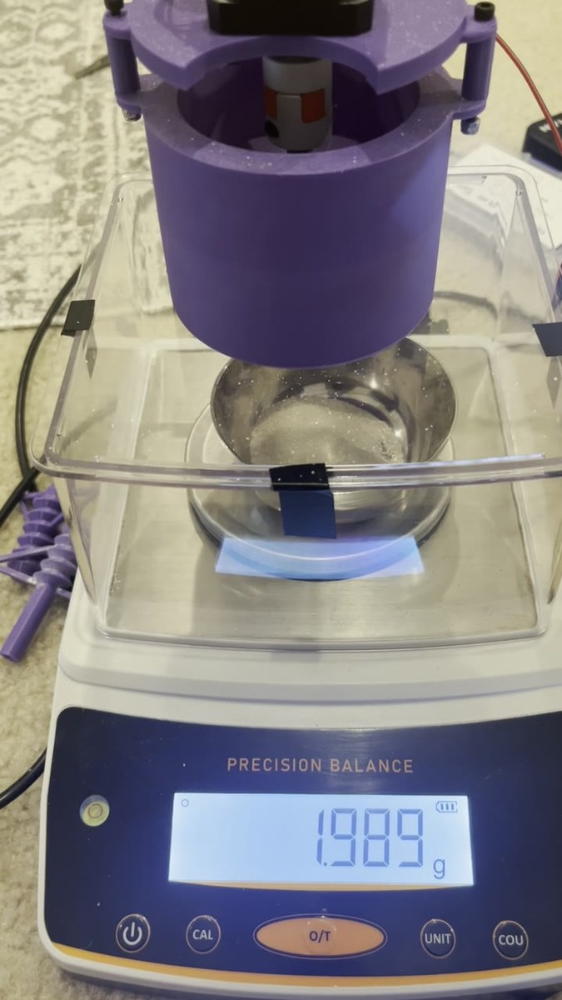

I keep looking at software frist, becuase software is where I can change things fastest. Even when the problem is a physical limit. The test that settled it was simple, same code different speeds, and the dispense times barely move. If the code were the limit, changing the code would of changed the times. It didnt, so the code isnt the limit, the motor is. Theres alot of temptation to keep tuning anyway because tuning feels like progress and swapping a motor feels like starting over.

## Today's results

Root cause found. Dispensing speed is limited by the NEMA 17 motor, not the software. the decision is made to switch to a NEMA 23, fr. The software tuning time wasnt wasted though, it produced something worth keeping, which is the next entry.

## What's still left to do next time

Order and mount the NEMA 23, retune around it, and run the full powder test properly, tho. All eight powders, two target weights, real numbers instead of vibes. Plus the two-speed idea that came out of the software wrok.

**Total time spent: 3 hours**

# August 16: Fast, then slow: the two-speed rule

## What I'm doing

Keeping the one good idea from the software-tuning detour. While I was trying to fix speed in code I tested a simple rule. Dispense fast for the bulk of the target, then slow down when youre about 1 gram away form the target, so the scale can catch up and final amount lands precisely.

## What happened

The rule works and it survives the motor swap, no way. Looking back its pretty simple, the bulk of the powder doesnt need care, the Last gram does. Sugar taught me tihs the hard way back in M2, it pours so fast that by the time the scale reports the weight, the auger has already dumped more. Slowing down near the target gives the scale time to be right.

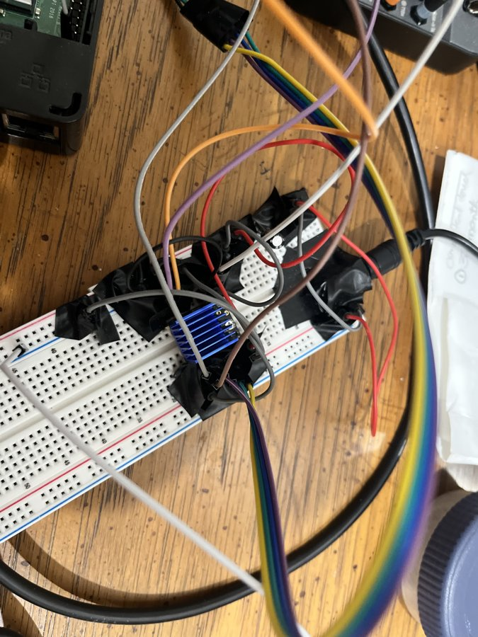

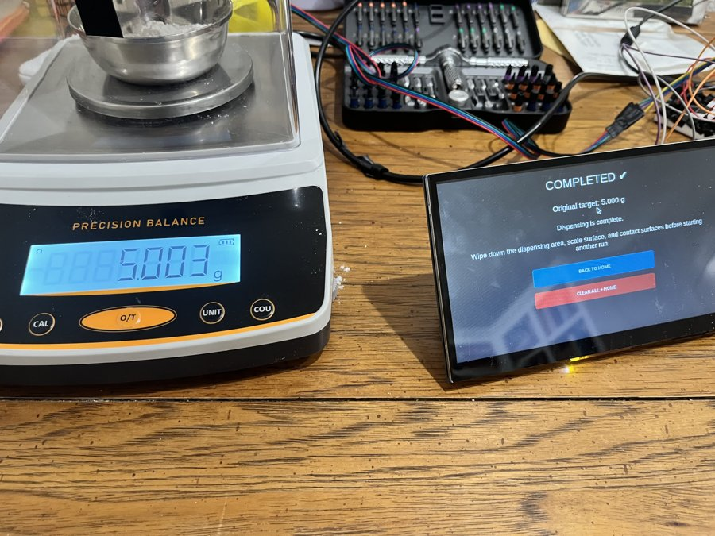

The hard part is the balence. Where exactly to switch from fast to slow, how slow slow is, and getting that right for eight different powders is a lot of trial and error. Each powder gets it's own version of the rule because a gram away from the target means something different for sugar than for flour. Sugar at a gram out needs the auger barely turning, little pulses with time between them, because it pours. Flour at a gram otu needs the auger stil turning enough to move clumps at all, because it doesnt same rule, different numbers, and the numbers only come from running the test and watching what happens. i dont think their is a shortcut for that part, you just run it and watch

The rule survives the motor swap because its about the scale, not the motor. The scale lag doesnt change when the motor changes. The last gram is where the scale's delay and the powder's momentum meet, so the only way through it is to slow down untill the measurement catches up with reality. The motor that runs it is about to get bigger ubt teh rule stays.

## Today's results

Two-speed dispensing kept as the approach. Fast bulk, slow final ~1 g. Speed goes up without giving accuracy away, and the rule applies across powders with per-powder tuning.

## What's still left to do next time

The actual numbers. Eight powders, two targets, full test. Honest results about which ones hit the 3% bar and which ones dont. Time to stop theorizing about speed and start measuring it.

**Total time spent: 3 hours**

# August 19: Two programs, not one

## What I'm doing

Splitting teh software the wya the final machine will run it. I use to have one program doing everything, and now tehre are two, the app with the visual interface, and a motor/scale program whose only job is dispensing.

## What happened

The app is where the user lives. Assign a powder to a slot, enter the amount, and when dispense start, the app calls the motor/scale program and hands it the target value the user typed in. The motor/scale program doesnt care about screens or buttons, it spins the motor, reads the scale, and keeps going until the weight gets to the target, within 3% error.

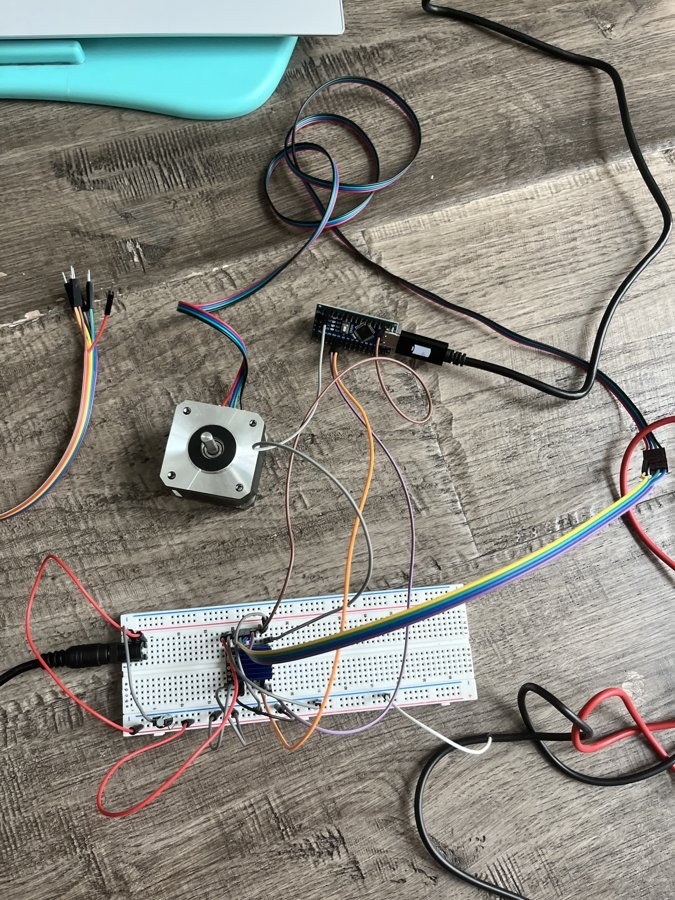

Dispensing is timing-sensitive and the interface isnt. And later there will be eight slots and recipes and a disk to position. I refuse to let the thing that stops a motor at exactly 5 grams also be the thing drawing buttons, lmao. So each program does one job and the app jsut tells the dispenser what to hit.

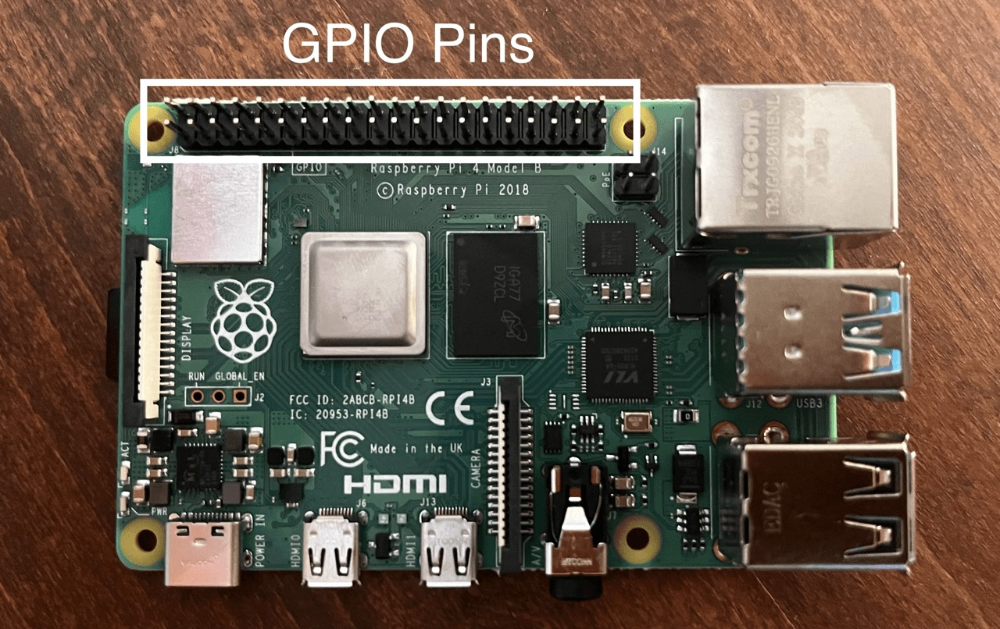

The split also makes each half testable on its own, which is the part that pays off immediately. I can run the motor/scale program from the command line with a target and a powder name and watch it dispense, without touching the interface at all. And I can click through the interface without a motor attatched and ssee if the numbers flow through. When something breaks, and it will, the ghost motor is already lurking, i know which half too blame, because the boundary between them is one call with one number in it. The interface side is a CustomTkinter app, dark, fullscreen at 800×480, built for the touchscreen. The dispenser side is the program that owns the motor and the scale. The app passes the target, the dispenser owns everything after taht.

## Today's results

Software architecture set. App calls dispenser, dispenser owns the motor and the scale and stops within 3% of target. the split makes each half testable on its own

## What's still left to do next time

Run it for real and watch it stop at a target on its own rn. That is the whole milestone in one sentence

**Total time spent: 5 hours**

# August 22: The 55-milligram test: 5 g is solved, 55 mg is not

## What I'm doing

Ok so this one was the full 8-powder test at two targets. 0.055 g, a tiny dose where a single grain matters. And 5 g, a normal dose. Same machine, same loop, eight very different powders. Granulated sugar, table salt, cocoa powder, ground cinnamon, baking soda, cornstarch, powdered sugar, lal-purpose flour. i wanted to see if it could handle both, not just the easy one, so i tested both targets in one go.

## What happened

Trial 1, 0.055 g target, and the numbers are honest in a way that stings:

| Powder | Dispensed | Error | Time |
|---|---|---|---|
| Granulated sugar | 0.056 g | 1.82% | 0:57 |
| Table salt | 0.058 g | 5.45% | 0:54 |
| Cocoa powder | 0.054 g | 1.82% | 1:03 |
| Ground cinnamon | 0.052 g | 5.45% | 1:10 |
| Baking soda | 0.054 g | 1.82% | 2:43 |
| Cornstarch | 0.053 g | 3.64% | 2:49 |
| Powdered sugar | 0.049 g | 10.91% | 3:07 |
| All-purpose flour | 0.047 g | 14.55% | 3:21 |

Three powders hit the 3% target and five didnt. Flour was off by 14.55% and powdered sugar by 10.91%. And lok at the times. The clumpy powders took over three minutes each to dispense 55 milligrams. Thats kinda the small-dose problem right there The free-flowing powders are fast and slightly overshoot, the clumpy ones are slow and undershoot, and at 55 mg their is no margin for either mistake.

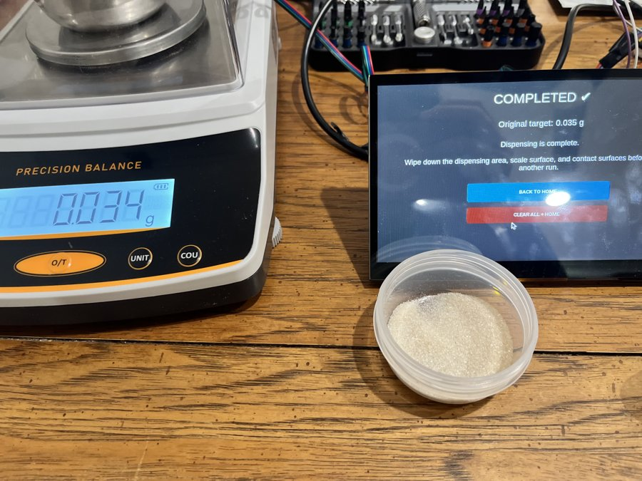

55 mg is so much harder then 5 g. At 5 g an error of a few milligrams is a fraction of a percent, invisible. At 55 mg the same few milligrams is 5, 10, 15 percent. The scale reads to 0.001 g, which is 1 mg, so a a single clump falling late is a 2% swing by itself. The auger cant meter what it cant grip. At these amounts one turn of the screw moves more powder than the whole remaining dose, so the machine is trying to dispense a fraction of a turn, and a fraction of a turn is not a thing the motor does cleanly. The free-flowing powders overshoot because they keep falling after the motor stops. The clumpy powders undershoot because they fall in clumps or not at all.

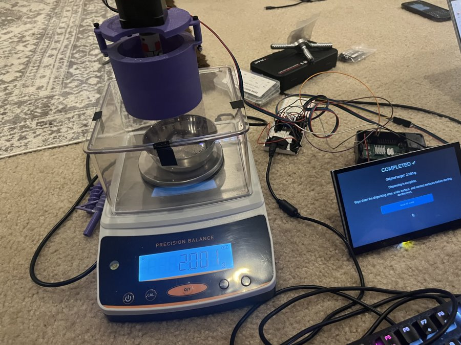

The pattern is the same as everything else in this project. The powders split inot tow families and the families fail in opposite directions. Free-flowing, fast, overshoot, done in under a minute. Clumpy, slow, undershoot, three minutes for 55 milligrams. There is no single setting that fixes both because the failure modes are opposites. Thats why the profiles exist, and why the the small-dose problem stays open after this test instead of getting solved by it. There really isnt a clever fix hiding in the settings lol. i dont love reporting that, but that is what the numbers say.

## Today's results

55 mg dosing, 3 of 8 powders within 3%, 5 of 8 miss. Flour and powdered sugar are the worst, both clumpy, both slow. This is the result i have to report, not the one i wanted.The 5 g trial is the other half of the story.

## What's still left to do next time

The 5 g trial first. Then figuring out what to do about small doses, because machine has to handle tehm eventually. Big doses work, small doses dont yet

**Total time spent: 5 hours**

# August 25: The 5-gram test: all eight within 0.3%

## What I'm doing

Trial 2 of the 8-powder test. Same eight powders, 5 g target this time. Yesterdays 55 mg trial was rough so this one decides whether the machine works.

## What happened

It works, every single powder, all eight, inside 0.3% error.

| Powder | Dispensed | Error | Time |
|---|---|---|---|
| Granulated sugar | 5 g | 0% | 1:54 |
| Table salt | 5 g | 0% | 1:49 |
| Cocoa powder | 5.006 g | 0.12% | 3:32 |
| Ground cinnamon | 4.985 g | 0.3% | 3:05 |
| Baking soda | 4.994 g | 0.12% | 5:01 |
| Cornstarch | 4.991 g | 0.18% | 4:55 |
| Powdered sugar | 4.996 g | 0.08% | 4:57 |
| All-purpose flour | 4.993 g | 0.18% | 4:39 |

Sugar and salt landed on exactly 5 g, adn the worst error in the whole table is cinnamon at 0.3%, which is a tenth of the 3% target. felt great honestly lol, after yesterday

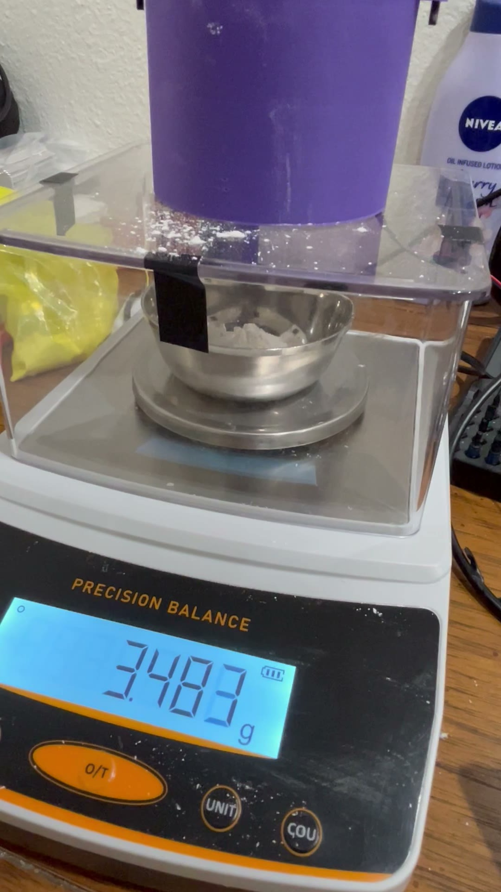

The times tell the other half The free-flowing powders finish in under two minutes, sugar 1:54, salt 1:49. The clumpy ones take four to five minutes, baking soda 5:01, powdered sugar 4:57, cornstarch 4:55, flour 4:39. Slow but right. And thats the trade the two-speed rule was built for. The clumpy powders need the slow finish, and the slow finish is what gets them inside 0.3%.


5 g works when 55 mg doesnt because its the same math from the other direction. At 5 g a few milligrams of overshoot or a clump falling late is a fraction of a percent, and the two-speed rule has room work. Fast bulk, then a slow final gram where the scale catches up and the auger crept too the target. At 55 mg theres no bulk phase and no room, the whole dose is the final gram. and the the speed problem is still there even when the accuracy isnt. Five minutes for baking soda is rigth but its not fast.

## Today's results

5 g dosing solved for all 8 powders, 0–0.3% error across the board. sugar and salt was exactly 5 g. So where M3 stands now, normal doses work beautifully, tiny doses dont yet. And speed is remaining problem, especially for the clumpy powders. Which is why the motor swap is next and not jsut a nice-to-have.

## What's still left to do next time

The powder behaviors write-up, because the test numbers dont explain themselves. And the NEMA 23 swap, because five minutes for 5 grams of baking soda is accurate but not a product. Also the barcode idea needs a decision. its beeen hanging aroudn since the profiles work and its time to either build it or kill it, lmao.

**Total time spent: 5 hours**

# August 28: Sugar settings make cornstarch crawl: splitting powder profiles

## What I'm doing

Running the closed loop across powders instead of just the friendly one. Finding out how one-size-fits-all the current dispensing code is. spoiler, it isnt lol.

## What happened

Sugar and table salt are super high flowing. When they get near the target they need to go super slow at the end, little careful turns, because the scale is still catching up while powder is still falling and it is easy to blow straight past the target. Between you and I, sugar is the scary one hear, it flows so well it overshoots if you dont slow down at the end.

Run those same settings with cornstarch or another fine, clumpy powder and opposite happens. Near the target the code slows way down, and at that speed no cornstarch dispenses at all. It just sits there barely moving, taking forever to crawl the last fraction of a gram. Same code, same careful ending, completely wrong behavior, because the powders have opposite problems.

Its the scale lag. The Pi polls the scale continuously, ubt the reading it sees is always a few milliseconds behind the powder thats falling. For a free-flowing powder, the fix is to slow down early so the falling powder settles before the scale reports it, otherwise you overshoot. For a clumpy powder, slowing down early means the auger is barely turning, and barely turning means barley dispensing, because cornstarch needs the screw moving to move at all. So one ending cant serve both. The code has to knwo which powder it is dispensing before it decides how too end.

So teh code split, The motor/scale program nwo has different categories depending on the consistency of the powder, different speeds and timing for free-flowing versus clumpy. And the app calls the rigth profile based on which powder the user picked in the interface.


Same as M1. In M1 the answer was different augers for different powders, and now the answer is different speeds and timing for different powders, in the same auger. The physical design splits by powder, and now the software splits by powder too. The profile idea survives too the final code, where every powder gets its own settings. i tried the one-size version and it doesnt work tbh.

## Today's results

Dispensing code is powder-aware now. Profiles split by consistency, app selects the profile by powder. The loop still stops within 3%, it just gets there differently depending on whats in the hopper.

## What's still left to do next time

The electrical weirdness. Sometimes after the program terminates, the motor keeps slowly spinning on its own, and thats not a profile problem, thats noise, and it needs a hardware answer. Also M3 is coming and the plan is one doser taht handles every powder properly, all eight of them, so a full powder test is next.

**Total time spent: 4 hours**

# August 31: Two kinds of powder, and no barcode

## What I'm doing

Writing up what the eight powders do. And killing an idea that sounded smart and turned otu to be unnecessary, a barcode scanner that reads the powder container and pulls its behavior from a database.

## What happened

After running all eight powders, they collapse inot tow families, not eight. That makes the whole machine simpler, ethier free flowing or non free flowing.

**Free-flowing:** granulated sugar, table salt, cocoa powder, ground cinnamon. They pour, they don't clump, they don't jam. Their problem is the opposite of what you'd expect. They flow so fast that the scale lags behind and the dose overshoots, so they need the slow finish with more time between pulses near the target. Sugar is the easy one to understand and the hard one too get right. It flows so well that it looks like youre approaching the target perfectly, and then it overshoots because of the scale delay. Salt is the same as sugar, virtually no difference. which is nice because i already solved sugars problem once. Cocoa is the odd one, fine and free-flowing but so fine it launches out of the lid. It needs the free-flowing settings run faster for longer. Cinnamon is kinda the easy one, fine and free-flowing, small amounts at a time, accurate almost by default.


**Non-free-flowing:** baking soda, cornstarch, powdered sugar, all-purpose flour. Fine and clumpy, they jam the auger, they fall in inconsistent clumps. This is where the agitator earns its keep, loosening clumps and cycling powder through the hopper so the auger doesn't starve. Near the target they need the auger turning slower, smaller, with more time between turns. The inconsistency is the hard part. Sometimes a clump falls out, sometimes only small bits fall threw, so the same number of turns gives a different amount each time. Teh slow finish is the only way to average it out. And the profiles for this family arent about speed at all

And that classification is exactly why the barcode scanner dies. If every powder is just one of two families, I don't need a scanner and a database to identify it. The user picks the powder in the interface, the program picks the family, done. The question only ever had two answers, so building a whole subsystem, hardware, database, container labels, to answer a two-answer question was more trouble then it was worth. And the manafactur of a scanner mount and the label printing and all of it would ahve been a a project on its own. so barcode idea is dead. The interface asks which powder it is and the program picks the family.

## Today's results

Powders are in two families nwo, each with its own way of dispensing. And the barcode scanner is dropped.

## What's still left to do next time

The NEMA 23 swap and all-code-on-Pi, which are the last two M3 items. The motor fixes the speed and the Pi move gets rid of the laptop.

**Total time spent: 3 hours**

# September 4: The program ends but the motor keeps turning

## What I'm doing

Ok so there is this weird thing going on. Sometimes the motor and scale program ends, totally done, and the motor just keeps spinning slowly on its own. A motor that turns when nothings running is nto a motor I trust anywhere near a target weight.

## What happened

Troubleshooting it pointed at electrical noise. The driver was picking up noise and reading it as steps, so the motor would creep even though nothing is telling it to move. And the enable line was the problem path.


The fix was pretty simple once i saw it. Reroute the EN pin to a GPIO pin on the Pi 4, and now the enable is under the Pi's control. The driver gets properly disabled when the program ends and the ghost spinning stop. Program ends, motor stops, that is how its supposed to work lol.


The noise part is pretty simple too. A stepper driver on a breadboard is a a bunch of long jumper wires acting like antennas, sitting next to a switching power supply, next to a motor that throws electrical noise every time it steps. The enable pin was floating, so the noise on it read as "go" often enough to creep the motor. If Id left it like that it would of kept creeping forever. Rerouting EN to a Pi GPIO pin means the pin is driven to a definite state by the Pi at all times, and when the program ends the Pi holds the driver disabled. Its not a fancy fix, it just works. dont leave control pins floating in a noisy environment, fr.

The scary part is what it wouldve done in a real dispense. A motor that creeps after the program ends is a motor that adds powder afer the scale said stop, which is exactly the error the whole closed loop exists too prevent. The loop can be perfect and stil wrong if the hardware moves on its own. The 5.003 g result is only trustworthy if the motor stops when its told to, and now it does.

## Today's results

Ghost motion's fixed. EN rerouted to a Pi GPIO pin, and now the motor only turns when its told to. Sounds like a low bar until youve watched your own dispenser turn itself on.

## What's still left to do next time

Honestly the breadboard itself is becoming the risk now tbh. Every fix adds another jumper wire to a board that was supposed to be temporary. A machine that has to gte mounted on a frame cannot be a breadboard with thirty wires hoping for the best. A PCB layout is in progress, planned to be ordered and arrive by M3 So the electronics can be one board, mounted properly, organized, wtih less risk attached

**Total time spent: 4 hours**

# September 7: Designing a PCB to escape the breadboard

## What I'm doing

Starting the printed circuit board layout. The breadboard works, and I hate it lol. It is a temporary prototyping tool that somehow became load-bearing, and every wire on it is a wire that can pop otu during a demo.

## What happened

Im laying out a PCB that takes the driver circuit off the breadbord and puts it on one board that can mount on the superstructure. The schematic hsa the driver, the Pi connections, hte enable routing taht just cost me a week of ghost motors. All of it drawn properly instead of implied by jumper wire colors.


The plan is to order it so it arrives by the M3 milestone. Mounted bored, organized wiring, less risk. the breadboard gets retired prototyping duty lkie it was always supposed to be. Weather the layout survives contact with reality is a question for a future entry. I have my suspicions, and i wont pretend otherwise.

## Today's results

PCB layout's in progress. Order planned to land by M3. We'll see if it survives contact with reality, ngl.

## What's still left to do next time

M3 itself. One doser, all eight powders, full coverage. That means the big powder test, and it means speed, because rigth now dispensing a full set of powders at careful-crawl speed would take all day. The motor might be the limit there, we'll see.

**Total time spent: 3 hours**

# September 10: The purple agitator takes shape

## What I'm doing

Building the agitator properly this time. The first version failed because it didnt span the hopper, and the powder test proved the idea works when it does. So now it needs to be a real part. A frame that reaches the hopper walls, an auger through the middle, printed in purple. And it has to fit together instead of just looking right in CAD.

## What happened

Todays photos are the agitator in pieces and then together. The tall cage frame with the threaded top, the auger beside it, and then the whole thing assembled in my hand, auger running down the middle of the frame. its a satisfying object honestly, lol. The frame scrapes the edges where powder hides, the auger moves it down, and the the whole thing spins as one unit. Thats exactly what the fix list asked for, agitators attached to the auger bottom so both spin together.


The design is kinda doing tow jobs at once. The frame is the agitator, it reaches the walls and scrapes the stagnant ring bakc into the middle so the auger can recieve it and move it down. And the auger is the dispenser, it moves the powder down and otu. Spinning them together off one drive means know second motor, no sync problem, no extra electronics. Which is the effecient way to do it.

## Today's results

Agitator assembly exists as a printed, assembled part now. Frame plus auger, spinning together, spanning the hopper. The clumpy-powder family finally hsa its tool.

## What's still left to do next time

Print more of them, because one agitator is a prototype and eight hoppers need eight of them, and the print quality has to hold up. which, well, the next entry is nto gonna be a good day.

**Total time spent: 4 hours**

# September 13: The print that turned into spaghetti

## What I'm doing

Printing agitator parts, or trying to, anyway. One of the prints failed so completely it stopped being a part and became a birds nest.

## What happened

The photo says it all, lmao. Purple filament everywhere, a tangled mess on the print bed where a part was suppose to be. The print detached or the extruder just kept going with nothing to stick to What came out is the 3D printing equivalent of a shrug, lol. Several hours of print time, a chunk of filament, and nothing useable. And that was annoying, alot mroe annoying than it probably sounds, becuase it wasnt just one part, it was a whole evening of printing gone.


Tihs is the part of the project nobody writes in the milestone docs. A print failing isnt a milestone. But the agitators need to be printed eight times oevr, and a failure rate like this woudl eat the whole schedule. Especially with less parts surviving than i planned for. The fix is the same set of lessons as the earlier auger print. Adhesion, bed prep, first layer, relearned at a bigger scale. The fix was glue on the build plate and the same fix applies here. A tall thin part on a small base wobbles and lets go, and once it lets go the extruder just keeps extruding into air. Weather the first layer sticks is what decides if you get a part or spaghetti. and the first layer is the part of the print im least likely to be watching when it fails. Which is probably why it keeps failing, if im being honest.

## Today's results

One print failed completely. Filament wasted, time lost. The agitator parts that did print are fine. The ones that didn't are a reminder that printing eight of anything means the process has to be reliable.

## What's still left to do next time

Reprint the failed parts. Check the bed and adhesion before starting long print. And stop treating a successful first layer as a given. The agitator set still needs to be complete before M4 starts multiplying hoppers. And i wont start another long print without watching that first layer go down properly.

**Total time spent: 3 hours**

# September 16: The NEMA 23 swap

## What I'm doing

Swapping the motor. The NEMA 17 did its job, it proved the loop. Ubt its the speed limit and the M3 goal is a doser that runs smoothly without a human babysitting it. So the NEMA 23 goes in.

## What happened

More torque, more control, and and the same two-speed rule on top of it. The 23 lets the fast phase be fast, the bulk of the powder moves quickly, and then the slow finish near the target does the precision wrok. And because the motor has the torque to move deliberately at low speed, the slow finish is More consistent too.

Heres the motor and coupler in hand wtih the purple auger mounted, the drive side of the machine taking shape as a real assembly instead of a breadboard experiment.


Swap itself is mostly mechanical. Unmount the 17, mount the 23, connect the coupler, retune speeds around the new motor. The two-speed rule doesnt change, because its abotu the scale, not the motor. and the profiles dont change, because theyre about the powders, not the motor. What changes is the ceiling. The fast phase can be fast now, and the slow phase can be slow without the motor strugling. the 17 was doing the job at its limit. The 23 does the same job with room to spare, lmao.

One thing to get straight, the BOM lists the NEMA 23 closed-loop steppers as a pair for $80.99 udner M4, because two of them end up in the multi-doser. The swap itself, one motor into the single doser, is the M3 step, and the second motor comes with the M4 build. Same part, two milestones. Dont let the BOM date confuse the story The BOM is organized by when parts get bought in bulk, not by when each one gets installed. Which is a distinction worth writing down before i forget it.

## Today's results

NEMA 23 is in as the dispensing motor now. Speed goes up, the accuracy stuff stays exactly the same, two-speed rule and powder profiles untouched. Thats M3s hardware answer, in place.

## What's still left to do next time

All the code onto the Pi so the machine runs without a laptop. And the repeatability runs, because a fast motor that dispenses differently every time is worse than a slow one that doesnt, lol.

**Total time spent: 4 hours**

# September 19: Everything on the Pi: no laptop required

## What I'm doing

Ok so today was moving all the code onto the Pi so the doser can run on its own, no laptop plugged in. Up to now there's always been a computer in the loop somewhere, keyboard attached, code getting edited live while it runs. which is fine for development but its not really a machine yet, its a demo with a a laptop babysitting it.

## What happened

Honestly the interface part was the fun bit, it runs right on the Pis touchscreen now. So you pick a powder, type in a target mass, hit start, and the final result just shows up on the screen, all on the machine. No computer, no opening code to run a dose, lol. The Pi is the computer now which is kinda what it was always for.


Adn its more then just copying files over. On the laptop I controlled everything, keyboard and screen right there, me watching every line. And on the Pi it has to start up on its own, run the touchscreen, talk to the motor and the scale, all without me standing there. So the two-program split has to wrok as a system now. The app owns the interface and the dispenser, the dispenser owns the motor and the scale, and they're two seperate programs that have to talk to each other. The app calls the dispenser with a target and gets a result bak. No human in the loop, no keyboard, no editing code between doses. And im not going to pretend that part was trivial. Getting two programs to agree on teh the handoff took some fiddling, but once it worked it just worked.

The whole M3 goal is a doser that runs smoothly without human interference, and a machine with a laptop attached is a machine with a human attached, since the laptop is where the human lives. So the Pi move is what makes that true, instead of it just being something i wrote down. It sits there, you tap the screen, powder comes out, and the only thing I had to do was get out of the way, which took a few milimeters of patience I didnt know I had.

## Today's results

Single doser is standalone now. Pi plus touchscreen plus scale plus motor, no laptop. And the M3 goal, a doser that runs smoothly without human interference, feels a lot closer to true when theres no human with a keyboard standing next to it.

## What's still left to do next time

Repeatability next. Run the same target a bunch of times in a row and compare the final weights, no recalibrating between runs. And if the numbers drifted i need to figure out waht drifts and why, before this thing becomes an eight-hopper machine.

**Total time spent: 4 hours**

# September 22: Repeatability runs, and writing the SOP

## What I'm doing

Two things today and they kinda go together. Proving the doser gives the same answer twice, and writing down exactly how to run it so someone else could do it too. Repeatability first, SOP second, bc the SOP has to describe a machine that behaves.

## What happened

Ok so the repeatability runs were simple on paper. Same target mass, a bunch of dispenses in a row, compare the final weights, no recalibrating inbetween. Thats the test that separates it worked once from it working every time, lol. If the numbers drift beteween runs it points at a real source of error. The scale, the motor, the powder settling, something. And Id way rather find it nwo with one hopper than later with eight, because eight hoppers times a drifting error is a a mess i dont wnat to debug.


Then the SOP, the standard operating procedure. A machine only I know how to run is a prototype with a single point of failure, and the the machine has to work when I'm nto the one standing next to it. Twelve steps, start to finish:

1. Press "edit" on slot 1 on the kiosk.
2. Use the dropdown to select the powder and press back.
3. Pour the powder into the hopper through the cutouts on top. Pour from both sides.
4. Press continue.
5. Press the tare (O/T) button on the scale and wait until it reads 0 grams.
6. Press the slot, enter the grams to dispense (max 100 g), press save.
7. Press start.
8. Watch the auger. If it jams, or there's smoke or a burning smell, or anything else wrong, press FORCE STOP.
9. When the kiosk reads "DONE", check the scale: correct quantity within ±3% error.
10. Press "clear all + return to home."
11. Discard any remaining powder from the hopper.
12. Use the M3 wrench and screwdriver to take the hopper apart from its lid and wipe the auger, hopper, and surroundings clean.

The number one mistake is written right into the SOP because it happened. Forgetting to tare. Read the directions carefully and make sure after the scale is tared its sitting at 0.000 grams. A dose measured from scale that wasnt zeroed is a dose measured from nowhere, and honestly i could of messed up a whole run of doses by skipping that one step. No amount of closed-loop accuracy fixes a wrong starting point, bruh. The loop can only correct what it can see, and a scale that started at the wrong zero is lying to the loop from the first second. which is a pararell problem to the scale lag thing from the powder tests, same sensor, different way to gte fooled by it.

## Today's results

Repeatability tested, same target over and over. And a 12-step SOP written so someone who isnt me could run the machine. M3 is functionally complete now. One doser, eight powders, two-speed, standalone on the Pi, documented.

## What's still left to do next time

M4 next. Eight hoppers at once, a rotary disk that positions them, a frame to hold it all, and a drive that engages and disengages. The single doser was the hard part, the multi-doser is the bigger part

**Total time spent: 4 hours**

# September 25: Hoppers with lids, and the disk fitting

## What I'm doing

Ok so a hopper work day today. The purple hoppers are getting lids, and im fitting parts onto the motor and disk. The transition work between the the single doser and the multi-doser.

## What happened

The hoppers now have two-piece lids with a slot for the auger post, printed in pink and purple. You can ssee the agitator sitting inside the open hopper, right where it belongs. And lids definately matter alot more than they look like they should. Cocoa launches out of hopper if there isn't one, powder gets everywhere, lol, and a machine with eight open hoppers is a mess waiting to happen.


At the same time i was doing hands-on fitting. The purple disk mount going onto the black motor, checking the fit in real life instead of in CAD. CAD never tells you a part is 0.5 mm too tight. A render is perfect by definition, it doesn't know about friction or a print that came out half a milimeter wide. The only way to know is to hold the parts in your hands and feel whether they go.


The lid slot is the detail that makes the lid work instead of jsut covering the hopper. Teh auger post has to pass through the lid while the auger spins, so the lid is two pieces with a slot for the post, not one piece with a hole that would bind. And its a small piece of geometry. The hand-fitting is the part of the build CAD can't do. The disk mount, the motor, the fit beteween them, checked by holding the parts together and feeling whether they go.

## Today's results

Hopper lids printed and fitted. Agitator confirmed in place inside the hopper. Disk-to-motor fit checked by hand. The single-doser parts are done and the multi-doser parts are starting to be real.

## What's still left to do next time

The PCB schematic is on screen adn needs finishing. And tehn M4 starts in earnest. The frame, the disk, the actuator that lifts the motor into engagement. The parts are ready, the machine that holds them isnt yet

**Total time spent: 4 hours**

# September 28: M3 done: what the single doser proved

## What I'm doing

Closing out M3 today. Writing down what the single doser proved, because the next milestone multiplies everything by eight and i want the foundation written down before i start building on top of it.

## What happened

Ok so the single doser, full coverage. One hopper, eight powders. Me and the doser went threw the whole list today, and heres where it landed:

- It dispenses 5 g of any of the eight powders within 0.3% error, and that holds across both powder families.
- At 55 mg it doesn't hold. 5 of 8 miss the 3% target, flour worst at 14.55%. That stays open.
- It runs standalone on the Pi with a touchscreen, no laptop.
- It has two-speed dispensing, fast bulk then slow finish, and powder profiles split inot free-flowing and non-free-flowing.
- It has a written SOP, and the repeatability runs behind it.


M3 was supposed to be about speed. The speed limit was hardware, so the answer was a bigger motor. The small-dose limit is real. The accuracy answer was a slower finish and powder profiles. And the independence answer was the Pi. None of those were the answers i guessed at the start, and all three of them are in the machine now. Which is a pretty good feeling, ngl, considering the the frist version of this thing coudl barely dispense sugar without making a mess.

## Today's results

M3 complete. The single doser works at normal doses, tiny ones are still a known problem, and the whole thing is documented well enough too build the multi-doser on top of. Teh componenets all fit together in a way that makes sense now, which wasn't true a month ago. felt Great to write that down.

## What's still left to do next time

M4 next. Eight hoppers, one disk, one shared drive, a frame, and the disk concept from way back comes bakc, except now it has to be real, with a motor that engages one hopper at a time and frame that holds everything square. And the loose ends form M3, the small doses, are still sitting there waiting. They arent going anywhere, lmao.

**Total time spent: 2 hours**

# October 1: The PCB schematic, on screen

## What I'm doing

The PCB schematic, finally on screen in full. i started the layout a while back to escape the breadboard, and this is the design as it stands. Teh driver circuit, the Pi connections, the whole electronics system drawn as proper schematic instead of a pile of jumper wires.

## What happened

The screen shows the schematic in the design tool. All the blocks laid out, traces being routed. And this is the board thats supposed to replace the breadboard, mount on the superstructure, and make the electronics organized and reliable instead of a wire nest that falls apart if you lok at it wrong.


Drawing the schematic is the part that forces you to undertsand your own circuit. On the breadboard the enable reroute was one wire moved from one hole to another. But on the schematic the enable line has to be drawn from the Pi GPIO pin to the driver EN pin, with everything in between visible. If i draw it wrong it will effect the whole board and i pay for it in a two-week shipping delay. A board doesnt forgive sloppy thinking the way a breadboard does, because you can't just move a trace with your fingers. Thats the risk of the PCB route and it's a real one. The breadboard is ugly and it works and and the PCB would be clean and it might not work, lol. But the machine cant live on a breadboard, not with a frame and a disk and eight hoppers and a demo to survive. So the board gets designed anyway, and im the one who has to live with the traces once theyre copper.

## Today's results

PCB schematic complete on screen, layout in progress. The electronics have a designed home nwo, even if taht home eventually changes

## What's still left to do next time

M4 next, omg. The frame, the disk, the actuator. And the electronics story pauses here and the mechanical story takes over. And theyll meet again later wehn everything has to live on the Same machine.

**Total time spent: 3 hours**

# October 5: The disk concept becomes real CAD

## What I'm doing

M4 now. Expanding the single doser into a multi-doser that can dispense multiple powders in one continuous run. And the rotary disk concept has beeen around since the start, a sketch and a rough model, and now it has to become high-fidelity CAD. Because this is the part everything else hangs off.

## What happened

The single doser was designed with this in mind from the start. Which is why the transition is smoother tehn it has any right to be. The disk i sketched early on is now a proper model. Eight pockets, one for each hopper, arranged in a circle. The first iteration is a solid disk with eight holes. The final iteration is lighter, a two-tier lattice structure, because a solid disk that size is heavy, slow to print, and a waste of filament.


Two tiers instead of one solid disk. Because a solid disk eight hoppers wide is big print, a lot of filament, a lot of weight hanging on the disk motor, and most of the material is doing nothing. The middle of the disk doesn't hold powder, the Pockets do. So the two-tier version keeps the pockets and the structure that holds them and dropped the rest. Less filament, faster print, lighter to spin. And the lattice looks like engineering instead of a hockey puck. The trade is print complexity. A lattice is harder to print cleanly than a solid slab, and if it warps or starts to loose alignment the pockets dont line up with the actuator. Ubt the weight saving is worth it, because the disk motor has to stop this thing at exact positions, and a lighter disk is easier to stop exactly.

The other thing that makes this transition smooth is that the single doser was designed for it. The hopper, the auger, the agitator, the motor mount, all of it was built as a unit that could be copied eight times around a circle. and the early concept sketch already had the disk with the hoppers on it. So making it real is mostly a matter of drawing the sketch properly. Exact pocket positions, exact spacing, exact center. The hard thinking was already done early on, and the componenets all lined up the wya they wree supposed to. Which arent things i get to say very often, lol.

## Today's results

Rotary disk in high-fidelity CAD. First iteration and final iteration. Eight hoppers, one disk. And the multi-doser finally has a shape, lmao.

## What's still left to do next time

The hard question the disk creates is how does one motor drive eight hoppers. Eight motors would be expensive and huge. And the answer is gonna be one motor that moves between dosers. Which means an actuator, a coupler, and a whole new set of problems.

**Total time spent: 4 hours**

# October 8: The actuator: bought, not built

## What I'm doing

Ok so the problem is the transition. One motor has to run eight dosers, so it needs to lift up while the disk spins to the next hopper, then come back down and and grab that auger. And that up and down part is a linear actuators job.

## What happened

At first the plan was to build the actuator ourselves, then i did the cost math and it fell apart. Building a linear actuator from parts costs mroe then just buying one. and the bought one is a known thing, a mini linear rail with a lead screw and a small stepper, 50 mm of travel. Which is exactly the lift the motor needs to clear the coupler and come back down. And turns out building it ourselves woudl've cost way to much for something i could just order, lol.


So we bought it instead. The BOM stil has it marked pending at $49.96, the oen item on the list that never got checked off as bought in the sheet. Which is either an accounting gap or the actuator arriving faster than the spreadsheet. Thats my best guess anyway Either way the actuator is a purchase, not a build, and honestly im fine with that, fr. The interesting engineering in tihs machine is the dispensing, and reinventing a lead screw doesnt make the powder dispense any better.

The cycle it makes possible is disk spins to the next hopper, actuator lowers the motor down onto the auger, motor dispensed, actuator lifts the motor back up, disk spins to the next hopper, repeat, eight times, one continuous run. The actuator is the part that makes one motor, eight dosers true instead of just slogan. Because without the lift the motor is either stuck engaged with one hopper forever or dragging across all eight. The 50 mm of travel is the clearance that lets the disk spin freely. The lead screw is what makes the lowering repeatable. The motor comes down to to the same place every time, which is the only way the coupler has a chance. It has to recieve the motor shaft the same way every single time.

## Today's results

Drive-engagement method decided. Linear actuator lifts the motor up while the disk rotates, lowers it to engage the selected doser. Actuator purchased, not built, on cost.

## What's still left to do next time

The coupler. Lifting the motor up and down is easy. Getting it to reconnect to the auger every single time, at whatever angle the auger stopped at, is the problem nobody warned me about. And its about to stop all progress.

**Total time spent: 2 hours**

# October 11: The coupler that only worked at one angle

## What I'm doing

Fixing the connection beteween the motor and the auger. Which has turned into the biggest roadblock of M4. The actuator lifts and lowers fine. The problem is what happens when it lowers.

## What happened

The frist coupler design only connected if the auger happend to be sitting at one very specific angle. And if it wasnt, and it almost never was, the motor would come down and not engage. and nothing could dispense. No tests, no progress on hardware or software. The whole machine held hostage by a connection that needed luck, bruh. And if the auger wasnt at that one angle, yuor out of luck.


This was a major roadblock because it blocked everything downstream. I couldnt test the disk. I couldnt test the actuator cycle. I couldnt test multi-powder runs. Because the motor couldnt reliably grab the auger it was supposed to turn. A machine that cant connect its motor to it's load cant dispense anything. And i had a very expensive machine that couldnt do anything for a while. Which is not a great feeling when the whole milestone is waiting on one connection, lmao.

The fix, the fix came after a lot of approaches. And the images show some of them. Attempt after attempt, idea after idea, test prototypes, different geometries. All of them mine, all of them trying to solve the same problem from a different direction. The answer that stuck was to line the motor coupler with serrated teeth that align with the auger coupler at any angle. Teeth, not a keyway. However the auger stopped, the teeth find each other and engage.


Teath work and a keyway doesn't because of what the auger does when it stops. It stops wherever it stops. A keyway needs the auger at one exact angle. Which means the machine has to rotate the auger to that angle before every engagement. Which means more code, more time, more ways for it to fails. Teeth need the auger at any angle, because tehre are enough teeth aroudn the circle that one of them is always close to aligned. And the lowering motion itself pushes them into engagement. And the connection finds itself instead of needing to to be found.

## Today's results

Serrated-teeth coupler works. Motor engages the auger at any angle. The roadblock is gone and the machine can run multi-doser tests now. Which isnt something i could say yesterday.

## What's still left to do next time

The frame, the disk, the actuator, the motor, and eight hoppers all need something to hang from. And that something is 3030 aluminum extrusion and a saw.

**Total time spent: 5 hours**

# October 14: Sawing 3030 extrusion for the frame

## What I'm doing

Building the superstructure. The frame everything hangs from. The machine outgrew the desk and the breadboard era, it needs a real frame, square and rigid. Disk in the center, actuator above the dispensing position, electronics on the side. Thats the whole job today.

## What happened

First tihng I needed was 3030 aluminum extrusion. Cut it with an electric saw, put it together with connectors and T-nuts. The photo from today is the frame going together on the floor, silver extrusions and black brackets, a saw nearby. The unglamorous middle of a build. Everything is measurement and cutting and re-measuring, becuase the disk has to be centered and the actuator has to line up with the slot positions or nothing works. I should of known the measuring would eat most of the day.


The frame is also about fitting in its envelope. The machine has to fit, thats constraint. Extrusion works for that because its strong and modular and you can move a bracket when you remeber the actuator is 2 cm off. Instead of rebuilding the whole thing. Thats why I went with extrusion instead of wood or printed parts. The machine is still changing so the frame has to change with it. Unbolt a bracket, move it, done lmao

so today is mostly a tape measure and a saw and checking the same dimensoin three times. The disk has to be centered, the actuator has to sit above the dispensing slot, the scale has to sit under it, the the screen has to be reachable, and the whole thing has to stay square while i cut and bolt it together on the floor. A frame thats a degree out of square is a disk that doesn't line up with its actuator, and a disk taht doesn't line up doesn't dispense. Not the glamorous part of the build lol. alot of this project is lkie that.

## Today's results

Frame under construction. 3030 extrusion cut and assembled, disk position centered, actuator position set above the dispensing slot. The machine has a skeleton nwo.

## What's still left to do next time

Mount everything on it. Disk in the center, actuator to the side above the set doser position, Arduino and perf board and Pi on the side with the wires in a printed cover. Then the first full assembley. Then the part where i find out waht doesn't fit.

**Total time spent: 5 hours**

# October 17: Frame and disk, together

## What I'm doing

Putting the disk on the frame. The frame is built, the disk is designed, and today they stop being seperate projects adn start being one machine.

## What happened

The rotary disk is mounted in the center of the extrusion frame. Photos from today show it form a couple of angles, the disk hanging in the frame with the purple mounts and the motor hardware starting to appear around it. First time the machine looks like the CAD. Which is weird after months of the CAD being the only version that looked finished. honestly it kind of caught me off guard how much it already looks like a machine, ngl.


The white disk itself is a big print. Eight pockets. theres a photo from a few days later of it sitting on the frame wtih the purple hub in the middle, which is the version that gets used. the printed one is solid and real and heavier than the CAD suggested. The disk in the CAD was light and lacy. The printed oen isnt light and lacy. Which isnt a detail the frame minds tho, but the disk motor will have opinions about later.


The weight matters becuase the disk doesnt just sit their. It has to spin and stop at exact positions, eight of them, and stop precisely enough that the actuator comes down onto the right hoppr. A heavier disk has more momemtum, which means more overshoot, which means the positioning code has to work harder. The CAD said light and lacy, the print says solid and heavy. And if the frame was even a little out of square i couldnt get nothing to line up, so im glad the measuring paid off. The motor will be the judge. The judge hasnt ruled yet.

## Today's results

Disk mounted in the center of the frame. The multi-doser has a body nwo. The remaining work is everything that attaches to that body.

## What's still left to do next time

The disk print itself, the actuator mounting, and the full assembly. Also the wiring, which is going to be an all-night job. i can already feel it coming, lol.

**Total time spent: 4 hours**

# October 20: First full assembly

## What I'm doing

First full assembly. Everything on the machine at once. Frame, disk, actuator, motors, screen, scale. The cad said it all fits. Today finds otu whether the CAD was right.

## What happened

The disk print is running, you can see it in the slicer on sceen. Eight pockets, sparse infill, the big white disk that the whole machine rotates around. And the assembly is coming together in the photos, the full CAD with the orange actuator column, the disk in the middle, the screen at the base, and then the real thing on the desk at night. Wires everywhere, disk in place, motors mounted. The machine existing in three dimensions for first time. And it wont look tihs New agian for a while, lmao.


The CAD and the real thing side by side. The frame holds the disk, the actuator column stands where the CAD said it would, the screen sits at the base, right where it was suppose to be. The motors are mounted. Everything the CAD promised is their, in three dimensions, on the desk, at night, with wires everywhere because the wiring hasn't happened yet and the wires are stil a pile instead of a system. And i keep coming back to how strange it is to see it as a a real object instead of a model.

and the disk positioning question is already waiting. The working notes from this week have the disk motor at 6,400 steps per revolution, divided by 8 slots, 800 steps per slot, with the idea of taking the shortest path between slots instead of spinning one direction. Encoders were considered and rejected as too complicated when basic geometry could do the job. That approach is whats being tried right now. Its going to change. The final code doesn't trust steps at all, it counts detents with a switch. But today the assembly is the achievement, and the positioning is tomorrow's problem. i know it's going to fight me lol. It just hasn't started yet.

## Today's results

First full assembly exists. CAD and real, side by side. The machine is a machine. What isn't done is the wiring, the code that moves the disk, and the part where it dispenses eight powders in a row without me standing tehre. So it's not done, it's just real now.

## What's still left to do next time

The wiring session, all of it, in one go, overnight if it has to be. The electronics have to move from the desk onto the machine, and the disk has to learn where it is. Which is a code problem i already know is gonna fight me. And an effecient fix is not going to come from just staring at it.

**Total time spent: 6 hours**

# October 23: The all-night wiring session

## What I'm doing

Wiring the whole machine. Not a bench test, not a subsystem, the whole tihng. Motors, actuator, disk, Pi, Arduino, scale, screen, all of it, onto the frame, in one session that runs through the night.

## What happened

The photos from tihs session are from the middle of the nite, and they look like it. The breadboard is mounted on a blue box on the the machine with wires going in every direction. theres a perf board in hand, a driver board in hand, disk segments on the carpet. And the machine is slowly turning from a mechanical assembly into an electrical one, bruh. And the amount of wires coming off that breadboard was honestly kind of insane.


This is the session where the M4 and M5 documents both get written, because the work crosses midnight and the write-ups land the next day. And the machine that comes out of this night is the machine that the rest of the project is about. Eight hoppers, one shared drive, an actuator, a disk, adn electronics that are, for now, a breadboard and a prayer. and dont let the prayer part fool you, it works.

The wiring is the part of the build that doesnt photograph well and matters most. Every motor needs power and control, the actuator needs its own driver, the Pi needs to talk to the Arduino, the Arduino needs to talk to the drivers, the scale needs its serial line, the screen needs its connection. None of it is hard on its own Lal of it at once, at 3 AM, on a machine thats still being assembled around you, is the job. the breadboard is mounted on a blue box on the machine because there isn't a better place for it yet. And the wires go in every direction becuase the wire covers haven't been printed yet. Thats M5's job. Tonight's job is just everything connected, everything alive. im not gonna pretend it looked good lol. It just worked. Which at 3 AM is the same thing.

## Today's results

Machine wired end to end, overnight. Motors, actuator, Pi, Arduino, scale, screen, all connected on the frame. And M4's mechanical work and M5's electronics work meet in this session. Which is a wierd issue i was worried about for weeks and it just happened, slowly, wire by wire.

## What's still left to do next time

M5 proper. The stepper code has to get fast, the electronics have to get organized, and the disk has to learn where it is. And the wiring works, now it has to work well, which is a whole different thing. And their is still a pile of wire to tidy before any of that counts as done.

**Total time spent: 8 hours**

# October 26: My step code is the bottleneck, not the motor

## What I'm doing

M5, fine-tuning and optimizing. The machine is built and wired, and now it's about making it fast. Motor speed has been an issue since M3. And the frist version of the stepper code is where the problem lives.

## What happened

The first version of the stepper code used basic Arduino commands to send step pulses at increasing speed. Simple, readable, and too slow, tbh. And the code itself became the bottleneck instead of the motor. The motor could go faster, the pulses just couldnt get to it fast enough, becuase the Arduino was spending its time running the pulse commands instead of pulsing. The code is doing the pulsing and pulsing is the slow part.


Last time the hardware was the limit and I blamed the software. i use to think the motor was always the slow part, but this time the software really is the limit. And the fix has to be in how the pulses are generated, not in how fast I ask for them. The basic pulse commands work by having the main loop do everything. Set the pin high, wait, set it low, wait, reapet. And every step costs the processor time, and the processor can only do one thing at a time. so the fastest the motor can go is the fastest the loop can run. That's the ceiling, and it's a low one.

If I'd kept tuning speeds and acceleration values, I'd have stayed under the same ceiling. And the ceiling isn't a number in the code, it's the way the code generates pulses. So tuning numbers was never going to fix it, the pulses hda to come form somewhere else. And once I saw that it was kind of obvious, lmao. Which is annoying lol, because I spent a while tuning numbers befor I saw it. And an effecient fix was sitting right there the whole time.

## Today's results

Diagnosis. Version 1 stepper code is too slow because basic Arduino pulse commands can't generate steps fast enough. And the motor isnt the limit here, the code is. Which is backwards from what I expected. But at least now I definately know waht to fix.

## What's still left to do next time

Version 2. Generate the pulses with a hardware timer built into the chip, so the pulses come from the timer, not from the main loop. And the motor gets tested against it's real limits instead of the code's limits. And the code stops being the thing in the way.

**Total time spent: 3 hours**

# October 29: Version 3: fault checking and type-in speeds

## What I'm doing

Version 3 of the stepper code. Tow things this time, fault checking, and typing in a speed to test it right away instead of re-uploading every time. And both of them are about the same thing, making the motor testable.

## What happened

Fault checking first. If the driver catches a stall or too much current, the code records exactly what speed it happend at. And thats way more useful than just knowing the motor stopped Now I know it stalled at this speed under this load, and that's actual data I can use, not a shrug. And the driver board is the part that reports it, so version 3 is really the code listening to the hardware for once.


Tehn the type-in speed testing. Before this, testing a new speed meant rewriting the code and re-uploading it to the Arduino every single time. That would of gotten old fast, and honestly it made me skip tests I should've run. And now I just type in a number and it run. Minutes per test down to seconds, and the motor gets characterized instead of me guessing at it. Guessing was the old method and it wasnt working, lol.


Ok so both of these are really about the same thing, making the motor testable. fault checking tells me where it fails, type-in speed let me find that spot fast. And without the first one I'm guessing about limits, and without the second one I'm too slow to map them. And once I know the limits I can run the machine fast without breaking it. And the componenets didn't change at all, the driver is the same Driver, the motor is the same motor, only the code gto smarter. Which is the cheapest upgrade in the whole project, ngl.

## Today's results

Version 3 done. Fault checking that records the exact speed of a stall or overcurrent, plus type-in speed testing wtih no re-upload. And the motor code feels like a tool now instead of a problem. Which is a good feeling after a whole day of it being a problem.

## What's still left to do next time

Electronics organization. The code is fast and the machine is wired, but the wiring is stil a breadboard and a prayer. And the PCB plan needs a verdict, because i cant keep putting that decision of. The machine needs a real answer for where its electronics live.

**Total time spent: 4 hours**

# November 1: The PCB is scrapped, the perf board fails

## What I'm doing

Deciding the electronics, finally. The PCB schematic has just been sitting there, the breadboard has been doing the job, and the machine needs a real answer for where its electronics live. And im done putting that off.

## What happened

The custom PCB is scrapped. We looked into building one to replace the breadboard and organize the Pi connections and motor controls so everything would be easier to mount and mantain, but we kept iterating and and never finalized a design. And at some point you just have to call it, the board isnt happening. And the machine needs electronics now, not a perfect board eventually. And that's the decision, even if it stings a little after all that schematic work.

So, perf board. A breadboard is to big to mount and too messy, so a perf board seemed like the middle ground. Smaller, mountable, soldered instead of jumperd. And the perf board failed to connect, the connections just didn't work. And after all that soldering, were back to square one on electronics packaging, lmao, and then the- Which is a frustrating place to be when you thought you were past it.


The answer in the end is going back to a breadboard, but a half breadboard, one I can keep adapting with a modular design, mounted in a 3D-printed custom mount. Its not pretty. The breadboard works, the perf board doesnt, and the PCB doesnt exist, so the breadboard is what stays. a mechanism that doesnt work doesnt get kept just because I already spent tmie on it. It gets replaced by the one that does work, even if it's uglier. And the connections on the perf board were pararell to nothing, they just didnt connect. Which is abotu as final as a verdict gets.

Honestly this is the same thing as the thread from early on, bruh. The PCB had a schematic, weeks of work, and a plan to arrive by M3. The perf board had an evening of soldering. Neither of them works, and the tihng that works is the thing I started with, the breadboard I was trying to escape. And letting go of the PCB is the same call as letting go of the thread. a mechanism that doesn't work doesn't get kept just because I already spent time on it. It gets replaced by teh one that does work, even if it's uglier.

## Today's results

Custom PCB scrapped, design never finalized, perf board tried, failed to connect, and the electronics go back to a half breadboard in a printed mount. Picked because it works and I can adapt it, not because it's pretty. And im fine with that. Pretty was never the requirement.

## What's still left to do next time

Mkae the breadboard look like it belongs on the machiene. Printed wire covers, an Arduino cover, a breadboard mount, and all the wires secured to one extrusion, so the machine doesn't look like a science fair project with its guts out. The electronics work, now they have to look like they work.

**Total time spent: 4 hours**

# November 5: Wire covers and one clean extrusion

## What I'm doing

Ok so, cleaning up the machine. The electronics work, the motors are fast, the disk turns, and the whole thing still looks lkie a wiring explosion. And M5's last job is making the machine look finished. Which is a real job.

## What happened

Printed parts to rescue. which is the theme of this whole project, when something needs to exist, print it. Custom wire covers, an Arduino cover, a breadboard mount, all printed to fit teh machine. And the wires get secured to the side and consolidated to one extrusion, so instead of cables going everywhere theres one clean run down one piece of frame. one run, one extrusion, nothing dangling.


Its not just cosmetic. Exposed wires get snagged and pulled and unpluged, and a machine that has to dispense eight powders in a row can't have a wire come loose because someone brushed past it. And the covers and the consolidation wree reliabilty work. A wire in a cover can't be snagged, a wire secured to one extrusion can't be yanked from three directions, and a breadboard in a printed mount can't slide off the machine mid-dispense. And the machine stops being one accidental tug away from a failure, lmao. And that's worth more than looking good, even though it also looks good. And alot of the reliability in this project has been exactly this kind of unglamorous work.

The other thing the cleanup does is make the machine demo-able, the demo is two weeks away. And a machine with its guts otu reads as unfinished to an audience no matter how well it works. A machine with covers and one clean wire run reads as a prodcut. The work is the same either way, but the audience can only see the outside, so the outside has to show the machine is finished. And for once it does.

## Today's results

Electronics organized. Printed wire covers, Arduino cover, breadboard mount, wires secured and consolidated to one extrusion. And the machine looks like a machine and it stops being one accidental tug away from a failure. Which is the result i care abotu, ngl.

## What's still left to do next time

Next up. The final code, the disk learning were it is, and the demo. The machine is built, wired, fast, and tidy, and nwo it has to prove it can run a whole recipe by itself.

**Total time spent: 4 hours**

# November 8: The assembly in CAD, again

## What I'm doing

Back in CAD, checking the assembly one more time before the final code push. The machine on the desk and the machine in CAD have been drifting apart all summer. Every printed fix adn rewired board moves the real thing a little further form the model. And this is when I close that gap, because the final code is about to be written against this exact geometery and it has to be right.

## What happened

The screen shows the assembly, the orange actuator column, the funnel and hopper, the frame, the whole machine modeled with the parts as tehy are now. And this is the version of the CAD that matches the machine, kinda, not the older version that matched the plan. And the difference between those two versions is the whole summer, lol.


the drift is the story of the whole summer. The disk got heavier than the CAD said, the electronics moved from a PCB plan to a half breadboard in a printed mount, the wire covers got added the coupler got serrated teeth, and their were always more parts to build than time to model them. And every one of those changes moved the real machine away from the model, and none of them got modeled at the time, because modeling takes time and building was faster. And this is when I pay that debt back, because the final code is about to be written against this exact geometry. And the actuator positions, the disk slots, the scale position, all of it has to be right in the modle, or the code that reads the model will be wrong about the machine. And that is nto a mistake I want to find out about on demo day.

The section cut is the view that shows whether the model is honest. The carousel, the actuator column, the frame, cut open. And if something in there was still the older version it would show, and it doesnt. The model and the machine agree agian, and i checked it the slow way, piece by piece, lmao, because a a diagnal cut through the wrong geometry would of been worse than no check at all.

## Today's results

Assembly CAD updated to match the built machine. The model and the machine agree again. Which matters because the final code is about to be written against this exact geometry. And for once the model isnt lying about anything.

## What's still left to do next time

The final code. Three pieces, Pi app, dispenser program, Arduino sketch, plus the disk positioning question the M4 notes got wrong that the code is going to have to gte right. And thats the big one, the rest is just typing.

**Total time spent: 3 hours**

# November 11: Printing the last hopper parts

## What I'm doing

Printing the last of the hopper parts. Eight hoppers means eight of everything, and the the print queue has been running all summer. Adn these are the final pieces, which feels strange to say after a whole summer of it never being empty.

## What happened

The photo form today is the print bed wtih the finished parts, stacked white cylindres, the hopper bodies, and the latice pieces beside them. Clean prints, no spaghetti this time, lol. And the process is reliable now in a way it wasnt before, and the spaghetti failure feels like a different project. Which in a way it was, that was before i figured out the process.


The reliability is the result here. At the start the auger wouldn't stick to the bed without glue, then a print turned into spaghetti, then the disk printed clean, then eight hopper bodies print clean in one run. And the process got reliable the same way everything else in this project did, by failing, figuring out why, and fixing the actual cause instead of hoping. glue on the bed, first layer watched, bed prep checked before a long print. None of it is exciting, and all of it is the reason the last parts printed clean. And dont let anyone tell you bed prep is boring, its what makes the prints come out clean, lmao.

Eight of everything means eight hopper bodies, eight lids, eight agitators, eight augers, and that takes alot of printing over the summer. And the machine has all of them now, and nothing left in the print queu, and the print queue being empty is a strange feeling after a summer of it never being empty. And after all that printing the last thing I wanted was a bad batch at the end, and an effecient print run means nothing if the parts dont fit.

## Today's results

Final hopper parts printed. The machine has all eight hoppers, all eight agitators, lal eight augers, and nothing left in the print queue.

## What's still left to do next time

The code. The final Arduino sketch and the Pi programs, and the disk positioning decision that changes everything abotu how the machine finds its slots. And thats the last big decision before the demo.

**Total time spent: 3 hours**

# November 14: The disk doesn't trust steps anymore

## What I'm doing

The final code, and the biggest change of approach in the whole project. The M4 notes said the disk would run on fixed steps, 6,400 steps divided by 8 slots, taking the shortest route in either direction, and the final code does the opposite. And it's the opposite for a good reason. Steps lie.

## What happened

Steps lie lol. A stepper motor can miss steps under laod, and if disk's position is just a count of steps sent, one missed step means every slot after it is wrong, and the machine doesnt know about it. A silent error that compounds. And the fix is to stop trusting steps and start trusting a physical switch. theres a mechanical detent switch on the disk, wired to pin D2, and the disk moves clockwise only, counting detents as they click past until it reaches the slot it wants. And the position is real, measured by the swtich.

The final Arduino sketch says it plainly in its own header:

```
Auger: STEP D9, DIR D8, ENABLE D10.
Disk:  STEP D11, DIR D12, ENABLE D4.
Mechanical switch: COM -> GND, NO -> D2.
ALL disk travel is clockwise only.
DISK PREV is intentionally rejected.
```

Clockwise only, no reverse, no shortest path, no step counting. The disk goes around until the switch says it's home, and if the indexing fails the stored position is invalidated instead of guessed at. And it's slower than the shortest-path idea and it's correct. Which is what matters when the machine is dispensing actual doses, tbh.


Why the M4 plan was wrong comes dwon to what a missed step costs. In the M4 notes the disk motor has 6,400 steps per revolution, 800 steps per slot, and the disk takes the shortest route. And that's elegent, and it's fragile, because the position is a count in the code's memory, and the code's memory is only right if evrey step happened. And under load, a heavy disk, eight hoppers, friction, steps get missed, and the count drifts, and the drift is silent, and the machine thinks it's at slot 3 and it's at slot 4, and it dispenses the wrong powder inot the right dose. And the detent switch fixes it by making the position physcial. The switch clicks when a slot passes, the code counts clicks, and if the clicks don't add up the position is invalidated instead of guessed at. And the expected pitch is 800 steps per slot, wtih 400 to 1,200 allowed. Which is the code admitting that steps are approximate and the switch is what counts. And the componenets didnt change, the switch was always there. i jsut wasnt listening to it.

The other change is clockwise only. The shortest-path idea meant the disk could go either direction, which meant the code had to track direction, and direction is another thing to get wrong. And clockwise only means the disk always goes the same way, the switch always clicks in the same order, and there's exactly one way to get from any slot to any other slot. Forward, slower, simpler, Correct, lmao.

## Today's results

Final disk positioning. Clockwise-only detent indexing via the D2 switch, 800 steps expected per slot, 400 to 1200 allowed, position invalidated on indexing error, and the M4 step-counting plan is superseded. And this is the version that runs.

## What's still left to do next time

The rest of the final code, the Pi app and the dispenser program, and getting all three pieces talking to each other the way the emails show them. And then the demo, which is tomorrow, so theres not much time left to get this wrong.

**Total time spent: 5 hours**

# November 17: The final code: three pieces

## What I'm doing

The final code, all three pieces, sent bakc and forth by email today. This is the software the machine runs, and it's the same architecture the M2 split started, grown up. And im writing this one down carefully because this is the version that that has to work tomorrow, omg.

## What happened

three pieces, each with one job. They dont step on each other, they each own one thing and they do it well. **app.py, on the Pi.** A CustomTkinter dark interface, 800×480 fullscreen, titled "Compounding Doser", it owns the recipes and the positioning, it passes the Arduino port and the current disk slot to the programs it calls, and it logs everything to CSV. And this is the screen the user touches, so it has to be the part that makes sense to a person, not jsut to me.

**motor_scale_controller.py, on the Pi.** Dispenses one powder to a target using scale feedback, you call it like `python3 motor_scale_controller.py 5.0 "Cornstarch"` and it handles that one powder, that one target, and nothing else. It doesn't move the actuator, it doesn't touch the disk, one powder, one target, scale watching. And splitting it out like this means one powder at a time is testible, and the app owns the recipe while the dispenser just does the one powder it is asked for.

**The Arduino sketch, on the Uno/Nano.** Auger on Timer1, disk detent indexing on Timer2 with the D2 switch, and the linear actuator on a TMC2209. And the rules are strict and they're written in the header. The actuator must be raised before any disk command, no simultaneous motions, the actuator's position is tracked in software only, there are no limit switches, and the disk is clockwise only. And bench values are 1,000 steps per second, 4 ms debounce, and those numbers are the ones I measured, not the ones I hoped for.

```
Auger: STEP D9, DIR D8, ENABLE D10.
Disk:  STEP D11, DIR D12, ENABLE D4.
Mechanical switch: COM -> GND, NO -> D2.
ALL disk travel is clockwise only.
DISK PREV is intentionally rejected.
```


The three pieces was the M2 split, grown up. At first there were two programs, the app and the dispenser, now there are three, because the disk and the actuator need a brain of their own, and that brain is the Arduino sketch. And the app owns the interface and the recipes, the dispenser owns one powder and one target, the sketch owns the motors, the actuator, and the disk position. And each piece does one job, each piece is testable on its own, and the boundries beteween them are single calls with single values in them. And it's the same architecture from the start, the split was right the first time.

The strict rules in the sketch header are the safety of the whole machine written down. Actuator raised befor any disk command, because a lowered motor and a spinning disk would tear the coupler apart. No simultaneous motions, because two things moving at once is two things that can collide. Actuator position tracked in software only, because there are no limit switches on the actuator, which means the code has to remember where it is, and if it forgets, it has to be told. Disk clockwise only, because the detent switch only works in one direction. And these are the rules the machine runs by, written in the code itself, and im glad they are written down, because tomorrow I will be nervous and the code will not be.

## Today's results

Final software complete and exchanged. Pi app plus dispenser program plus Arduino sketch, with the pin map, the detent protocol, and the safety rules all written down in the code itself. And the machine's brain is done which is a strange thing to rite after a whole summer of it not being done.

## What's still left to do next time

Demo day, the machine on a table, eight hoppers, and an audience, and everything from the start to nwo gets proven in one afternoon. And I hope it works lol, because there is no version 4 of this day.

**Total time spent: 5 hours**

# November 20: it works end to end

## What I'm doing

Doing final tweaks on the machine, the carasoul rotation got fixed earlier now I need to do some test runs to make sure it works correctly and then test all the powders again and see if it dispenses accurately.

## What happened

The finished machine, two-level carousel wtih eight clear PETG hoppers on top, lids and funnels in place, two big black motors on purple mounts over the disk, the 3030 extrusion frame holding it all, the touchscreen at the base, and a black electronics box with PHARMATECH printed on it. I had to make sure there were no mechanical clearances and I tidied up the wires some more. I also tried making the ui a bit smoother.


After finally fixing all these issues with ethier dispensing the amount of turns the motor takes to dispense correctly, how many rotations the disc has to do, all these electrical issues, im proud to say the machine finally fully works!

## Today's results

Machine works end to end, I was also able to show to some of my friends.

## What's still left to do next time

The next version, small-dose accuracy, for one, but thats a different log. This one ends here, with a machine that works, and it works bc of a whole summer of parts that didnt. Which is a seperate kind of ending than I expected back when I started

**Total time spent: 4 hours**
