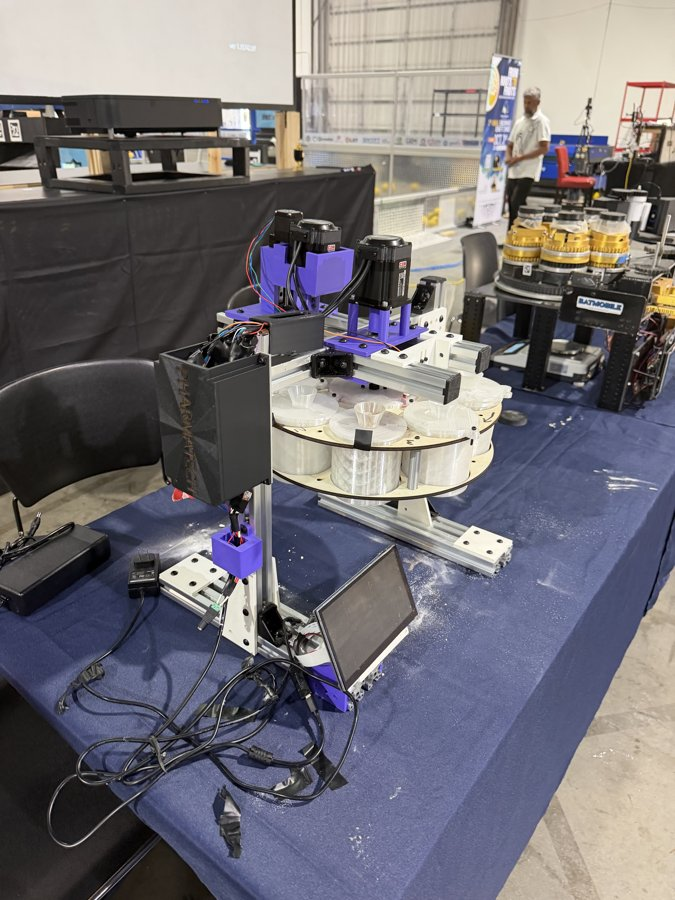
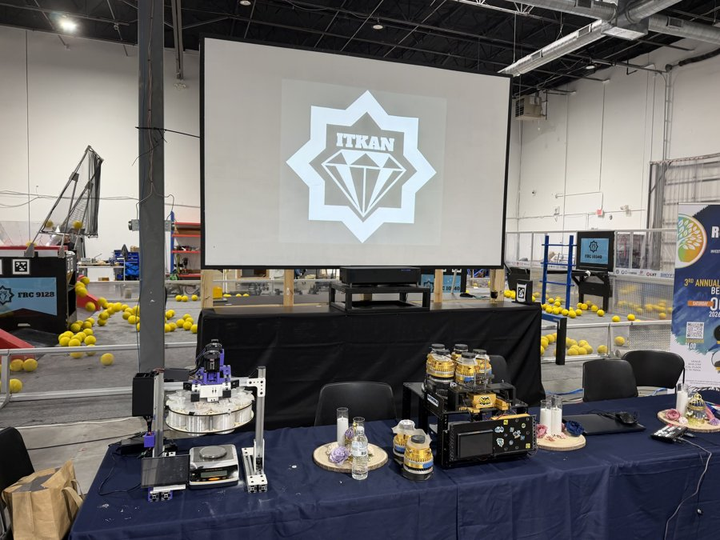
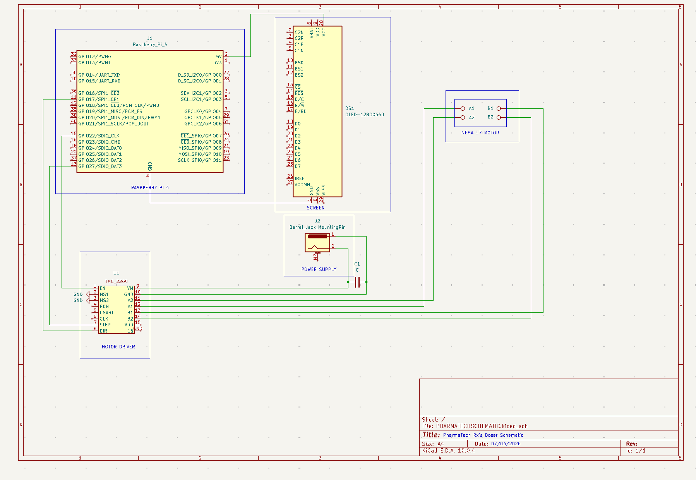
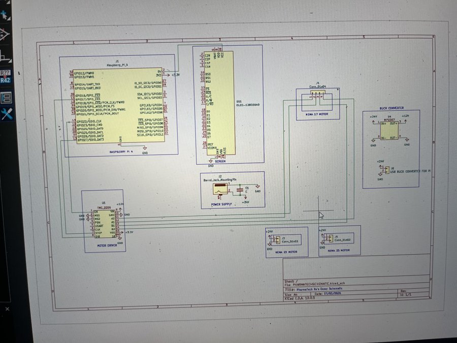

# PharmaTech Rx

An automated powder dispenser, it features 8 dispensing slots and a caracsual dispenser. It is a low cost pill compounder costing under ~$750, users can set custom recipes and the machine can dispense most different kinds of powders in rapid succession, never exceeding a 2% accuracy while being faster than manual compounding. It is relatively easy to assemble and is built with hobbyist electronics and hardware, any custom parts are either 3d printed or laser cut on wood.

## Why I made it

Compounding a pill means weighing out several different powders, accurately, one after another by hand that is slow, and a small error in any one powder is the whole dose wrong. I wanted a machine that could hold 8 powders, pick the right one, and dispense exactly the target mass by itself, without letting powders mix. The trick that makes it buildable is sharing the motors every hopper has its own auger and agitator so powder never touches another powder's parts, but only two motors clip into whichever hopper is over the scale  motors doing the work of 16.

## Pictures

The finished machine at demo day — eight clear PETG hoppers on top, two motors on purple mounts over the disk, touchscreen at the base, PHARMATECH electronics box. Powder on the tablecloth is the review: it dispensed, here, in front of people.





## Videos

Watch the machine working — all Unlisted on YouTube:

- [Full machine dispensing 6 g granulated sugar (0:29)](https://www.youtube.com/watch?v=Er3vP-hmCKU) — September 5, 2026. The full 8-hopper machine dispensing to a 6.000 g target, closed-loop on the balance, touchscreen in frame.
- [Rotary disk indexing (0:40)](https://www.youtube.com/watch?v=ff1ccdtU3H8) — September 6, 2026. The disk indexing between hopper slots, with the two shared drive motors on purple mounts and the 3030 frame.
- [Single doser closed-loop test, 2 g target (1:13)](https://www.youtube.com/watch?v=9py9lcKt120) — July 4, 2026. Early single-doser test: the touchscreen shows a 2.000 g target, dispensing in progress, and the balance lands at 1.999 g.

## Full 3D model

The September assembly in CAD — carousel, funnels, lead screw, actuator, screen, and orange 3030 frame. This is the model the machine on the demo table was built from.


Onshape: https://cad.onshape.com/documents/e2fb2b451acf286ed66ba165/w/6cd2a3204126190097256c46/e/a24ad7b28850453fc00479b6?renderMode=0&uiState=6b073d85ecf010ccbc4620c0


## Schematic

There is no PCB in this machine — see Known Issues below. There is a schematic. It covers the driver circuit, the Pi connections, and the enable routing.





The board was never finalized, so it was scrapped. 

## Wiring

No PCB, so the wiring lives on a half breadboard in a printed mount, with wires secured to one extrusion.

| Function | Arduino pins |
|---|---|
| Auger | STEP D9, DIR D8, ENABLE D10 — Timer1 hardware pulses |
| Disk | STEP D11, DIR D12, ENABLE D4 — Timer2; detent switch on D2 (INPUT_PULLUP, pressed on rim = LOW, released in detent = HIGH) |
| Linear actuator (TMC2209) | STEP D6, DIR D7 |
| Detent switch | COM → GND, NO → D2 |

Rules, written in the sketch header: the actuator must be raised before any disk command; actuator, disk, and auger never move at the same time; actuator position is tracked in software only, there are no limit switches for actuator, only for rotating carasoul; the disk moves clockwise only. `SET SLOT n` replies `DONE DISK SLOT n`; an indexing error invalidates the stored position.

## How it works

1. Pick a powder and a target in the touchscreen kiosk, pour the powder into its hopper, tare the balance to 0.000 g, enter grams (max 100 g per hopper).
2. The disk indexes clockwise to the selected slot, counting detents on the mechanical switch — not steps — to know where it is.
3. The drive lowers onto the hopper, the auger turns, and the balance watches the mass in real time. It runs fast, then slow as it approaches the target, and stops itself at the target.

Tested on 8 powders: granulated sugar, table salt, cocoa, ground cinnamon, baking soda, cornstarch, powdered sugar, all-purpose flour.

| Target | Result |
|---|---|
| 5 g | All 8 powders within 0.3% of target |
| 55 mg | 5 of 8 powders miss the 3% target — flour 14.55% error, powdered sugar 10.91% |

## How to assemble

Assembly is relatevely simple compared to other machines, all parts can be custom made and the only mechanical part you need to buy is 3030 extrusion and T-Nuts which you can ethier handsaw or bansaw. For the most part the rest of the things you need to buy are ethier sensors, motors, etc. You will need to lasercut/3dp the rest of the mechanical parts. You can view the the onshape to see how to assemble the mechanism. 

## How to flash

**Arduino Uno / classic Nano (ATmega328P) — the sketch:**

1. Open the Arduino sketch (final state September 12, 2026 — see Journal 055 for the pin map, detent protocol, and safety rules) in the Arduino IDE.
2. Connect the Uno/Nano over USB.
3. Select board **Arduino Uno** (or **Arduino Nano**, ATmega328P), and select the serial port.
4. Click **Upload**. Bench values in the final code: 1,000 steps per second, 4 ms debounce.

Before this, testing a new speed meant rewriting the code and re-uploading every time. Version 3 of the step code (Journal 049) lets you type in a speed and test it immediately — use that loop to characterize the motor instead of guessing.

**Raspberry Pi 4: the app:**

1. Install the Pi programs on the Pi 4 with the 7" 800×480 touchscreen attached.
2. Run the touchscreen app:
   ```
   python3 app.py
   ```
   CustomTkinter, fullscreen, titled "Compounding Doser." It owns recipes and positioning, passes `ARDUINO_PORT` and `DISK_CURRENT_SLOT` to the dispenser, and logs everything to CSV.
3. Or dispense one powder directly, for testing:
   ```
   python3 motor_scale_controller.py 5.0 "Cornstarch"
   ```
   That program dispenses one powder to one target using scale feedback. It does not move the actuator or the disk.

The three pieces — `app.py`, `motor_scale_controller.py`, and the Arduino sketch code are all uploaded

## Operating it

Assign the powder to a slot in the kiosk, pour into the hopper, tare to 0.000 g, enter grams, start, FORCE STOP on any jam, smoke, or smell, confirm the result is within ±3%, then disassemble with M3 tools and wipe the auger and hopper clean. Forgetting to tare is the documented #1 mistake. Full 12-step procedure is the project SOP (Milestone 3 folder in Drive).


\* Hours are reconstructed estimates from session evidence — photos, doc dates, test durations — not a contemporaneous time log.

## BOM

From the project bill of materials sheet — 22 items, $732.06. 
| Part | Used for | Milestone |
|---|---|---|
| Bonvoisin analytical balance, 500 g × 0.001 g | Scale feedback | M2 |
| Raspberry Pi 4 kit (4 GB) | Controller | M2 |
| Hosyond 7" 800×480 DSI touchscreen | Kiosk UI | M2 |
| USB→RS232 serial adapter (PL2303) | Balance → Pi | M2 |
| NEMA 17 stepper, 2 A, 59 Ncm + TMC2209 | First auger drive | M2–M3 |
| 8×8 mm plum flexible coupler | Auger shaft coupling | M3 |
| NEMA 23 closed-loop integrated steppers ×2 | Disk + upgraded drive | M4 |
| 3030 T-slot aluminium extrusion + connectors + T-nuts | Frame | M4 |
| 24 V 15 A 360 W power supply | Main power | M4 |
| LM2596 buck module; 24 V→5 V bucks | Power regulation | M4 |
| Mini linear rail, T6×1 lead screw + NEMA 11, 50 mm travel | Drive lift / engage actuator | M4 |
| Barcode scanner | Dropped after powder classification (Journal 031) | M4 |
| Food-safe PETG filament ×2 | Hoppers and printed parts | M4 |
| Acetone | Vapor smoothing printed parts | M4 |
| M2.5 screw assortment | Assembly | — |

## Known Issues

- **Small doses are not solved.** At a 5 g target every powder lands within 0.3% error, but at a 0.055 g target, 5 of 8 powders miss the 3% target (flour 14.55%, powdered sugar 10.91%). 

- **No PCB.** 

- **No limit switches on the actuator.** Actuator position is tracked in software only. If the code loses track, it has to be told where the actuator is.
- **Disk is clockwise only, by detent.** 


