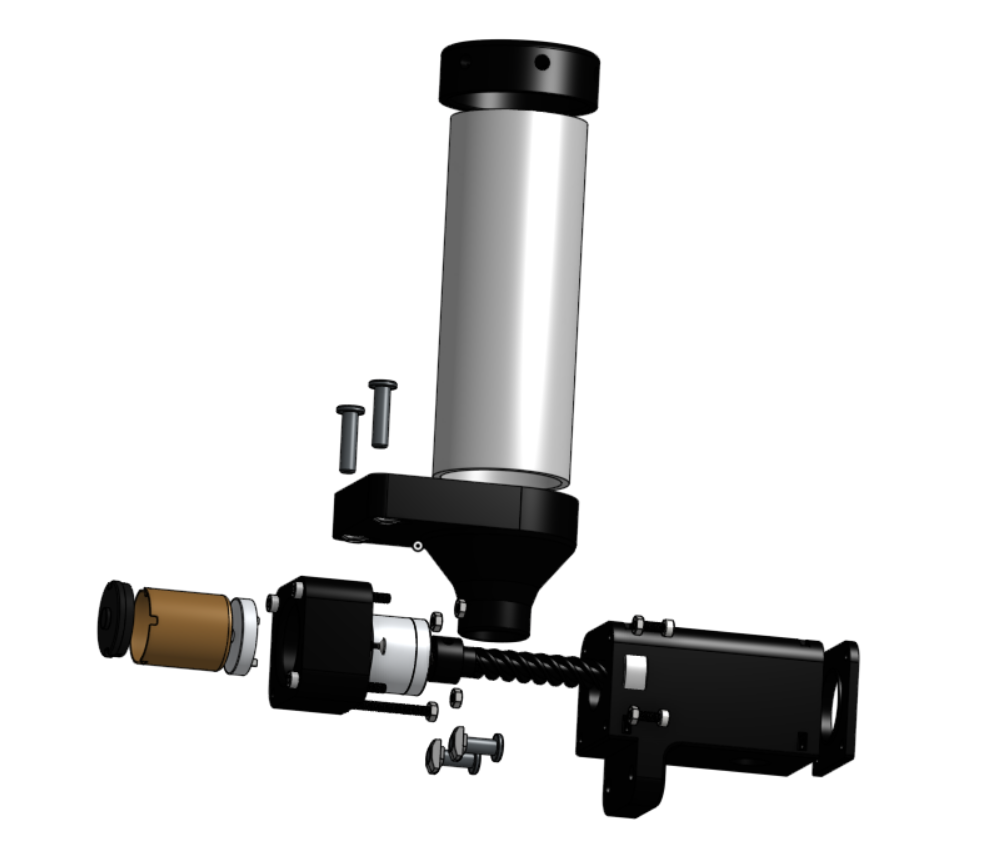
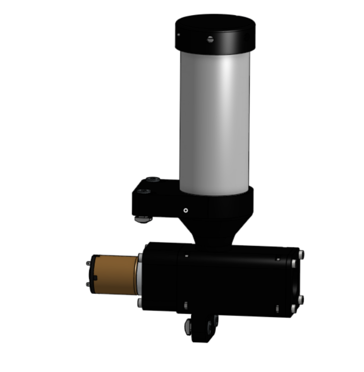

# 001 — Studying an auger filler before designing mine

**Date:** 2026-06-12
**Milestone:** Before M1
**Type:** Achievement

## What I'm doing

Ok so before i draw anything of my own i want to get how an auger filler works. Not kinda know. So I found a full 3D model of one and saved the STEP file tonight. Now I can open it up and look at teh real geometery instead of guessing from pictures finished machines. First thing I want is the the whole powder path laid out in front of me, not just the outside of a finished machine.

## What happened

ngl its simpler than I thought it would be tho. Powder sits in a tube on top. Drops down through a funnel into a horizontal barrel. And theres a screw inside the barrel that pushes the powder out the end. One motor at the back turns the screw. Thats the whole machine.

Cap, tube, funnel block, motor, screw, barrel. Like six things. Each one does its own job. The screw is the whole metering idea. Every turn moves a consistent amount of powder. Everything else is just holding powder abvoe it and catching what falls. So what im copying from this design is how it meters, not how its laid out.

The part I keep thinking about is the corner. In this design the screw is horizontal, so powder falls down out of the tube and then has to turn ninety degrees to get pushed sideways out the barrel. And that corner is where powder is going to sit. And jam. And be a pain to clean. And for what im building the powder is going to be sitting in hoppers and dispensing straight down anyway. so why make it turn at lal. Put the auger vertical, inside the hopper, and let it push the powder down and out the bottom. Gravity is already going that direction. And it removes the corner completely instead of designing around it. Which is alot cleaner than trying to fix a corner that shouldnt be tehre in the first place.

Putting the auger vertical makes the rest of the machine simpler. Because the powder never has to change direction. It just falls, gets metered by the screw, and comes out the bottom. And thats the first real decision. And i havent drawn a single part of my own yet. I also made a doc called "Augur Mechanism Details" to write this up properly. And so far the only thing in it is "make short write up". So that still needs doing. And dont ask me why I started a doc just to put oen line in it lol. I wanted somewhere to put the writeup once I understood the thing.

## Today's results

I get the metering part now. And ive got the first design decision made. Vertical auger inside the hopper. Gravity doing the work instead of a corner. The reference model is saved and I can pull it open whenever I need to check how something was put together. And the componenets are only six parts, so theres not much to hide behind. If the metering works the machine works.

## What's still left to do next time

Set the actual targets for mine. How many hoppers. How much powder each one holds. How acurate it has to be. Taht kind of thing. Then start the first hopper in CAD. And write up the auger mechanism doc instead of leaving it as one line.

**Total time spent: 2 hours**
