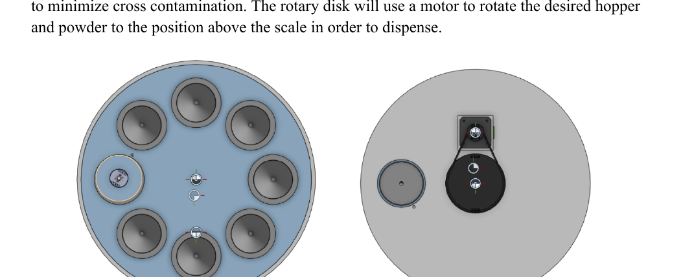
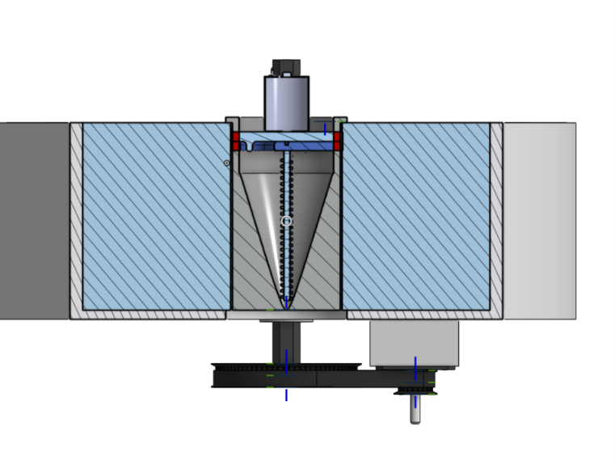

# 002 — Eight hoppers, but not sixteen motors

**Date:** 2026-06-15
**Milestone:** M1
**Type:** Achievement

## What I'm doing

Starting the actual design today. The machine is a pill compounder. Basic shape is settled. A rotary disk with 8 hoppers in it. The disk turns whichever powder I need over the scale and dispenses from there. i started the CAD today too. What im figuring out now is how the hoppers get powered. Because thats where this design can get dumb realy fast if i dont think it through first.

## What happened

First idea was every hopper gets its own auger and its own agitator. Good for cross contamination since nothing is shared between powders. But then I counted motors. An auger motor and an agitator motor for each of 8 hoppers is 16 motors. Sixteen motors is expensive. Heavy. A wiring nightmare. And sixteen motor drivers. All of it, just too turn screws. And most of them would be sitting their doing nothing. Only one hopper dispenses at a tmie. So fifteen motors would be dead weight at any given moment. Pretty bad trade for a machine thats supposed to be simple.

so the plan lowk did a 180. Instead of a motor per hopper, two motors sitting above the one slot thats over the scale. They clip into whichever hopper rotates into that position and power its auger and agitator. Each hopper keeps its own auger and agitator, so powder never touches another powders parts. But the motors are shared. Two motors total doing the work of sixteen. The auger and the agitator touch powder, so every hopper needs its own. The motors never touch powder, so they can be shared. Cross contamination stays solved because nothing powder touches is ever shared. And the motor count stays sane because the expensive moving parts are the ones that get shared.

Picking teh dispensing mechanism wasnt really a debate. Im going with an auger. Every turn moves a consistent amount of powder. Which is what I need if this thing is going to hit a target weight instead of just dumping. A vibrating chute or a flap would be simpler too build and impossible to control. So the auger stays. Every turn moves a consistent amount and thats what hitting a target weight needs.

Why a rotary disk instead of eight fixed hoppers in a row. Theres one scale and one place powder comes otu. Eight fixed stations would mean eight scales or a moving scale. Both dumber than a disk that just turns the right hopper over the one scale. And the drive has to be pararell whith the hopper it clips into or the whole clip-in idea doesnt work. So the alignment matters even though there is only one drive position.

## Today's results

Concept is locked. 8 hoppers around a rotary disk. Each hopper with its own auger and agitator. One clip-in drive with two motors above the dispensing slot. Auger for metering. Teh motor math is what makes the rest of the machine buildable. 3 motors instead of 16. Cross contamination stil solved because the powder-touching parts are never shared. And the whole thing is alot more effecient than sixteen motors sitting idle. Three motors for eiight hoppers and 1 scale. Pretty clean split between the parts that touch powder and the parts that dont.

## What's still left to do next time

Prove one hopper works before printing disk. If a single hopper and auger cant dispense one powder accurately there is no point building eight of them. So first milestone is one hopper, printing and testing. And the agitator isnt in yet either. Thats planned for later once the basic dispensing works.

**Total time spent: 3 hours**
