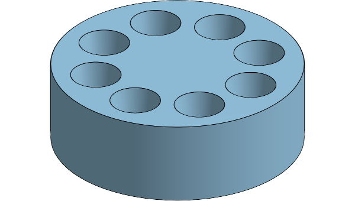
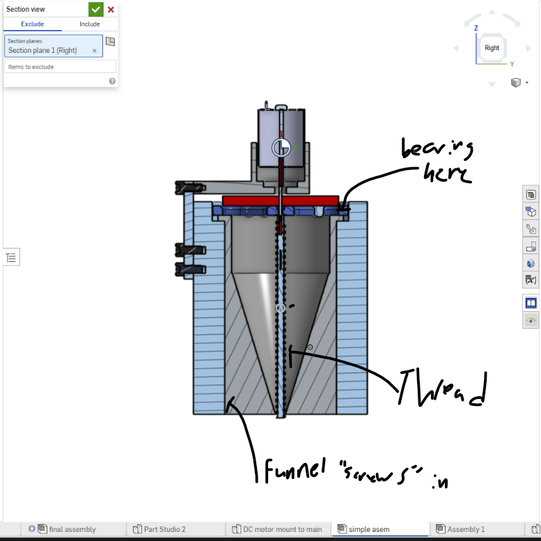
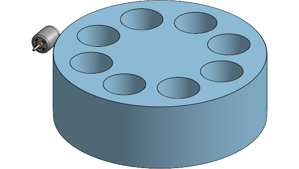
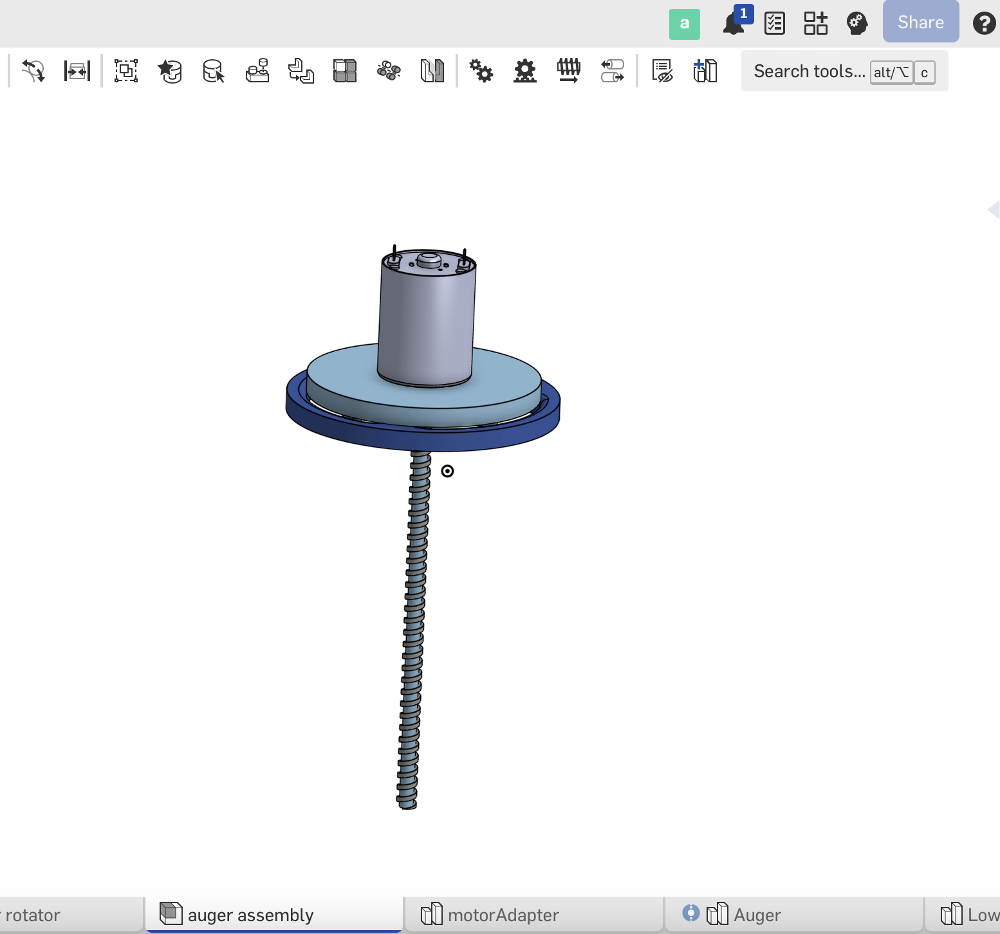

# 003 — First hopper in CAD: tube, funnel, screw

**Date:** 2026-06-18
**Milestone:** M1
**Type:** Achievement

## What I'm doing

Designing the single hopper first, befor any disk. The whole machine depends on one hopper being able to hold powder and push it out the bottom in a controlled way. So if I get this one part right the disk is just eight copies of it arranged in a circle. 

## What happened

I am building the disk first, then the funnel. The first version is just the rotary disc. A blue cylinder with a ring of circular pockets cut into the top face. One pocket per hopper. And at this point the assembly hsa exactly one part in it, the disc. 

The funnel is with a thread cut into the stem. A 2 1/4-4 1/2 thread, 10 cm deep.. Powder sits in the tube and theres a Theres a funnel at the bottom. And the auger runs down the middle and pushes powder out through the funnel. The motor sits on top and turns the auger. and i did a section view and annotated it by hand so I could think through what connects to what. Bearing at the top where the shaft comes through. The thread where the funnel screws in. The funnel itself at the bottom. The thread is there becuase the whole M1 idea is that this thing has to come apart for cleaning with minimal tools. Powder gets everywhere, and if you cant take the hopper off the funnel and wipe it down, the machine is useless after one powder. A thread means no tools, just unscrew it. That was the reasoning, anyway. And it wont survive contact with a real printer, but that is a problem for later.

I also tried a different motor that afternoon, a GF7, plus an idea called "Spinning Big Arm". And it went nowhere. First dead end of the project, day one lol. 

The auger is a profile swept along a spiral path. The shaft is a circle wtih a 2.5 mm radius, so the auger is a long screw with a 5 mm shaft and a spiral flight wrapped around it. And the flight is the part that moves teh powder. The shaft is just the spine it hangs off.

And the same day brings in the NEMA 17 stepper (a 17HS4401) and a DC motor mount. Plus a 160T 3M belt and a robot shaft. And a first build that puts a small DC motor and the auger together. So there are two motor ideas in one day. A stepper, which can count turns and stop exactly where you tell it. And a small DC worm-gear motor, which is cheap and simple and already on hand. And the DC motor is the experiment. A DC motor cant count turns the way a stepper can, so it was never going to be the dispensing motor. But i researched online and the reason I thought a dc motor could work is that the gear ratio would make it accurate emnough for our needs.

And an hour later, another change adds the motor adapter. A disc about 60 mm across with three posts on it that the motor sits on. And the Lower plate. And the adapter is the piece that connects the motor to the auger. Motor on top, adapter disk, long screw underneath. And it looks simple sitting in CAD. Everything looks simple in CAD. And a few milimeters of error in the adapter would throw the whole shaft off. Which is the kind of thing I only notice once I try to fit it together.

The last day is cleanup. And by then the document was a total mess. Half of it old imports and dead ends. And I couldnt find anything. so i cleaned up the onshape document. The disc copy got renamed. A dead part got deleted. A "stationary disc" folder got made. And a couple of dead parts got deleted. And I also did a cleanup pass that deleted the old imports and sorted the rotary disc and funnel into folders. And there was alot of junk in there. Boring work. But the Doc went from unusable to navigable. Which is what the next three days needed And the parts arent diagnal or anything clever. It is just a pile of parts that needed sorting. 

## Today's results

One hopper design exists in CAD now. Tube, funnel, auger, motor mount. And a section view that shows the whole powder path from top to bottom. The auger is a real spiral screw, not a placeholder. The disk has its pockets. The motor question is still open, stepper vs DC. But both are in the doc now. And the connection I am least sure abotu is the thread between the hopper and the funnel. Because the hopper has to come apart easily for cleaning. 

## What's still left to do next time

Print it. The auger is the frist print and I already know long thin screws are annoying to print. So that is the first test. Then the threaded hopper and funnel pair, to see if the screw-in connection works in plastic the way it works in CAD.

**Total time spent: 8 hours**
