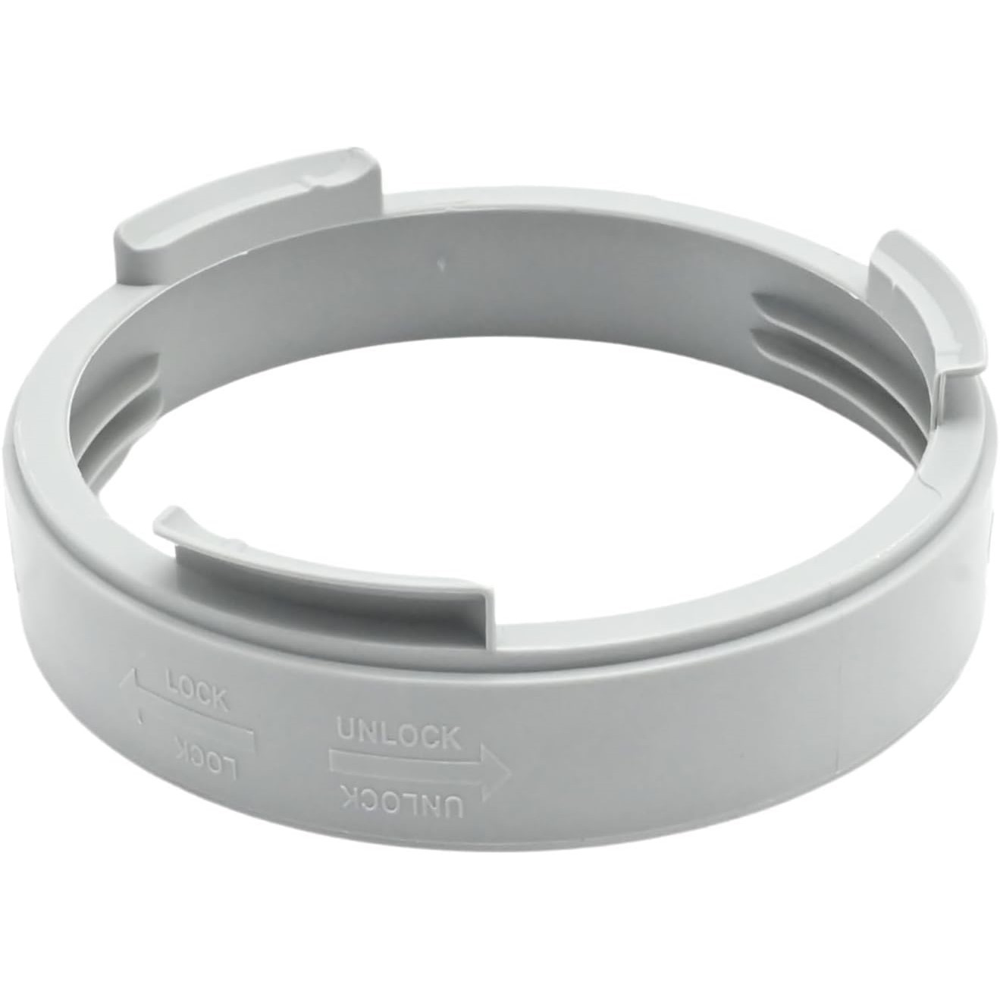
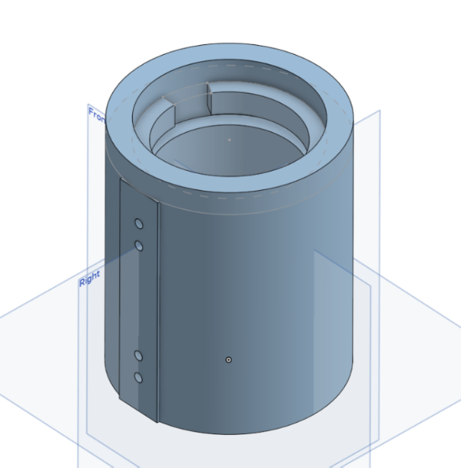
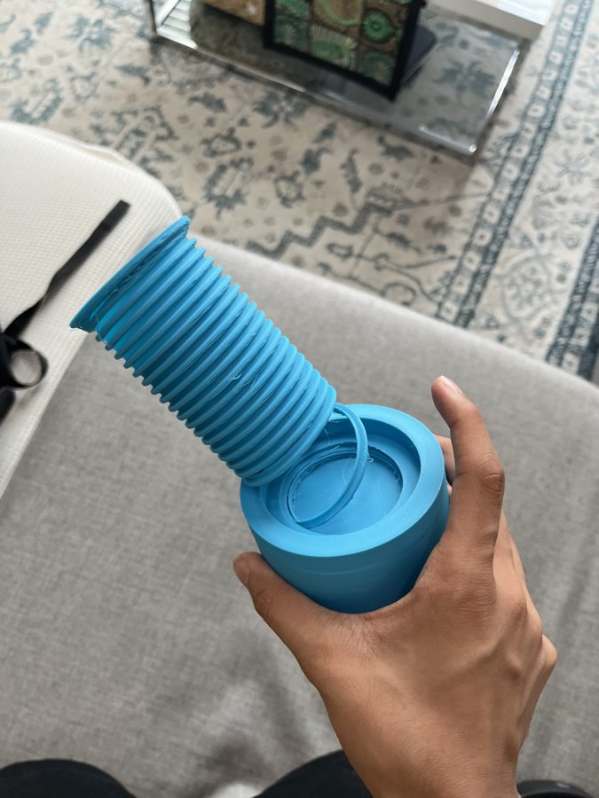
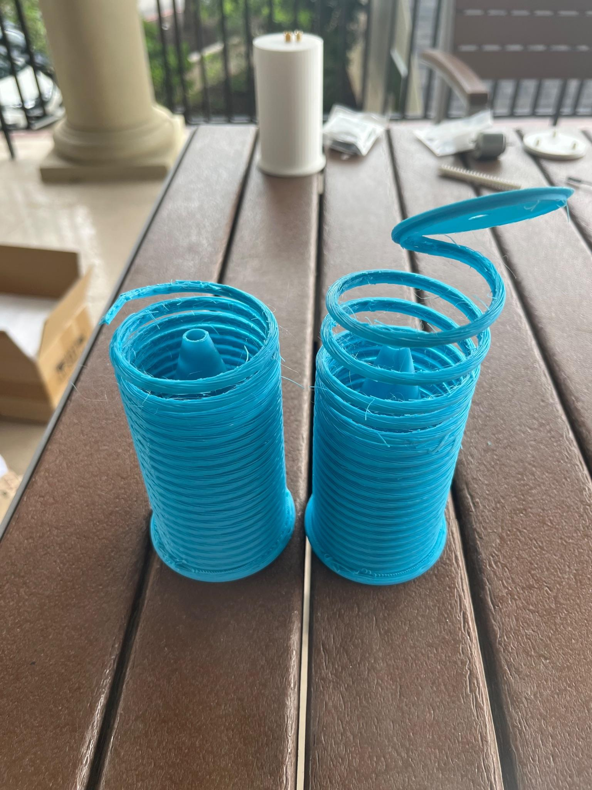
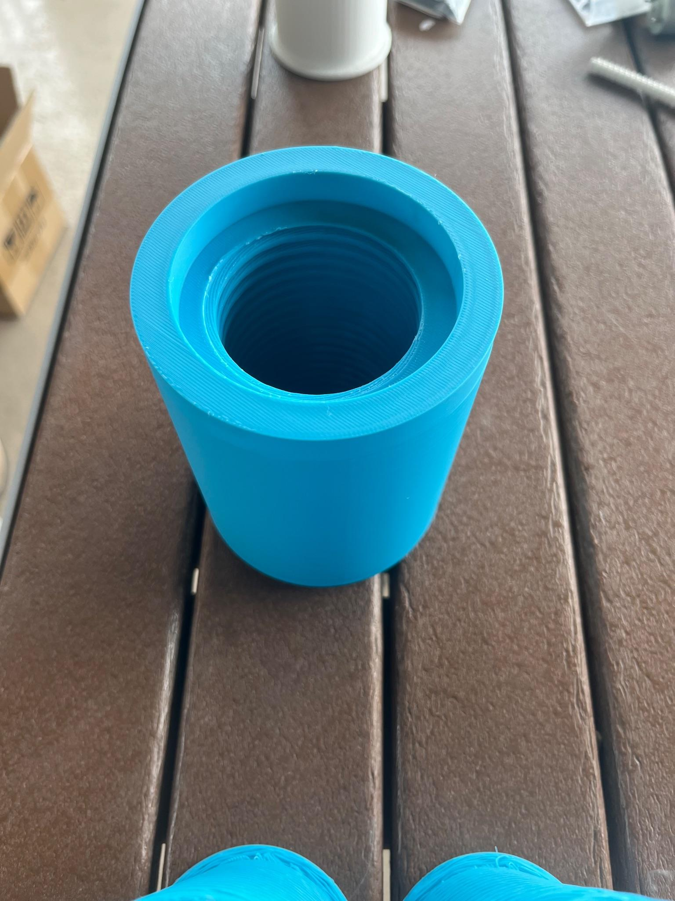

# 006 — The thread fails and the latch replaces it

**Date:** 2026-06-21
**Milestone:** M1
**Type:** Roadblock

## What I'm doing

Two things so far. Restructuring the CAD document. And settling how the hopper connects to the funnel, thread or latch. The thread was the original plan. The latch is the alternative. i researched the latch by looking at how a blender locks its jar on. Because I wanted a connection a printer coudl hold tolerance on, not another pretty CAD thread.

## What happened

 The cleanup got rid of the old imports and the old assembly and left the doc cleaned up so it makes sense. And the disc got hole and thred work. 3 1/4-4, 1/4-20, and Ø 6 cm holes, all 10 cm deep. Plus an external thread. And a few dead parts got deleted.

But the real change is in the final assembly. It went from 2 loose parts with nothing holding them together to 7 parts fastened together. The disc plus the auger fastened together. And the model looks completly different. The disc is a tall grey drum now with the auger and motor unit sitting on top and one circular recess on the top face. Instead of the flat blue disc from the start. Same parts. Completely different machine on screen. Half an hour later the disc gets reworked again. The angles adjusted. The auger spiral edited. And the top recess gets shallower. Same drum, slightly different.

And then the latch. I looked at how a blender locks its jar on and copied the geometry. The funnel gets two slits cut into its sides and the hopper end gets two extruding slabs, tabs, that line up with the slits. And the hopper drops in flush, twists, and the tabs catch behind the slits so it is locked in position. And and pulling it back out is the same move in reverse. A slot is a slot. It either fits or it doesnt. And if it is loose I change one number instead of re-cutting a whole thread profile and hoping. Because a thread needs the printer to hold a precise helical groove that has to turn with almost no tension. And that is exactly the kind of thing a printer is bad at. And the latch also keeps the thing I wanted from the thread in the first place. The hopper comes off with no tools so it can be wiped clean. Which is what I wanted the thread for anywyas.

But designing it made me stop and think about whether the hopper needs to come off at all. The latch works. But it is still two parts with a seam between them. And seams are exactly where powder hides when you are cleaning. And either way the same pocket has to be wiped down. And a detachable hopper just creates more surfaces that need rigorous cleaning. And the next step might be combining the funnel and the enclosure into one part. Or just carving the hoppers straight into the rotary disk so there is nothing to take apart. But right now I am still trying to mkae the detachable version work.

the thread was not dead yet. I was still working it in cad. There is a screenshot of the thread settings on my phone from that day. Me going through the thread profile for the hopper stem. And the thread in the model was the 2 1/4-4 1/2 cut from the first version, 10 cm deep. i wanted to believe it would work. But the plan was to stop arguing about it in CAD and test it for real. Print both halves and screw them together. And I kept the latch in CAD untill the test. Because I didnt want to throw away the backup before I knew the thread was dead.

today is the test. Both parts printed, blue filament, threads on both. And the prints themselves came out fine. That is the annoying part. The problem starts when I screw the hopper into the funnel. It goes in ok for the first bit and then gets progressively harder to turn. And the thread starts to crumple and fray apart instead of sliding. And you can see it in the photo, the top of one has the thread peeling up in a spiral where it got chewed. And the real issue is I can't print grooves accurate enough for a thread that needs to turn with very little tension. A printed thread isnt a machined thread. The tolerances are too sloppy. So instead of screwing smoothly it binds. And once it binds the plastic just destroys itself. And more retries with slightly different sizing isnt going to change that. It is the wrong mechanism for a 3D print, not the wrong size.

And I don't want to spend a week tuning thread clearances and end up in the same place. Because the printer is the limit, not the numbers. And the thread was the whole reason the hopper was designed to come apart in the first place. The M1 idea was minimal tools, easy cleaning, unscrew and wipe. And a connection that gets harder to unscrew every time and damages itself doing it fails the one job it had. And that stings a bit. Becuase I spent three days on a connection that was never gonna wrok in plastic. And the latch was sitting there the whole time. And the accomodate-the-thread approach would ahve just been more of the same. so i stopped

## Today's results

Threaded hopper connection is dead. The latch wins. Two slits, two tabs, twist to lock, no thread involved. And the document is restructured and the assembly is fastened together for the first time. And the bigger question is still open. If the hopper has to come apart at all? And either way the same pocket has to be wiped down. And a detachable hopper just creates more surfaces that need rigorous cleaning. And the next step might be combining the funnel and the enclosure into one part. Or just carving the hoppers into the disk itself so there is nothing to take apart. And the latch doesnt fix the seam problem. It just makes the seam easier to open. Which is not the same thing. And I need to remember that before I build the latch version. Because building it might be building the wrong thing twice.

## What's still left to do next time

Build the latch version and test it. The slits and tabs are already in CAD. So print the funnel with slits and the hopper with tabs and see if it locks and unlocks cleanly. And also the auger still needs to print reliably. And nothing has had powder in it yet. So far everything has just been plastic spinning in air. And then powder tests. Sugar first, because sugar flows easily and will show me if the auger geometry itself is right before I fight with harder powders.

**Total time spent: 8 hours**
