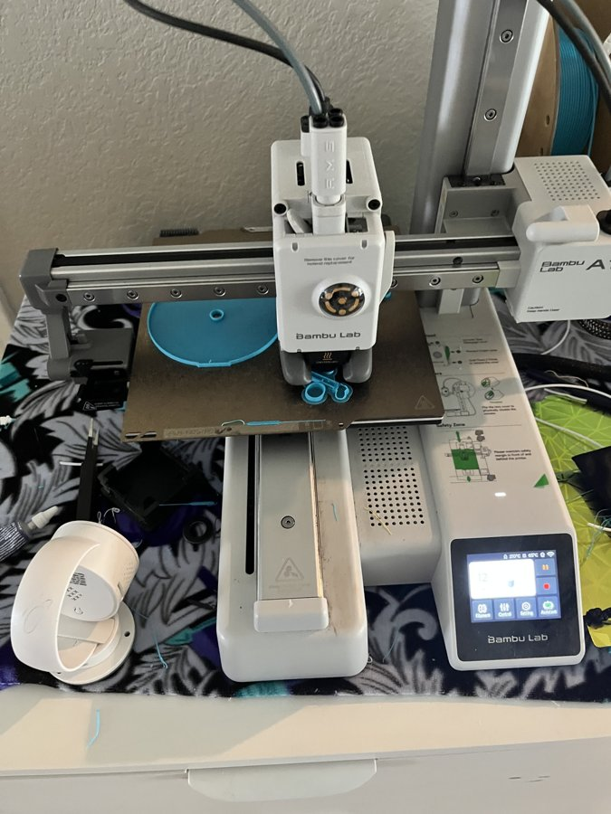
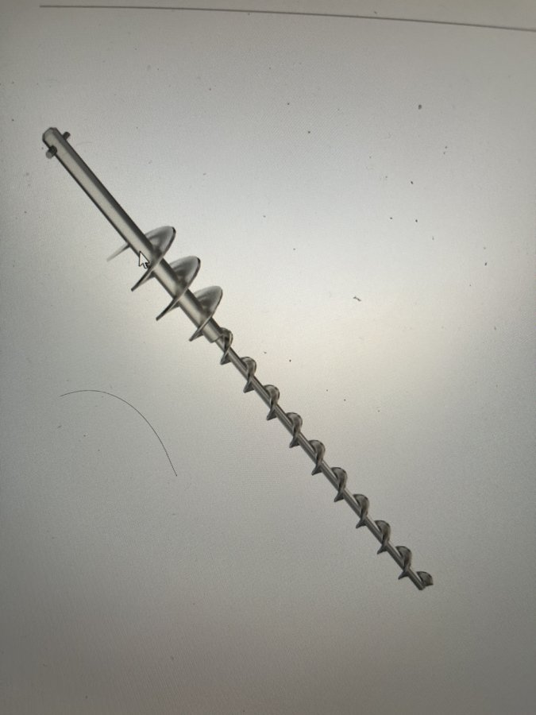

# 004 — The auger print won't stick, glue fixes it and a brim

**Date:** 2026-06-24
**Milestone:** M1
**Type:** Roadblock

## What I'm doing

Printing the auger. It is the part everything depends on and it is also the worst shape to print. Tall, thin, with a screw thread wrapping around it. so the contact patch on the build plate is tiny compared to how tall it gets. And im already expecting trouble because a tall thin screw is a lever that wants to peel itself off the bed the higher it goes.

## What happened

The adhesion kept failing. A print that tall on that small a base wobbles as it gets higher and eventually lets go or shifts. And then the rest of the screw prints into air or into into a leaning mess. And i lost prints to this before I got clean ones. Every failed auger is a couple hours of printing gone. And it is kinda the same failure every time. The frist layers look fine. The print gets taller. It starts to wobble. And then it is done. And the worst part is how normal the first layers look. Their is no warning. It just lets go halfway up.

The thread does'nt help at all. It sticks out sideways and catches on nothing. It just adds overhang and weight up high while the base stays tiny. So the taller it gets the worse the leverage gets. And the print was'nt failing because of the thread geometry. It was failing because a tall thin thing on a tiny base is'nt stable unless the base is stuck down.

The fix turned out to be boring. Glue on the build plate with a big brim. With the base stuck down properly the auger prints clean all the wya up. Just glue lol. And i spent time asuming the problem was something interesting. Temperature, speed, the thread geometry. And it was just that a tall thin screw needs its base glued dwon like everything else tall and thin. And the quanity of glue does'nt need to be much. A thin layer is enough. It just has to hold the first layers while the rest of the screw goes up. And im annoyed at myself for not trying it first, because the neccessary fix was sitting on my desk the whole time.

## Today's results

Auger prints reliably now with glue for adhesion. Small thing but it was quietly eating hours. And it is worth writing down because future me will definitely forget and wonder why prints are failing again. It is the glue. It is always the glue lmao. And im writing it here so I dont have to relearn it on the next tall print.

## What's still left to do next time

The auger is only half the hopper. And the thread is already dead as of yesterday. So the latch version is next. The agitator still does'nt exist. And also the prints I do ahve need actual powder in them. So far everything hsa just been plastc spinning in air. And sugar is the first test becuase it flows on its own.

**Total time spent: 3 hours**
