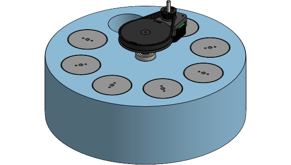
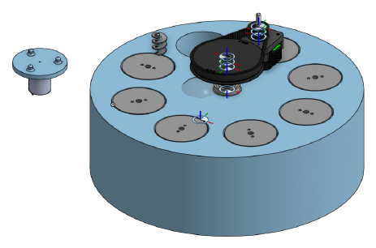
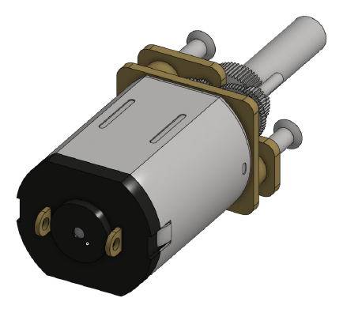

# 005 — Seven versions in one day

**Date:** 2026-06-27
**Milestone:** M1
**Type:** Achievement

## What I'm doing

Auger prints are running so im stuck in CAD all day. seven rounds of changes. The disc kept changing shape every time I changed something and honestly most of the day was just me stairing at it trying to figure out what I even did.

## What happened

The motor stuff is the big thing. A whole micro-metal motor set showed up at once, motor assembly, straight gears with Portugese names on them, the motor parts, the STEP file, plus a new housing tube and a DC motor mount. And a simpler assembly around the auger. So the old DC worm gear motor is out, auger and its parts go in instead.

And then the disc just changes. It was the tall grey drum, now its a flat blue disc with 8 grey pocket containers on top and the black auger and motor unit sitting on it. Same parts underneath. Completely different machine on screen. I cant tell you which change did it because tehre wree lkie fifty of them and I didnt track each one. All I knwo is the part list and the render lol. Flat disc, eight pockets, auger on top.

Two of the saves are just checkpoints with nothing in them. I save like that when working, it pays off once and then you just keep doing it forever. Then some small stuff on the rotary disc, a hole and a thread, hiding and showing things. Assembly looks the same, and then- Then the auger, which took forever, the profile and the spiral just reworked over and over, edits, deletes, put it back in. 

Then the housing tube. First circle is 57.8 mm across, thats the tube the powder sits in. Parts keep disapearing and reappearing while I shuffle things around, I stopped tracking why and just read the part list each time. few undos, some parts deleted, some shown again. Auger ends the day as a finished screw, Spiral flight and all, rounded edge on the end. Disc is a flat plate with eight pockets. Motor adapter is just a single 60 mm circle now, simpler than when I built it.

## Today's results

Doser is a real assembly now. Flat disc, 8 pockets, auger and motor unit on top, housing tube sized, auger actually built out. Seven rounds in about eight and a half hours. The thing on screen finally looks like the thing in my head. At least the M1 half of it.

## What's still left to do next time

Powder tests. CAD is way ahead of the actual machine rigth now. Sugar first through the printed hopper, see if any of this works outside the screen. Tomorrow is plastic and powder

**Total time spent: 5 hours**
