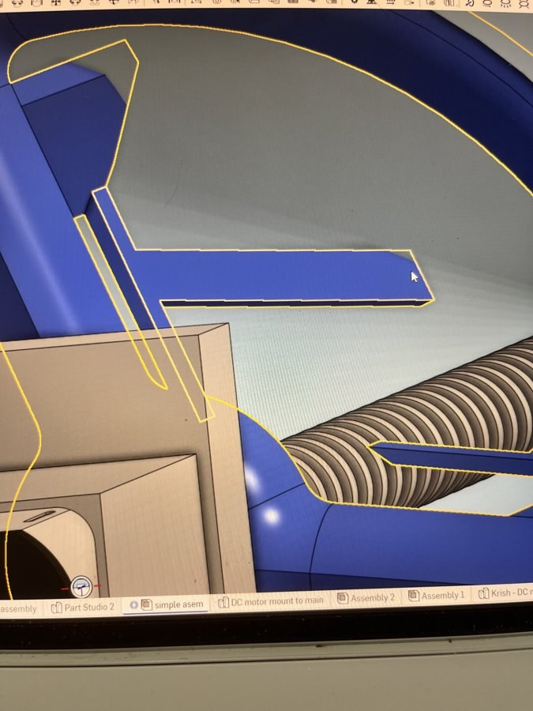
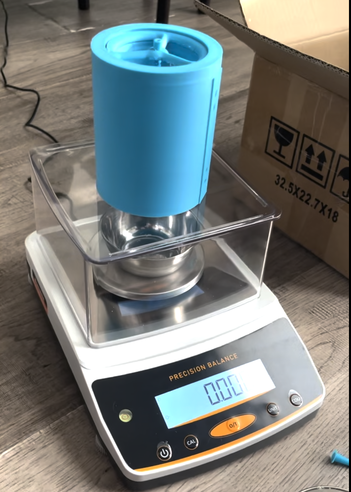

# 008 — Sugar falls out before the motor even starts

**Date:** 2026-07-01
**Milestone:** M1
**Type:** Roadblock

## What I'm doing

First real powdre test. Sugar. Because it flows easily and should be the friendliest possible case. Hopper loaded, auger in. Time to see if the metering idea form the reference design works in mine. 

## What happened

Sugar went in the top and some of it came straight out the bottom... Not while dispensing. Just while pouring it in. And the auger is supposed to be the thing controlling when powder moves. But sugar flows so freely that it just runs through the gaps around the screw and out the exit on its own. And a a dispenser that dispenses when it feels like it is not a dispenser. The problem is the exit, not the screw. The screw meters powder while it turn. But when it is standing stil the gaps around it are just open channels. And sugar is happy to flow through an open channel under gravity alone. So the fix is at the exit. the screw cant hold powder bakc when its not turning. Because the gaps are gaps whether the screw is spinning or not. And the exit is the only thing that can say no to gravity when the motor is off.

so i made the auger with a narrowr opening at the end. So there is resistance at the bottom of the screw. And the sugar can't just free-fall through anymore. It needs the auger turning to push it past the tight part. The tight exit is a gate. It holds the powder back when nothing is pushing. And lets it through when the screw pushes. The screw pushes, the exit resists. And the balance between them is what makes the dispense controllable. And the exit wasnt the part I was thinking about when I designed the screw. i was thinking about the flight and the shaft. But the exit turned out to be just as important. And the screw and the exit have to work together. The screw meters and the exit holds. And if either one is wrong the whole thing leaks or jams. And im glad sugar showed me that now, on the easy powder, instead of on cornstarch later.

It also taught me the exit geometry matters as much as the screw itself The screw meters the powder but the exit decides whether gravity gets a vote. And every powder after sugar is going to need its exit thought about, not jsut its screw. And the machine that works is the one where the screw and the exit agree wtih each other. And sugar is the powder that proved that. Because sugar is so free-flowing it finds every gap you leave it. And if the exit holds sugar, it will probably hold the rest.

## Today's results

Leak fixed. Sugar stays in the hopper when I pour it in and only comes out when the auger turns. So that is a relief lol. And the hopper on the scale is how I know, not by eyeballing it. Every powder test from here on is weighed, not eyeballed. And the scale is going to be in every test from now on.

## What's still left to do next time

Measure it. Run the auger in consistent turns and check what comes out each time. Me and the scale will figure out if "consistent turns" really means consistent amounts.  i need the numbers to back it up.

**Total time spent: 3 hours**
