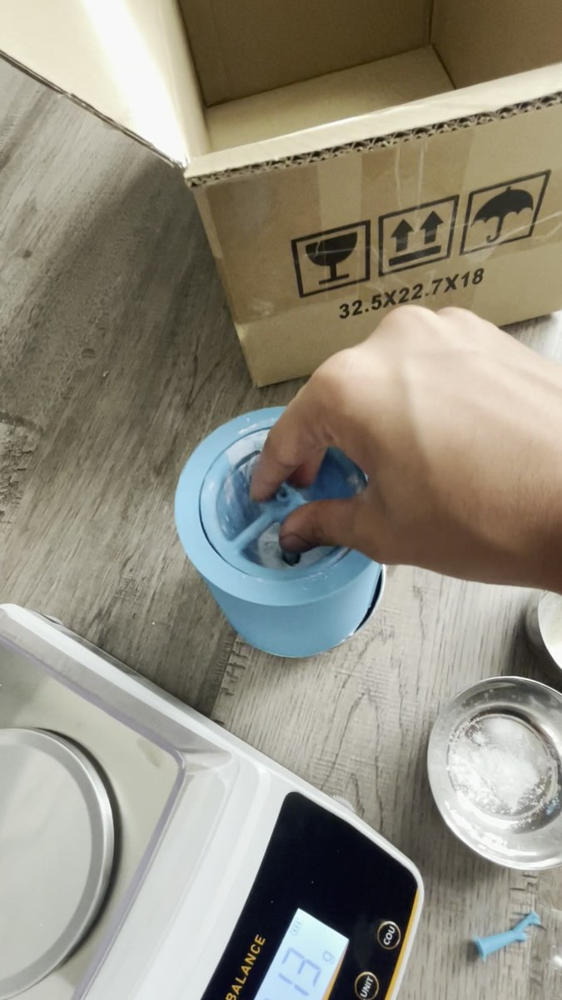
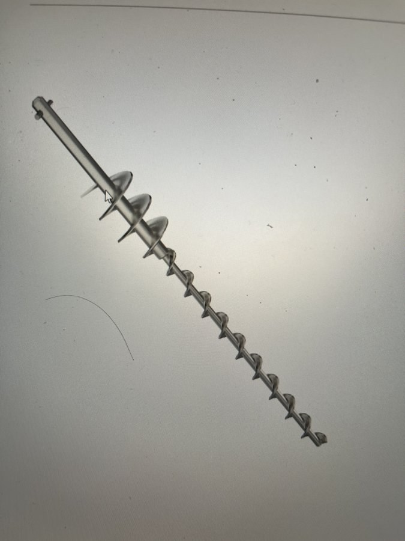

# 009 — Sugar is dispensing consistently

**Date:** 2026-07-04
**Milestone:** M1
**Type:** Working result

## What I'm doing

Ok so M1 comes down to one question. If I turn the auger the same amount, do I get the same amount of sugar otu every time. Hopper on the scale, turn, wiegh, do it again. That is the test. And the first thing I needed was a way to know the answer that was not just eyeballing a pile of sugar. So the scale is the judge here, not me.

## What happened

It works!!! wtih the narrower exit on the auger, sugar comes out in the same amounts for the same turns of the screw, over and over. Turn it this much, get this weight. Turn it again, same weight agian. And it worked better than I though it would on the first real try. And that is the whole metering idea from the reference auger filler I looked at back at the start. Just vertical and in my hopper this time. The screw meters, the exit holds, and the weight repeats. The screw moves a fixed volume per turn, so teh same turns move the same powder. And the exit keeps gravity out of the eqation. So the only thing deciding the amount is how much I turn the screw.

The other thing sugar proved is it doesn't need an agitator at all. It just flows. There is always sugar falling into screw so the auger never starves. And so for sugar at least the simplest version of the design is enough. Which felt great after all the printing, tho. And i should enjoy that while it lasts because I already know not every powder is gonna be like this. And a a lot of the later work is going to be about powders that do not flow. So sugar being easy is a gift, not a guarantee.

And this test matters because everything after it kinda depends on it. The motor, the scale loop, the whole closed-loop idea. All of it assumes the auger is a reliable metering device. And if the same turns gave different amounts every time, no amount of software could fix that. Because the software would just be correcting something random. And sugar says the process isn't random. Same turns, same weight, over and over. And the componenets all agree with each other for once. Which is not something I get to say very often in this project.

## Today's results

First powder officially working. Sugar. Same dispense per turn. No agitator needed. And the single-hopper design is validated for a free-flowing powder. Which means the concept is real and M1 is most of the way tehre. And the test isnt a fluke. It repeated. Turn after turn, same weight, same result.

## What's still left to do next time

Cornstarch next. It is the opposite of sugar in every way that matters. Clumpy, sticky, doesn't flow. And the original plan was one hopper and auger design for every powder with only the motor movement changing. And cornstarch is about to test that plan hard. Adn I already know sugar was the easy one. so i am not expecting cornstarch to be easyaswell

**Total time spent: 2 hours**
