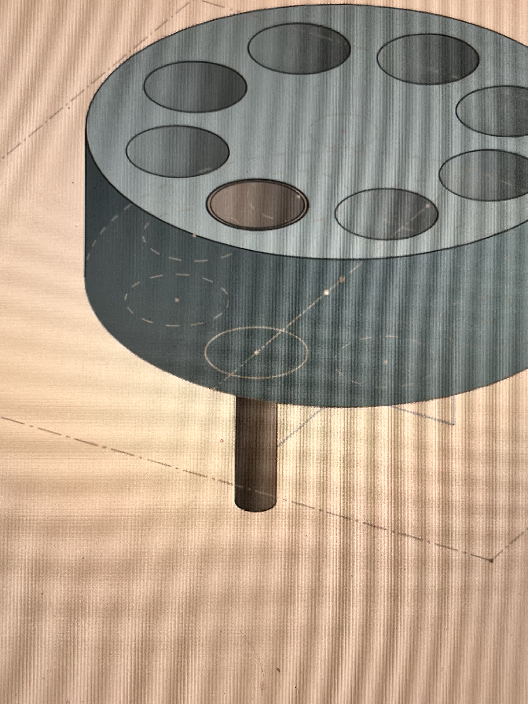
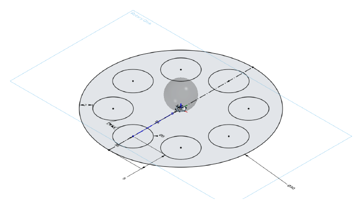

# 007 — No detachable hopper at all: carving them into the disk

**Date:** 2026-07-07
**Milestone:** M1
**Type:** Achievement

## What I'm doing

Making the call on the hopper conection for real this time. Thread failed. Latch works but I am not convinced. And i have already been modeling the disk with the hopper pockets in it while I test all this. First thing I need is to stop designing connections and decide whether the hopper needs to come off at all.

## What happened

The more I think about cleanig, the less the detachable hopper makes sense. It was detachable for cleaning. But either way, the same divot has to get wiped dwon. And a detachable hopper doesnt remove the cleaning. It just adds a second part and a seam between them. And the seam is exactly where powder is going to hide and need the rigorous cleaning I was trying to avoid. And thats teh part that kept bothering me. Because I was designing a solution that made the problem worse.

And the seam is not a small detail. It is the whole cleaning problem in miniature. A crack where powder collects and never comes out. And it is worse than just cleaning. This machine compounds pills, which means different powders go through it. And cross contamination is the whole reason the hoppers have their own augers in the first place. And a seam between two parts is a place powder collects and doesnt come out. And that leftover powder is the wrong ingredient in somebody's later dose. And a detachable hopper doesnt just add cleaning. It adds a contamination risk that the fixed version doesnt ahve. And that is alot worse than a cleaning annoyance. A cleaning annoyance wastes tmie. A contamination risk wastes a dose.

So. Final design. The hoppers are carved into rotary disk. One part. Nothing to unscrew. Nothing to latch. No seam. Less to clean. Less filamnet. Faster prints. And the disk CAD has been heading this way for days. The pockets was already in it. The first render is a disc with a ring of pockets. And every change since has kept them. The pockets were the design all along. i just spent three days arguing with myself about whether tehy needed a connection on top of them. And they dont. They never did.

The thread and the latch both go in the bin of ideas that worked on paper. The thread failed in plastic. The latch works, but it solves a problem I no longer have. If nothing detaches, nothing needs a latch. And that is the part that is easy to miss. I spent three days designing ways to take the hopper apart. And the right answer is to stop taking it apart. And the latch is a goood design for a problem I dont have anymore. Which is a weird thing to say about your own work lol. But it is true. And a seperate latch version would just be more parts to clean. More seams to hide powder in. And more filament for nothing.

## Today's results

M1 design is settled. Rotary disk with all 8 hoppers carved into it. Auger in each hopper. Shared clip-in drive from the concept. And this is the design I am building. And it is alot simpler than the version I started the week with. One part instead of two. No seam. No latch. No thread. And the disk sketch already had it. Ø30 disc, Ø6 pockets, eight of them in a ring. Which is the drawing the disk was built from. And I lowkey should have trusted the sketch sooner.

## What's still left to do next time

Powder. Everything so far is plastic and CAD. The design only counts once powder moves through it the way it is supposed to. Sugar already works but now we need to test on cornstarch, which I already suspect is going to be a problem because it clumps if you look at it wrong. And the disk wont prove itself until powder goes through it.

**Total time spent: 2 hours**
