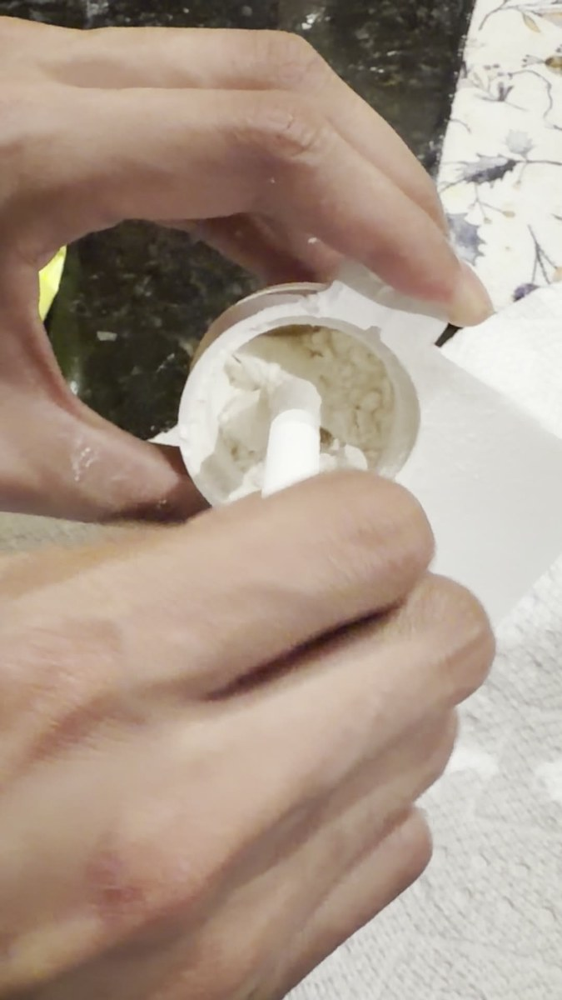
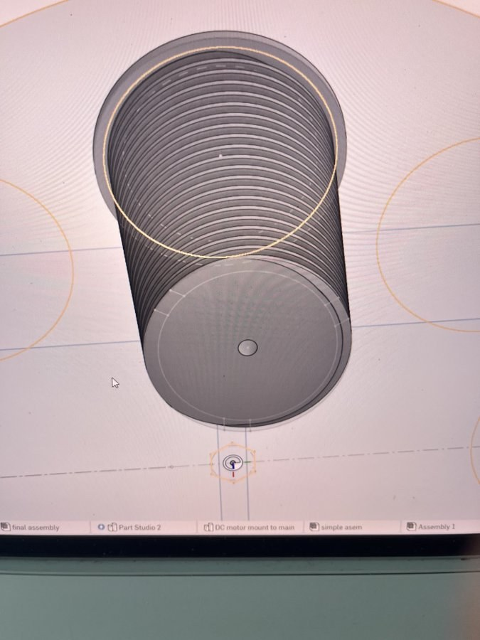

# 010 — Cornstarch jams the auger solid

**Date:** 2026-07-10
**Milestone:** M1
**Type:** Roadblock

## What I'm doing

Running cornstarch through the exact same hopper and auger setup that just worked for sugar. And the plan was one design for every powder. And this is where that plan goes to die. And the frist thing I needed was to see if sugar being easy meant anything at all. Or if it just meant sugar was easy.

## What happened

Cornstarch dose not flow. It clumps. And instead of falling into the screw and getting carried down, it packs together. The auger ends up trying to push a solid plug of powder instead of loose powder. And it jams. Repeatedly. And sugar falls inot the screw on its own. Cornstarch has to be convinced. And the sugar auger has nothing in it that does the convincing. The screw only moves the powder directly above it. So the clumps that pack together above the screw just sit there and get pushed as a plug. The threads are to tight and too shallow for a powder that sticks to itself. The clumps need room to grab onto the screw. And the sugar screw doesnt give them any. It just squashes them tighter. And the the jam is not a one-off. It happens every time lmao. Because the Geometry is wrong for the powder. Not because i loaded it wrong.

And there is a second problem hiding behind the first one. Even where it doesn't jam, there is cornstarch sitting in the hopper that the auger never touches. Out at the edges. Just stagnant. And the screw only moves the powder directy abvoe it. so part of the hopper is dispensing and part of it is just storage that never empties. Which for a compounding machine is a real problem. Because that leftover powder is the wrong amount of an ingredient sitting in a later dose. And the auger can't fix that by itself no matter how good the screw is. Because the screw's reach is the screw's width. And the hopper is wider than the screw. And that was annoying to figure out, tbh. Because it means the screw was never going to be enough on its own. And the edges are a few milimeters away form the screw at the closest point and a lot further at the far side. And no amout of turning the same screw is going to reach them. Because the screw is in the middle and the powder is at the walls. And that distance is the problem.

## Today's results

Cornstarch in the sugar setup. Jams. And leaves stagnant powder the auger can't reach. Two separate failures. And the screw geometry is wrong for clumpy powder and there is no mechanism keeping the whole hopper moving. And the one-design-for-every-powder idea is officially dead lol. Different powders are going to need different augers at minimum. And the auger arent the problem in the abstract. It is the problem for this powder, in tihs hopper, with this thread spacing. And that tells me what to change.

## What's still left to do next time

Two fixes to try. A wider auger with bigger threads for cornstarch specifically. So the clumps have something to grab onto and room to move. And an agitator that keeps the whole hopper cycling. Which i already know is coming because it is on tonight's fix list. And the agitator attempt so far has its own problem, next entry. And the wider auger wont fix the edges either. It will just jam less. So both fixes are needed, not just one.

**Total time spent: 3 hours**
