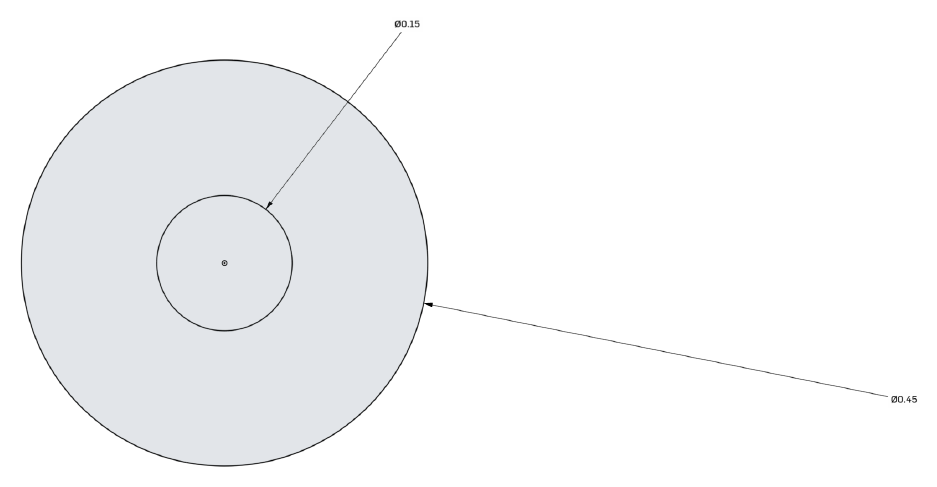
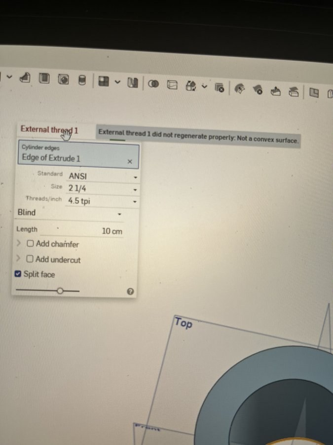

# 011 — A wider auger with bigger threads for cornstarch

**Date:** 2026-07-13
**Milestone:** M1
**Type:** Working result

## What I'm doing

Making a cornstarch-specific auger insteed of forcing cornstarch through the sugar one. Wider screw, bigger threads. And if clumpy powder jams because it gets compressed too tight and can't grip the screw, giving it room and grip is the obvious direction to try. And the first thing I needed was a screw that treats clumps like something to carry, not something to squash.

## What happened

It worked, mostly lol. And the wider auger with bigger threads lets the cornstarch grab the surface of the screw and get carried instead of packing inot a plug. Because the threads receive the clumps and pull them down instead of squashing them together. And the bigger thread spasing also means the powder isnt compressed as tightly in the tube. so it flows more smoothly and the jamming mostly stopped. And it felt great after yesterday. Because yesterday was just jam after jam and today the powder moves.

The spacing is the trick here. A clump needs a gap it can sit in. And the wider threads give it that gap. So the screw carries the clump instead of fighting it. And the powder moves down the tube instead of packing into a plug at the top. And dont underestimate how much of a difference a few millimeters of thread spacing makes. Because the sugar screw and the cornstarch screw look almost the same until you put powder in them. And than tehy behave like completely different machines.

Not perfect though. It is relatively consistent with an acceptable error margin. pretyt much it dispenses and the amounts are close enough for now. But cornstarch is never gonna behave like sugar no matter what screw I put udner it, and- And the design needs streamlining too. Right now there are just multiple augers floating around for different powders and i need a system for that. Which auger goes with which powder. And how the machine knows. And that is a problem for the sofware side later. But the physical answer is already decided. The machine carries different screws for different powders. Full stop. And the quanity of augers is going to keep growing if I dont get a system for it. Because every new powder is going to want its own screw. And a seperate screw for every powder is fine as long as I know which one is which. Which i dont yet. Not properly.

## Today's results

Cornstarch dispenses without jamming on the wider, bigger-thread auger. Acceptable error margin. And M1 now hsa two powders working, but on two different auger geometries. So "which auger for which powder" is a permanent part of tihs design from here on. And the wider screw isnt a universal fix. It works for cornstarch. And sugar still wants its own screw. Different powders, different screws. And the machine has to carry both.

## What's still left to do next time

The stagnant powder problem is still unsolved. A wider auger doesn't reach the edges of the hopper either. And that is the agitator's job. And my first agitator attempt already failed for a dumb reason. And also tonight's fix list has a tapered-thread auger and double agitators on it. So the auger experiments aren't done. And the edges are still sitting there full of powder the screw cant reach. Which is the next thing to fix.

**Total time spent: 3 hours**
