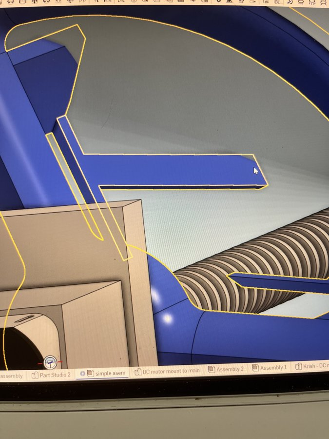
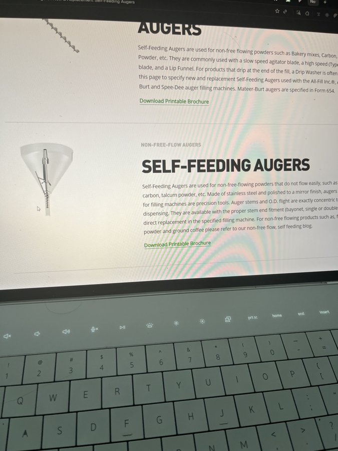

# 012 — The agitator print fails, it doesn't reach the walls

**Date:** 2026-07-16
**Milestone:** M1
**Type:** Roadblock

## What I'm doing

Trying to fix the stagnent powder problem with an agitator. Something inside the hopper that keeps all the powder moving toward the auger instead of just the powder directly abvoe the screw. and i CADed one and printed one. And the first thing I needed was something that reaches the walls. Because the middle of the hopper was never the problem. The edges were.

## What happened

The print failed. And looking at it, the design failed frist. And the agitator doesnt account for the full width of the hopper. It stirs the middle and leaves a ring of powder around the edges completly untouched. Which is exactly the powder that was stagnating in the cornstarch test. And an agitator that misses the edges is decoration lol. The agitator has to be shaped to hopper, not just roughly the right size. Because the job is the whole hopper, edge to to edge. And a paddle that roughly fits is what I printed. And it roughly works. Which is to say it doesnt. and im nto surprised it failed in print. Because the design was wrong before the printer even started. And the print jsut made the wrongness visible.

What the agitator has to do is scrape the edges of the hopper as it turns. Physically push the wall powder back into the middle where the auger can grab it. And that means it has to be designed to the hopper's exact inner shape. Not just be a paddle that roughly fits. The wall powder is the powder that never moves. so the agitator has to go to the wall. It can't just stir the middle and hope the edges follow. Because they wont. They just sit there. And the agitator has to track the wall all the way around as it turns, scraping as it goes. And if it is a few millimeters short it leaves a rign. And that ring is the problem again, just in a different shape. And this is the part of the build where the fix is annoyingly simple and i still had to print the wrong thing to figure it out. Because the agitator is not a separate little part you drop in. It is a part of the hopper's shape. Its job is the whole hopper, edge to edge, or the edge powder stays put. And alot of the design work in this project is kinda like that. The simple lesson you only learn by printing the wrong version first.

## Today's results

Agitator attempt oen. Failed print. Wrong size anyway. And the next one definitely scrapes the walls or it is not worth printing. And this also settles that the agitator isn't a small add-on. It is a real part that has to be designed per hopper. And im going to shape the next one to the hopper itself, not to a guess about the hopper. Because the guess is what failed me unfortuantly

## What's still left to do next time

The fix list I wrote tonight covers it. Mount two agitators on the bottom of the auger so they spin together off the same drive. Shaped to cycle the whole hopper. And that is the version to build next, along with the tapered auger. And M1's milestone write-up is due with what I have. Two powders working, a list of exactly what still doesnt. And the agitator is at the top of that list. Because without it the edges never empty.

**Total time spent: 2 hours**
