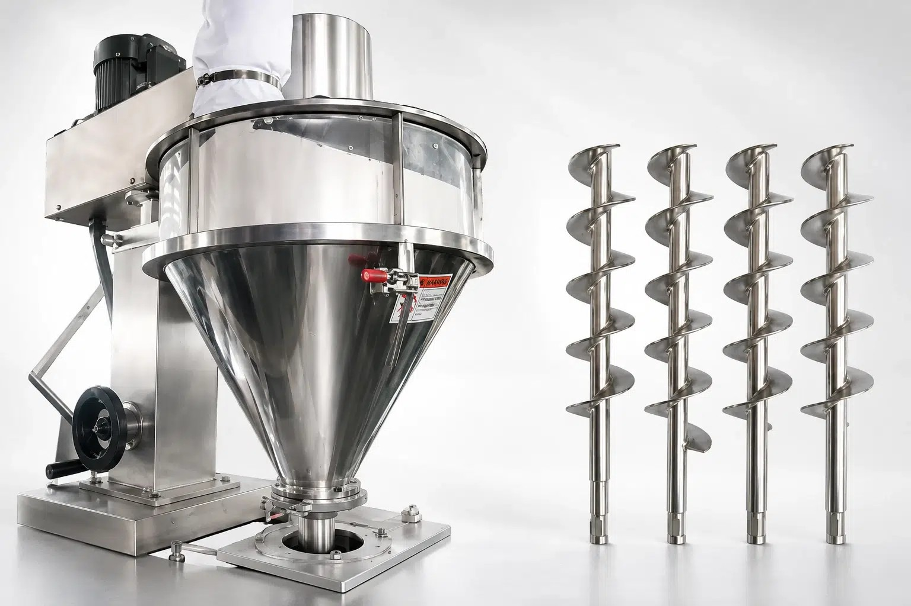

# 013 — Tonight's fix list: two agitators and a tapered auger

**Date:** 2026-07-19
**Milestone:** M1
**Type:** Roadblock

## What I'm doing

Writing myself a fix list before I foregt what the powder tests showed. And I literally made a doc called "STUFF TO FIX TONIGHT" so future me cant pretend he didn't know. And there are two changes. Both about the same problem. Powder that sits still doesn't dispense. And the first thing I needed was to get the list out of my head and onto a page. Because the tests gave me three separate answers and they all point at the same thing.

## What happened

First, the agitator situation. And right now their is no working agitator. The one print I tried didn't span the hopper so powder around the edges just sat there. And the fix I am going with is attaching the agitator to the botom of the auger itself. So when the auger spins the agitator spins with it. Same motor, no extra drive to sync, less wires to deal with later. And not one agitator arm, two. So the powder gets "agitgated" all the way around instead of one blade pushing a trench through it. And that is how the doc says it, typos and all. And it is still the plan lol. Two arms means the powder gets worked from both sides as the auger turns. One blade just pushes a trench and leavs the rest. While two blades keep the whole hopper cycling. And thats the difference between stirring the middle and moving the edges. And a a single arm was never going to be enough. i just didn't ssee it until I wrote the list down.

Second, a whole second auger configuration. And the current auger has uniform threads the whole way down. And the new one will have threads that funnel down, tapered, so the spacing changes along the screw. And different powders are clearly gonna want different screws. Sugar already proved it doesn't behave like cornstarch. So instead of one perfect auger I am gonna have two configurations. The uniform one with agitators attached. And the tapered one, also with agitators. And i have been reading up on auger types too. There is a whole thing about self-feeding augers I had open on my laptop yesterday. And the research page is the one I keep coming back to. Because there is mroe auger theory there than I expected there to be. And the agitator is part of it, not a separate topic. Which is the part I kept missing.

The powder tests gave me three separate answers and they all point at the same thing. Sugar works on the plain auger. Cornstarch works on the wide auger. And nothing works without something moving the edge powder. So the next build is two auger configurations, both wtih two agitators attached to the auger bottom. And then rerun sugar and cornstarch against both to see which powder wants which screw. And the list is a print queue now, not just a note. Because every item on it is a part I have to print before M1 is done. so tomorrow i print instead of remembering, lmao

## Today's results

Fix list is written down and specific. 2 agitators mounted on the auger bottom so they spin together. And a second tapered-thread auger configuration. Two auger setups total, not one. And the doser cad is also in the middle of a change sprint rigth now. A lot of auger changes landed in the last two days. And that is its own entry. And the list cant be much clearer than that. Two screws, two agitators each, rerun both powders. And tehn I will know which powder wants which screw.

## What's still left to do next time

Build both. Print the tapered auger. Print agitators that reach the hopper walls this time. And rerun sugar and cornstarch against both configurations to see which powder wants which screw. And then M1 is done and the scale/motor work starts. And the fix list is the whole next session, not a side quest. Because without it the edges never empty and the powders never behave.

**Total time spent: 2 hours**
