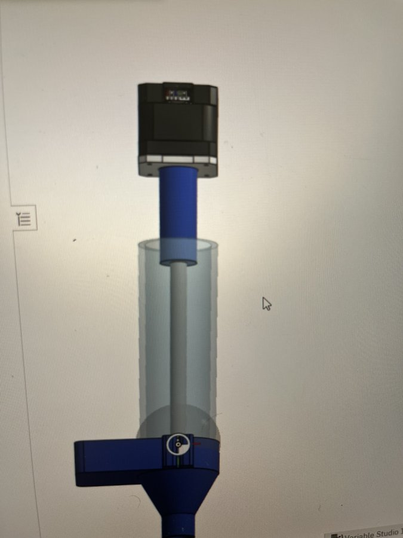

# 014 — Starting a second CAD document: newauger

**Date:** 2026-07-22
**Milestone:** M1 → M2
**Type:** Achievement

## What I'm doing

The doser document is geting crowded. It has the disk, the auger experiments, motor imports, all of it in one place. And i am starting a clean document for the next phase of the design. It is called newauger. Which tells you exactly what my priorities are lol. And the first thing I needed was a doc that only has the parts going into the machine. Not every experiment I ever tried.

## What happened

The single doser is getting mroe real in this document. And the version I am working on today has the motor mounted on top of the tube with the auger under it. Blue printed parts for the bottom feeder. The whole powder path in one assembly instead of pieces floating around. And tehre is even a breadboard modeld next to the motor mount in one of the studies. Which is me starting to think about where the electronics physically go instead of treating them as a later problem. And they are a later problem. But a soon later problem. The single doser in the new doc is one complete unit. Motor on top, tube, blue bottom feeder. The doser doc was doing two jobs and doing neither cleanly. It was the M1 archive of every auger experiment and also the place the real machine was supposed to come together. so splitting it means the new doc only has the parts that are going into the machine. And the old doc keeps the history.

Why a second document at all. Because the doser doc was doing two jobs and doing neither cleanly. And the risk is the two docs drift apart and I lose track of which one is true. Which is a real risk. But the doser doc was already unreadable. So it is the better trade. And the new doc doesnt have to carry the history. It just has to carry the machine. And a a seperate doc for the real machine is more effecient than one doc trying to be both an archive and a build. Because every time I opened the doser doc I had to wade through dead ends to find the parts that mattered. And that wasnt going to get better. It was only going to get worse as M2 added electronics.

## Today's results

newauger document created. Single doser assembly is coherent in it. And the design is shifting from "does a hopper wrok" to "how does this become a machine wtih motors and electronics attached". And the doser document stayed as the M1 archieve. And the new doc is where the machine lives now. Which is a cleaner split than trying to keep both jobs in one place.

## What's still left to do next time

Electronics. The motor on top of that CAD doesn't turn itself. And I need a driver, something to control it, and the scale in the loop. And honestly I should sketch the whole system otu on paper before I wire anything bc the parts list in my head keeps changing. And the breadboard in the CAD is a hint, not a plan. And the plan is the next thing to draw.

**Total time spent: 3 hours**
