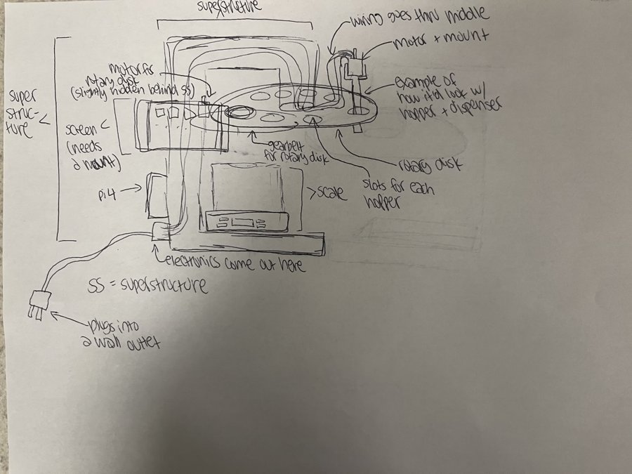
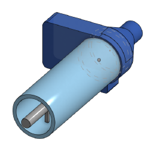
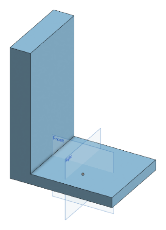

# 015 — Sketching the whole system on paper

**Date:** 2026-07-25
**Milestone:** M2
**Type:** Achievement

## What I'm doing

Before I wire anything I need the whole machine on one page. CAD is great for one part at a time and terrible for "wait, how does the scale talk to the motor". So paper. I need a picture where every piece exists at once, frame and disk and and drive and scale and Pi, arrows for what connects to what, instead of five CAD documents and a pile of intentions in my head. Thats what today was.

## What happened

I drew the whole system out by hand. Superstructure, thats the frame, labeled SS in the sketch because im not writing superstructure forty times. Rotary disk with the hoppers, motor and mount above the dispensing spot, scale underneath, Pi 4 off to the side running it. Arrows for what connects to what, a note abotu witch hopper is over the scale and how the drive reaches it. Its messy, my drawing skills arent the best lol but you get the idea. First time the entire machine is in one picture, mechanics and electronics and all, instead of five cad document and a pile of intentions in my head. A couple connections are just question marks in arrow form, mostly how the scale reading gets back into the dispensing decision. At least now the question marks are written dwon somewhere.

The sketch does something CAD cant do right now. It holds the whole system in one view while i still dont know half the answers. In CAD id have to decide the exact size of everything before I could even see the system. On paper I can put the Pi next to the scale wtih an arrow and a question mark and move on i dont have to loose track of which connection I was unsure about, its right there on the page. answers come later, in the wiring tho. The sketch's SS box already becomes a real part same day, an L-shaped plate for the superstructure. and the auger I drew in CAD, the screw inside a translucent tube, is one of the componenets the sketch has to hold together.

## Today's results

One complete system sketch. Frame plus disk plus drive plus scale plus Pi, connections mapped. So the M2 electronics shopping and wiring has an actual target now instead of vibes.

## What's still left to do next time

Wire it. Breadboard first, driver and motor, get a stepper turning udner control. Tehn bring the scale in. The sketch says the Pi runs the show, so the Pi has to run a motor and read a scale at the same time. Thats the next thing to prove, fr.

**Total time spent: 2 hours**
