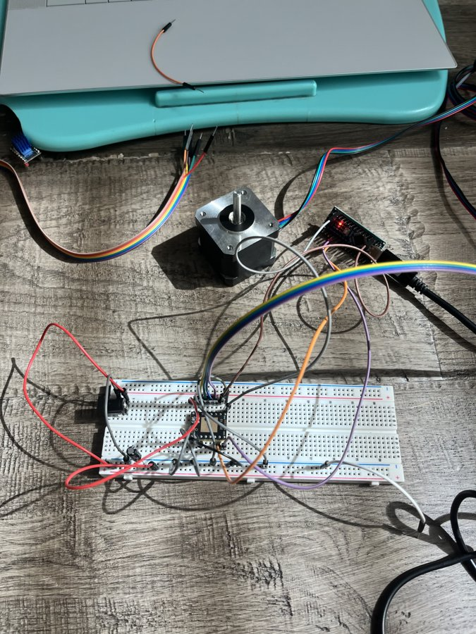
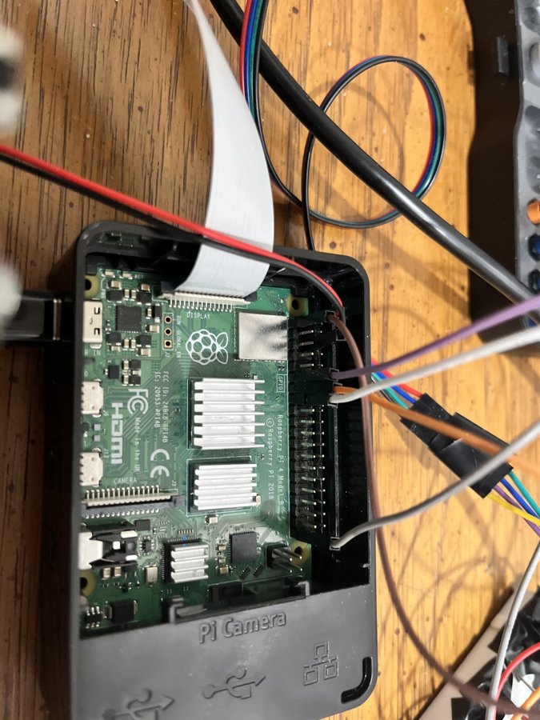

# 016 — Electronics start: breadboard, driver, and a lot of wires

**Date:** 2026-07-28
**Milestone:** M2
**Type:** Achievement

## What I'm doing

Starting the electronics on the desk. Up to now the auger has only ever been turned by hand or in CAD. M2 is a motor turning it under closed-loop control with the scale, and step one of that is a stepper motor alive on a breadboard.

## What happened

Desk is covered. Power supply brick, breadboard with the driver on it, a stepper motor, rainbow jumper wires going everywhere in the way they do when youre still moving things around every two minutes. honestly there were to many wires to keep track of by the end of the day. I have photos from today taht are just escalating levels of wire mess lmao, which is how you can tell its a real electronics day and not a staged one.

Progress looks kinda like nothing right now. Nothing is mounted, nothing is clean, half the work is figuring out which wire is which for the fourth time. Ubt the motor end of the system from my paper sketch exists on the desk nwo, physically. thats the jump from M1 to M2. I started on the breadboard instead of going straight to a PCB or a mounted board becuase nothing is decided yet. Driver choice, wiring, power arrangement, all of it is still changing every time I touch it. A breadboard lets me change it in seconds, a PCB woudl lock me into whatever I guessed on day one. My day-one guesses were not that good, so the mess stays for now. changing your mind is cheap on a breadbord, and doing it this way is just more effecient than redrawing a board every time I move a wire. The driver and the Pi meet on the desk today, and i wont pretend the the wiring looks good, it doesnt, but it doesnt have too yet.

## Today's results

Electronics bench is live, no way. Power, breadboard, driver board, stepper motor, all on the desk and being wired together. The doser is no longer just printed plastic.

## What's still left to do next time

Get the motor turning under program control, than the scale. The scale connection is its own adventure since it talks serial, RS232, which means an adapter board and more wires. After that the two halves have to meet, a motor program that listens to the scale. Thats the actual M2 milestone

**Total time spent: 5 hours**
