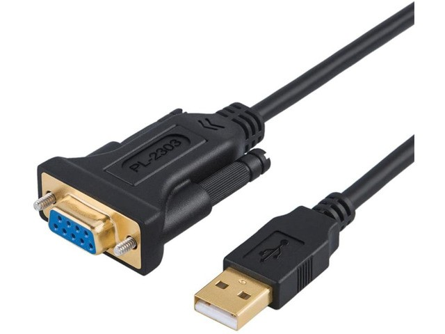
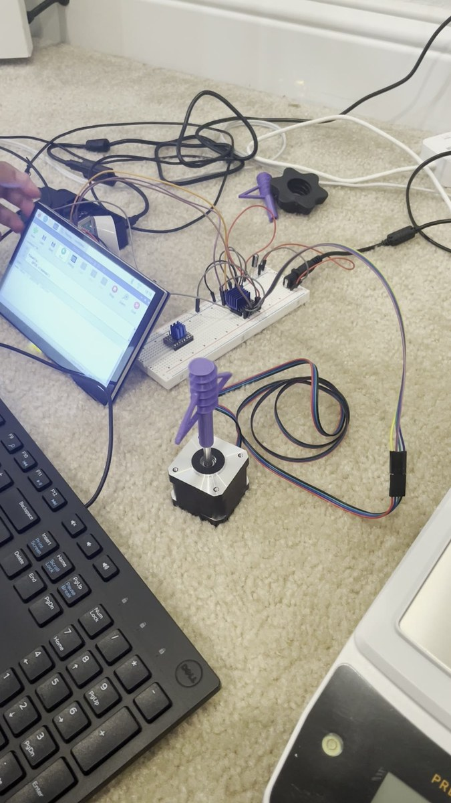

# 017 — Wiring the scale's serial adapter

**Date:** 2026-08-01
**Milestone:** M2
**Type:** Achievement

## What I'm doing

Ok so the scale is the other half of the closed loop and it dont speak USB, it speaks RS232 serial like its 1995. So today was adapter boards and more breadboard time, getting the scale's readings into a from the Pi can read. Nto glamorous omg. Still has to happen.

## What happened

The adapter is a little serial board and now its got the rainbow cable treatment too. Most of todays close-ups are just me documenting which wire goes where before i unplug something and and forget, because your the one who has to figure it out later and that person is also me. its a system, technically.

Without the scale readings getting to the Pi their is no closed loop at all. Hearing the scale turns out to be a hardware problem before its a software won. Once the readings land on the Pi, dispensing to a target becomes a program. Until they do its just a motor and a scale sitting near each other having seperate lives. This is also the frist time the scale stops being a lab tool I set a hopper on and starts being a component of the machine. The scale isnt for checking my work after the fact anymore, the scale, its the sensor the machine steers by. im starting to tihnk of it that way now.

## Today's results

Scale interface wired. RS232 adapter connected into the breadboard setup. Both halves of the loop, motor control and scale reading, are sitting on the desk now waiting to be combined in code.

## What's still left to do next time

The combining. Two programs, one taht runs the touchscreen side and one that dispenses using scale feedback, and making them talk to each other. Plus the powder work keeps going in parrallel, the hopper still needs its agitator sorted. That has beeen running alongside the electronics all week, fr.

**Total time spent: 4 hours**
