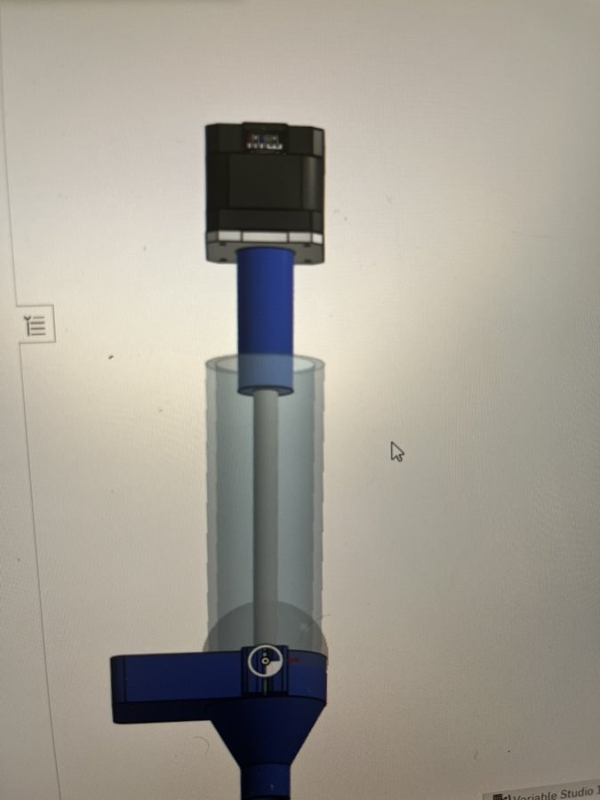
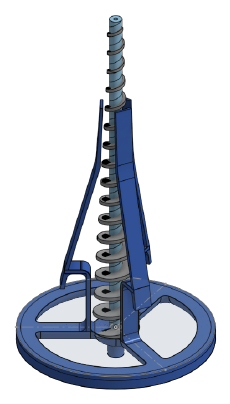

# 018 — Powder test with an agitator actually in the hopper

**Date:** 2026-08-04
**Milestone:** M1 → M2
**Type:** Working result

## What I'm doing

While the electronics come together Ive still got the hopper problem from M1 running in parallel, powder at the edges never reaching the auger. Tonight the hopper has an agitator in it, down in the powder. And there is cinnamon, or one of the brown powders, the photo doesnt label itself, dusted all thorugh it.

## What happened

Looking down into the hopper from the top you can see the difference the agitator makes. The powder is not sitting in a neat undisturbed layer, its worked through, coating everything. Its been getting moved around the whole hopper instead of jsut the column above the screw getting eaten away. That is the stagnant ring problem from the cornstarch test getting attacked properly.

This is the fix list from the 17th turning into actual hardware. Two weeks ago the agitator was a failed print that didnt reach the walls, and honestly i should of tested the new one sooner. But now there is one in a hopper with powder in it doing the job. I cant tell you the dispense numbers were suddenly perfect, this was a does-the-powder-move test, not an accuracy test, but the Powder moves lols. Their is alot riding on that one question because if the powder doesnt move the auger has nothing to meter. And the two track are finally meeting. The electronics bench hsa a motor and a scale, the hopper has an agitator and a working auger. The only thing left is making the first one drive the second one while the scale watches. Taht is M2, and its this week.

## Today's results

Agitator works in a real hopper with real powder. The whole hopper cycles, no stagnant ring, no way. Beteween this and the wider cornstarch auger, both cornstarch failures from M1 have working answers now.

## What's still left to do next time

Accuracy, with the motor and scale. that is M2 proper The mechanical side dispenses, now it has too dispense the right amount and stop itself. And the write-up for M2 is gonna be due soon to, so the closed loop needs to exist this week, not eventually.

**Total time spent: 3 hours**
