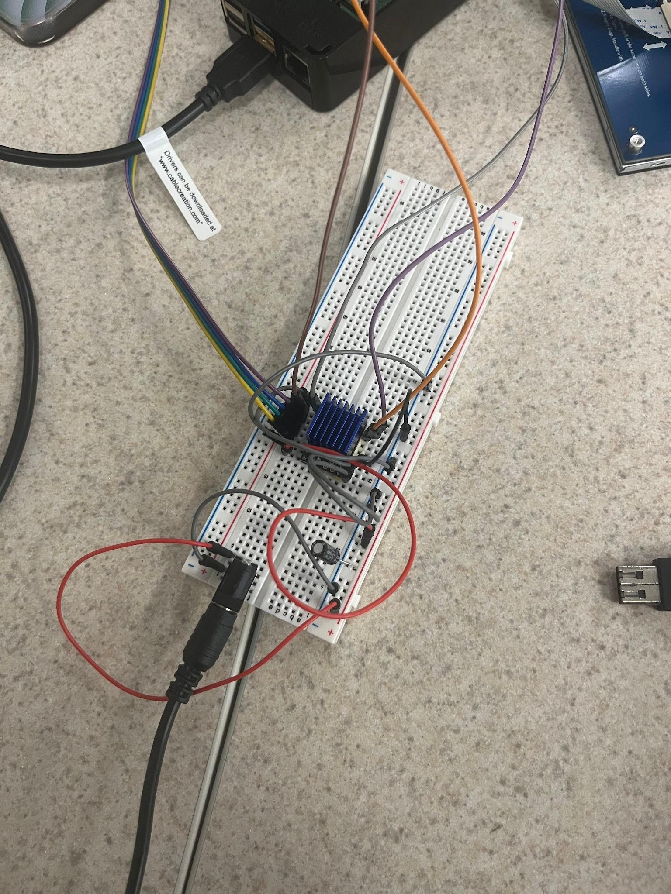
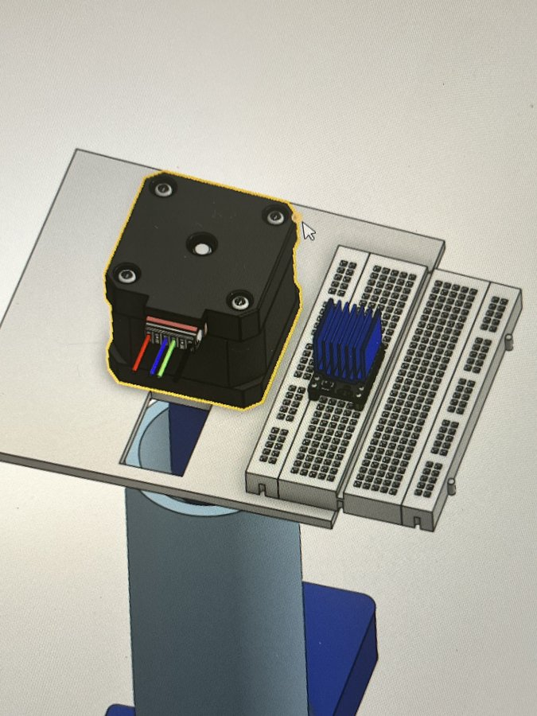

# 020 — The motor system: NEMA 17 and a TMC2209 on a breadboard

**Date:** 2026-08-07
**Milestone:** M2
**Type:** Achievement

## What I'm doing

Ok so M2 is doser plus scale, closed loop, one hopper, one auger, oen motor. The motor has to be a stepper so the Pi can tell it exactly how much to turn. The setup is a NEMA 17 stepper with a TMC2209 driver, wired on a breadboard, because everything lives on a breadboard until it works twice in a row.

## What happened

The early wiring sessions were me getting the pieces on the desk, and now it's an actual system. Pi wired to the TMC2209 on the breadboard, driver wired to the NEMA 17, motor ready to be coupled to the auger. The plan for the interface is in the write-up too. The user assigns powders to slots, types in how much they want, and machine dispenses it. Right now there is one slot and the user is me, but the shape of the thing is there.

A stepper because of the whole metering idea from M1. Turn the auger the same amount, get the same amount out. A stepper is the only cheap motor that makes that true, because it moves in exact steps instead of just spinning until you cut teh power. The NEMA 17 is the standard size for this kind of thing, strong enough to turn an auger full of powder. The TMC2209 is the driver that tells it how to step, quietly and wtih current control so it doesnt cook it self. If the driver is nto wired right you couldnt get nothing to move at all. The motor itself is already in the CAD, mounted on the plate next to the breadboard.

Breadboard becuase nothing is decided yet, and i already knwo im gonna hate it later lol. Driver choice, wiring, power arrangement, all of it is still changing every time I touch it. A breadboard lets me change it in seconds, a PCB would lock me into whatever I guessed on day one. so the mess stays for now, changing your mind is cheap on a breadboard. The motor arent coupled too the auger yet, that is a whole separate problem, the coupler, and it's coming in M4. Today the motor just has to turn when the Pi tells it too.

## Today's results

Motor system wired. NEMA 17 plus TMC2209 plus breadboard plus Pi, the doser has a drive now, omg. Whats left in M2 is the code and getting it to behave.

## What's still left to do next time

The scale side and the screen. The touchscreen arrived and needs wiring to the Pi, and the scale needs its RS232 connection finished so the Pi can read weights. Then the tow programs, the interface, and the one that dispenses.

**Total time spent: 4 hours**
