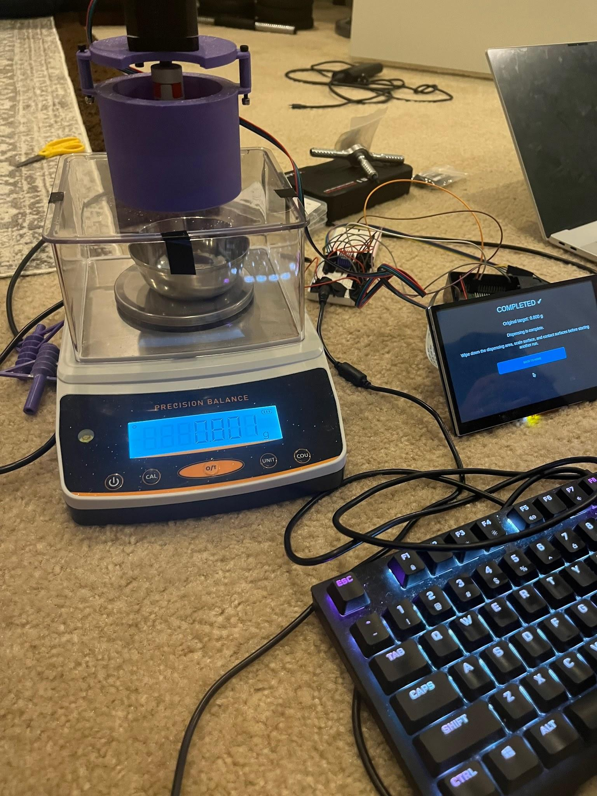
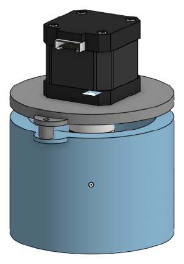

# 021 — The scale and the screen join the Pi

**Date:** 2026-08-10
**Milestone:** M2
**Type:** Achievement

## What I'm doing

Giving the Pi its two peripherals, eyes and hands. The touchscreen is the interface the user will touch, and the scale is suppose to be the sensor the whole closed loop depends on. Both nede to be talking to the Pi today.

## What happened

The touchscreen is wired too the Raspberry Pi 4. The scale connects thorugh one of the Pi's blue USB ports with the RS232 adapter in beteween, the serial setup from last week. The Pi polls it for weight readings continously.

And now the test setup exists as a complete thing for the first tmie. Hopper over the scale, scale feeding the Pi, Pi running the screen and the motor. I have a photo of the whole arrangement on the desk, hopper on the balance, screen alive next to it, keyboard still plugged in because we're not animals lol, everything is still in development mode. The scale connection is the part that took the most thinking. The balance is a lab instrument, it talked RS232 serial, and the Pi speaks USB, so the PL2303 adapter sits between them translating. The Pi polls the scale continuously, cycling through readings, which means the weight the program sees is always a few milliseconds old. That lag matters later, its the the reason sugar overshoots at the end of a dispense, because the scale is still catching up while powder is still falling. But today the important thing is just that readings arrive at all. The Pi can hear the scale now, and thats what today was for.

The screen is a 7-inch touchscreen, 800×480, the size the interface was designed for. Its the screen the user will stand in front of, assign a powder to a slot, type a number, and press start. Today its wired and alive, showing whatever the Pi shows. And the keyboard is still attached because the code is changing every ten minutes and im not desperate enough to start typing on a touchscreen yet

## Today's results

Pi plus touchscreen plus scale over RS232 plus motor driver, all connected. The hardware loop is physically closed, but the behavior is missing so far. Nothing yet decides keep dispensing, now stop.

## What's still left to do next time

Write the tow program. One with the visual interface where amounts get entered, and a seperate motor/scale program that takes the target, spins the motor, watches the scale, and stops at the target. The interface calls the dispenser. If that works even once, M2 is real

**Total time spent: 4 hours**
