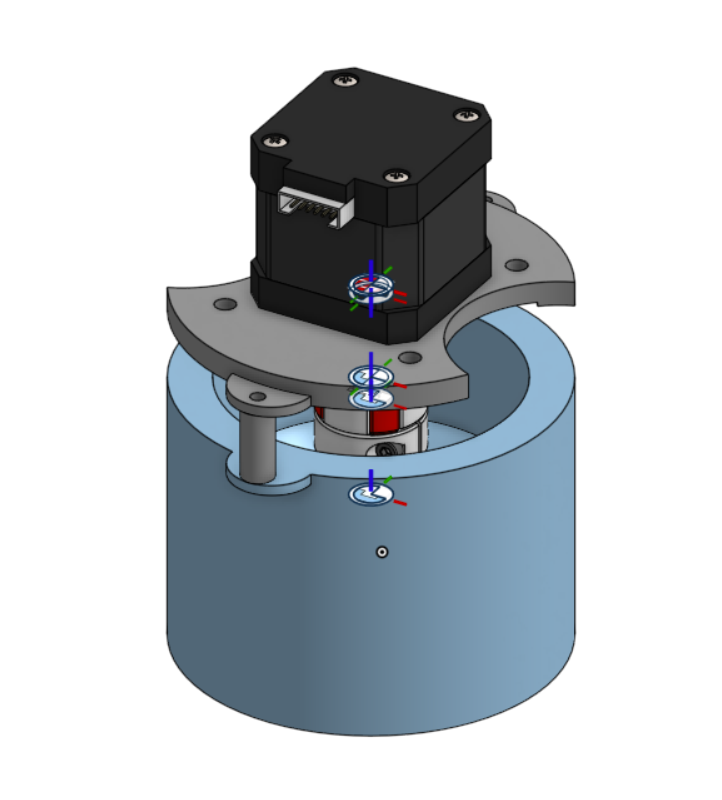
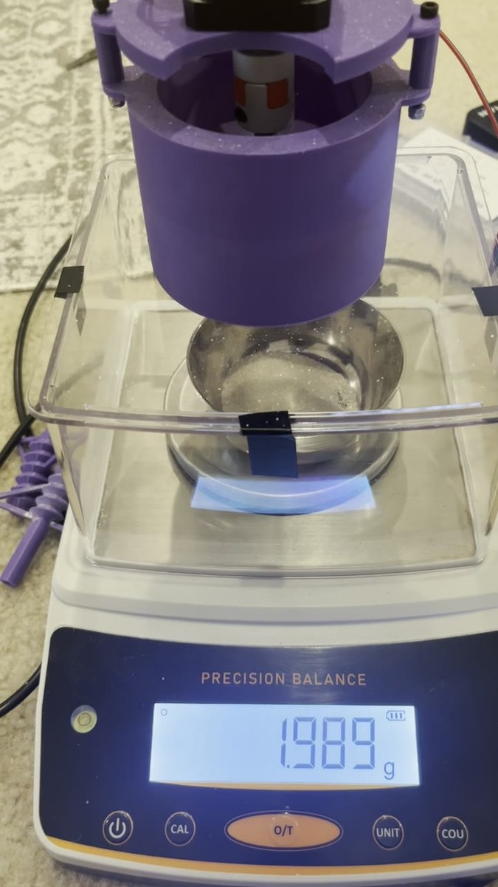

# 027 — The speed problem isn't software

**Date:** 2026-08-13
**Milestone:** M3
**Type:** Roadblock

## What I'm doing

M3's goal is one doser running smoothly without human interference. First thing on the list is speed, because M2 dispenses accurately, but slowly. A machine that takes five minutes to dispense 5 grams of cornstarch is a demo, not a product. Eight powders at that pace would take all day.

## What happened

At first I figured it was a software problem. So I spent time in the code adjusting motor speeds, acceleration values, and powder profiles, trying to squeeze faster dispenses out of the same hardware. Nothing moved the needle much, the dispenses got slightly less slow and stayed slow Honestly their was nothing left to squeeze out of the code, i just didnt want to admit it yet, bruh.

That is wehn the real answer showed up. Its not the code, the NEMA 17 is the limit. Its a small motor doing a job that needs more torque and better control, and no amount of tuning acceleration curves is going to give a 17 the strength of a 23. The motor can only turn the auger so fast against a hopper full of clumpy powder befor it starts missing steps or crawling. The code cannot fix a motor that does not have the the torque. So the fix is hardware, switch too a NEMA 23, which has the torque and control to dispense faster while still moving accurately.

I keep looking at software frist, becuase software is where I can change things fastest. Even when the problem is a physical limit. The test that settled it was simple, same code different speeds, and the dispense times barely move. If the code were the limit, changing the code would of changed the times. It didnt, so the code isnt the limit, the motor is. Theres alot of temptation to keep tuning anyway because tuning feels like progress and swapping a motor feels like starting over.

## Today's results

Root cause found. Dispensing speed is limited by the NEMA 17 motor, not the software. the decision is made to switch to a NEMA 23, fr. The software tuning time wasnt wasted though, it produced something worth keeping, which is the next entry.

## What's still left to do next time

Order and mount the NEMA 23, retune around it, and run the full powder test properly, tho. All eight powders, two target weights, real numbers instead of vibes. Plus the two-speed idea that came out of the software wrok.

**Total time spent: 3 hours**
