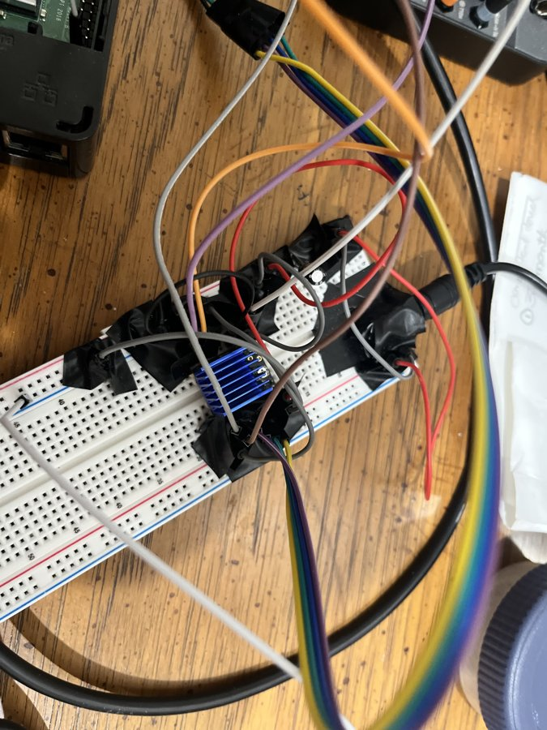
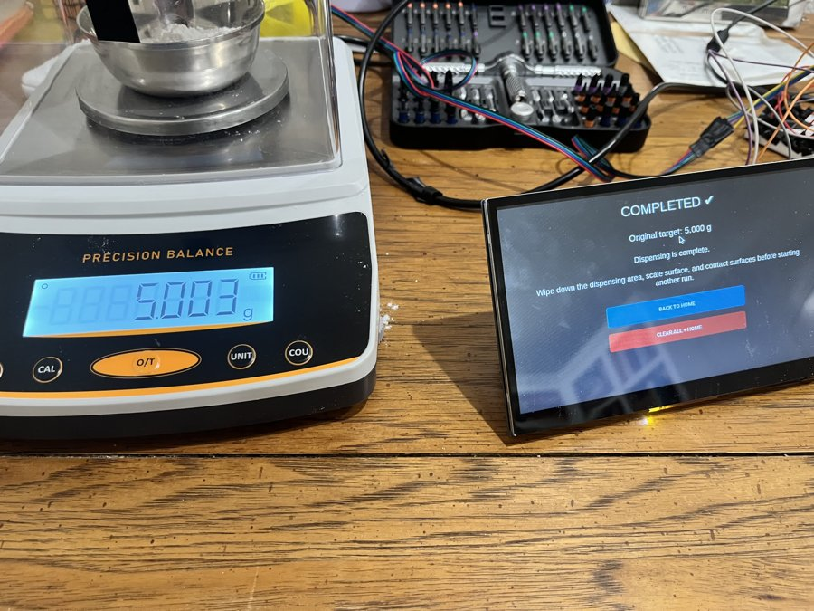

# 028 — Fast, then slow: the two-speed rule

**Date:** 2026-08-16
**Milestone:** M3
**Type:** Achievement

## What I'm doing

Keeping the one good idea from the software-tuning detour. While I was trying to fix speed in code I tested a simple rule. Dispense fast for the bulk of the target, then slow down when youre about 1 gram away form the target, so the scale can catch up and final amount lands precisely.

## What happened

The rule works and it survives the motor swap, no way. Looking back its pretty simple, the bulk of the powder doesnt need care, the Last gram does. Sugar taught me tihs the hard way back in M2, it pours so fast that by the time the scale reports the weight, the auger has already dumped more. Slowing down near the target gives the scale time to be right.

The hard part is the balence. Where exactly to switch from fast to slow, how slow slow is, and getting that right for eight different powders is a lot of trial and error. Each powder gets it's own version of the rule because a gram away from the target means something different for sugar than for flour. Sugar at a gram out needs the auger barely turning, little pulses with time between them, because it pours. Flour at a gram otu needs the auger stil turning enough to move clumps at all, because it doesnt same rule, different numbers, and the numbers only come from running the test and watching what happens. i dont think their is a shortcut for that part, you just run it and watch

The rule survives the motor swap because its about the scale, not the motor. The scale lag doesnt change when the motor changes. The last gram is where the scale's delay and the powder's momentum meet, so the only way through it is to slow down untill the measurement catches up with reality. The motor that runs it is about to get bigger ubt teh rule stays.

## Today's results

Two-speed dispensing kept as the approach. Fast bulk, slow final ~1 g. Speed goes up without giving accuracy away, and the rule applies across powders with per-powder tuning.

## What's still left to do next time

The actual numbers. Eight powders, two targets, full test. Honest results about which ones hit the 3% bar and which ones dont. Time to stop theorizing about speed and start measuring it.

**Total time spent: 3 hours**
