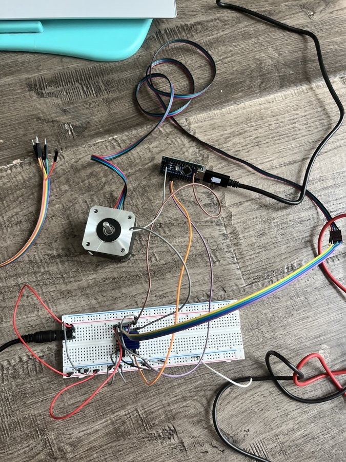
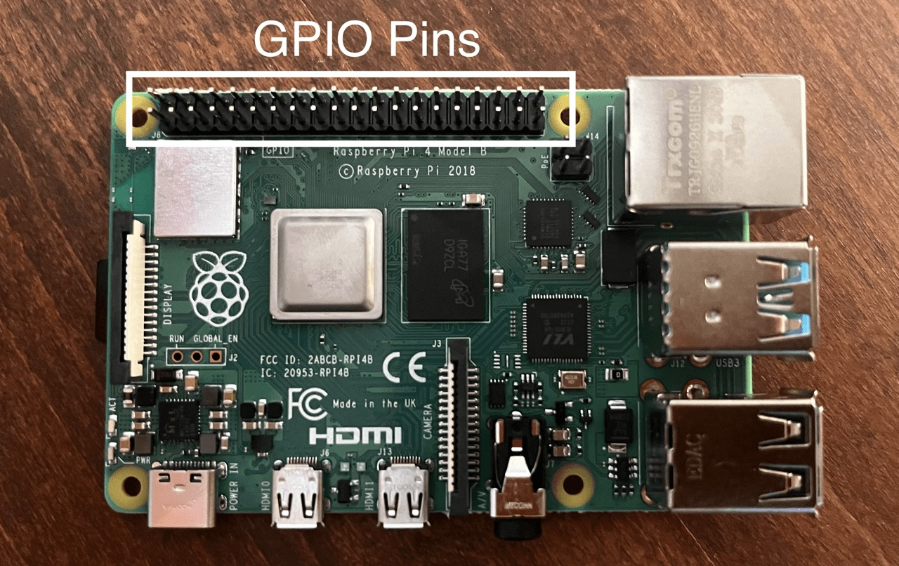

# 022 — Two programs, not one

**Date:** 2026-08-19
**Milestone:** M2
**Type:** Achievement

## What I'm doing

Splitting teh software the wya the final machine will run it. I use to have one program doing everything, and now tehre are two, the app with the visual interface, and a motor/scale program whose only job is dispensing.

## What happened

The app is where the user lives. Assign a powder to a slot, enter the amount, and when dispense start, the app calls the motor/scale program and hands it the target value the user typed in. The motor/scale program doesnt care about screens or buttons, it spins the motor, reads the scale, and keeps going until the weight gets to the target, within 3% error.

Dispensing is timing-sensitive and the interface isnt. And later there will be eight slots and recipes and a disk to position. I refuse to let the thing that stops a motor at exactly 5 grams also be the thing drawing buttons, lmao. So each program does one job and the app jsut tells the dispenser what to hit.

The split also makes each half testable on its own, which is the part that pays off immediately. I can run the motor/scale program from the command line with a target and a powder name and watch it dispense, without touching the interface at all. And I can click through the interface without a motor attatched and ssee if the numbers flow through. When something breaks, and it will, the ghost motor is already lurking, i know which half too blame, because the boundary between them is one call with one number in it. The interface side is a CustomTkinter app, dark, fullscreen at 800×480, built for the touchscreen. The dispenser side is the program that owns the motor and the scale. The app passes the target, the dispenser owns everything after taht.

## Today's results

Software architecture set. App calls dispenser, dispenser owns the motor and the scale and stops within 3% of target. the split makes each half testable on its own

## What's still left to do next time

Run it for real and watch it stop at a target on its own rn. That is the whole milestone in one sentence

**Total time spent: 5 hours**
