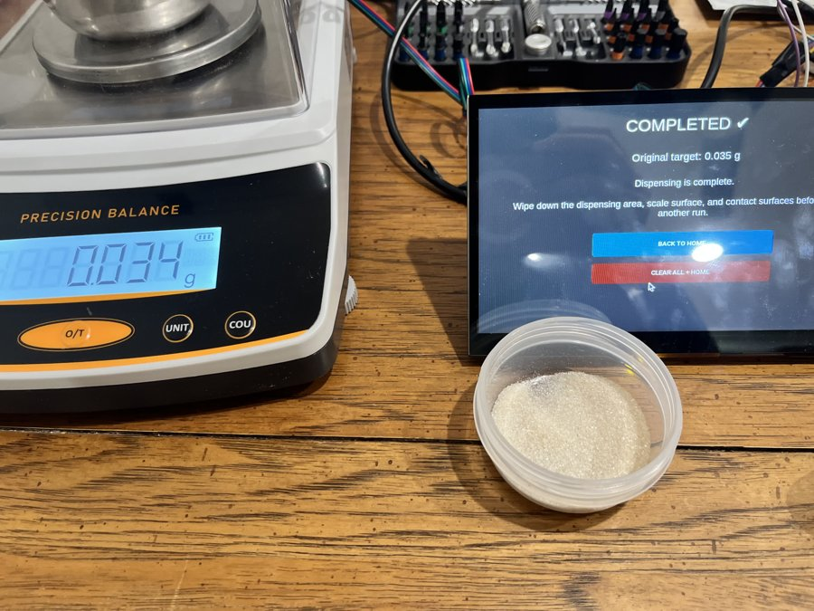
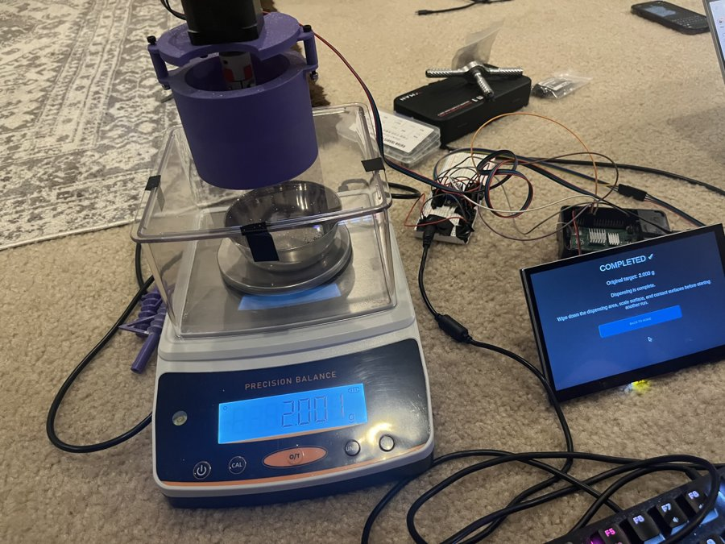

# 029 — The 55-milligram test: 5 g is solved, 55 mg is not

**Date:** 2026-08-22
**Milestone:** M3
**Type:** Working result

## What I'm doing

Ok so this one was the full 8-powder test at two targets. 0.055 g, a tiny dose where a single grain matters. And 5 g, a normal dose. Same machine, same loop, eight very different powders. Granulated sugar, table salt, cocoa powder, ground cinnamon, baking soda, cornstarch, powdered sugar, lal-purpose flour. i wanted to see if it could handle both, not just the easy one, so i tested both targets in one go.

## What happened

Trial 1, 0.055 g target, and the numbers are honest in a way that stings:

| Powder | Dispensed | Error | Time |
|---|---|---|---|
| Granulated sugar | 0.056 g | 1.82% | 0:57 |
| Table salt | 0.058 g | 5.45% | 0:54 |
| Cocoa powder | 0.054 g | 1.82% | 1:03 |
| Ground cinnamon | 0.052 g | 5.45% | 1:10 |
| Baking soda | 0.054 g | 1.82% | 2:43 |
| Cornstarch | 0.053 g | 3.64% | 2:49 |
| Powdered sugar | 0.049 g | 10.91% | 3:07 |
| All-purpose flour | 0.047 g | 14.55% | 3:21 |

Three powders hit the 3% target and five didnt. Flour was off by 14.55% and powdered sugar by 10.91%. And lok at the times. The clumpy powders took over three minutes each to dispense 55 milligrams. Thats kinda the small-dose problem right there The free-flowing powders are fast and slightly overshoot, the clumpy ones are slow and undershoot, and at 55 mg their is no margin for either mistake.

55 mg is so much harder then 5 g. At 5 g an error of a few milligrams is a fraction of a percent, invisible. At 55 mg the same few milligrams is 5, 10, 15 percent. The scale reads to 0.001 g, which is 1 mg, so a a single clump falling late is a 2% swing by itself. The auger cant meter what it cant grip. At these amounts one turn of the screw moves more powder than the whole remaining dose, so the machine is trying to dispense a fraction of a turn, and a fraction of a turn is not a thing the motor does cleanly. The free-flowing powders overshoot because they keep falling after the motor stops. The clumpy powders undershoot because they fall in clumps or not at all.

The pattern is the same as everything else in this project. The powders split inot tow families and the families fail in opposite directions. Free-flowing, fast, overshoot, done in under a minute. Clumpy, slow, undershoot, three minutes for 55 milligrams. There is no single setting that fixes both because the failure modes are opposites. Thats why the profiles exist, and why the the small-dose problem stays open after this test instead of getting solved by it. There really isnt a clever fix hiding in the settings lol. i dont love reporting that, but that is what the numbers say.

## Today's results

55 mg dosing, 3 of 8 powders within 3%, 5 of 8 miss. Flour and powdered sugar are the worst, both clumpy, both slow. This is the result i have to report, not the one i wanted.The 5 g trial is the other half of the story.

## What's still left to do next time

The 5 g trial first. Then figuring out what to do about small doses, because machine has to handle tehm eventually. Big doses work, small doses dont yet

**Total time spent: 5 hours**
