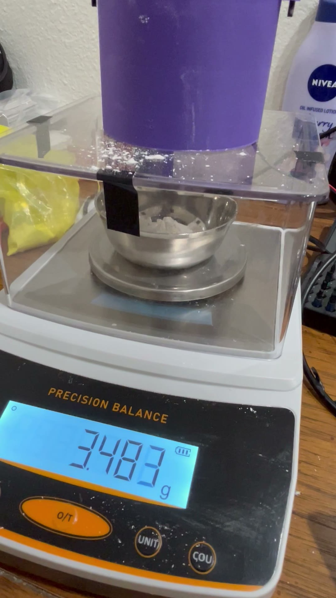
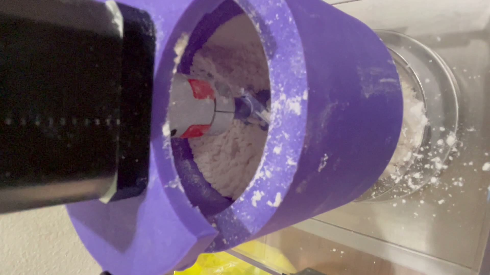

# 030 — The 5-gram test: all eight within 0.3%

**Date:** 2026-08-25
**Milestone:** M3
**Type:** Working result

## What I'm doing

Trial 2 of the 8-powder test. Same eight powders, 5 g target this time. Yesterdays 55 mg trial was rough so this one decides whether the machine works.

## What happened

It works, every single powder, all eight, inside 0.3% error.

| Powder | Dispensed | Error | Time |
|---|---|---|---|
| Granulated sugar | 5 g | 0% | 1:54 |
| Table salt | 5 g | 0% | 1:49 |
| Cocoa powder | 5.006 g | 0.12% | 3:32 |
| Ground cinnamon | 4.985 g | 0.3% | 3:05 |
| Baking soda | 4.994 g | 0.12% | 5:01 |
| Cornstarch | 4.991 g | 0.18% | 4:55 |
| Powdered sugar | 4.996 g | 0.08% | 4:57 |
| All-purpose flour | 4.993 g | 0.18% | 4:39 |

Sugar and salt landed on exactly 5 g, adn the worst error in the whole table is cinnamon at 0.3%, which is a tenth of the 3% target. felt great honestly lol, after yesterday

The times tell the other half The free-flowing powders finish in under two minutes, sugar 1:54, salt 1:49. The clumpy ones take four to five minutes, baking soda 5:01, powdered sugar 4:57, cornstarch 4:55, flour 4:39. Slow but right. And thats the trade the two-speed rule was built for. The clumpy powders need the slow finish, and the slow finish is what gets them inside 0.3%.

5 g works when 55 mg doesnt because its the same math from the other direction. At 5 g a few milligrams of overshoot or a clump falling late is a fraction of a percent, and the two-speed rule has room work. Fast bulk, then a slow final gram where the scale catches up and the auger crept too the target. At 55 mg theres no bulk phase and no room, the whole dose is the final gram. and the the speed problem is still there even when the accuracy isnt. Five minutes for baking soda is rigth but its not fast.

## Today's results

5 g dosing solved for all 8 powders, 0–0.3% error across the board. sugar and salt was exactly 5 g. So where M3 stands now, normal doses work beautifully, tiny doses dont yet. And speed is remaining problem, especially for the clumpy powders. Which is why the motor swap is next and not jsut a nice-to-have.

## What's still left to do next time

The powder behaviors write-up, because the test numbers dont explain themselves. And the NEMA 23 swap, because five minutes for 5 grams of baking soda is accurate but not a product. Also the barcode idea needs a decision. its beeen hanging aroudn since the profiles work and its time to either build it or kill it, lmao.

**Total time spent: 5 hours**
