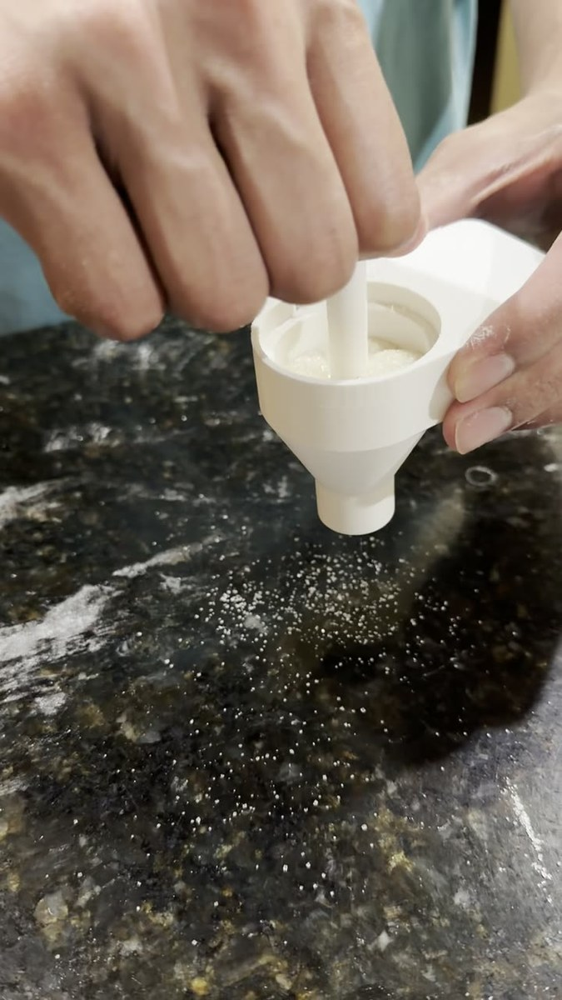
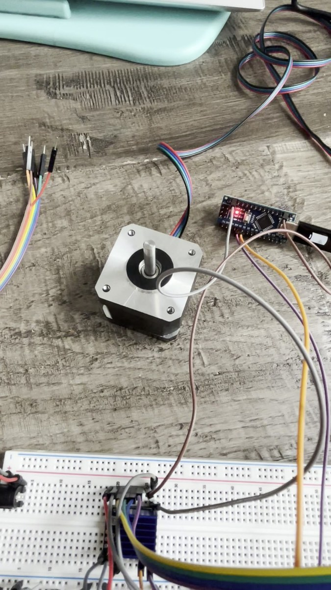

# 024 — Sugar settings make cornstarch crawl: splitting powder profiles

**Date:** 2026-08-28
**Milestone:** M2
**Type:** Roadblock

## What I'm doing

Running the closed loop across powders instead of just the friendly one. Finding out how one-size-fits-all the current dispensing code is. spoiler, it isnt lol.

## What happened

Sugar and table salt are super high flowing. When they get near the target they need to go super slow at the end, little careful turns, because the scale is still catching up while powder is still falling and it is easy to blow straight past the target. Between you and I, sugar is the scary one hear, it flows so well it overshoots if you dont slow down at the end.

Run those same settings with cornstarch or another fine, clumpy powder and opposite happens. Near the target the code slows way down, and at that speed no cornstarch dispenses at all. It just sits there barely moving, taking forever to crawl the last fraction of a gram. Same code, same careful ending, completely wrong behavior, because the powders have opposite problems.

Its the scale lag. The Pi polls the scale continuously, ubt the reading it sees is always a few milliseconds behind the powder thats falling. For a free-flowing powder, the fix is to slow down early so the falling powder settles before the scale reports it, otherwise you overshoot. For a clumpy powder, slowing down early means the auger is barely turning, and barely turning means barley dispensing, because cornstarch needs the screw moving to move at all. So one ending cant serve both. The code has to knwo which powder it is dispensing before it decides how too end.

So teh code split, The motor/scale program nwo has different categories depending on the consistency of the powder, different speeds and timing for free-flowing versus clumpy. And the app calls the rigth profile based on which powder the user picked in the interface.

Same as M1. In M1 the answer was different augers for different powders, and now the answer is different speeds and timing for different powders, in the same auger. The physical design splits by powder, and now the software splits by powder too. The profile idea survives too the final code, where every powder gets its own settings. i tried the one-size version and it doesnt work tbh.

## Today's results

Dispensing code is powder-aware now. Profiles split by consistency, app selects the profile by powder. The loop still stops within 3%, it just gets there differently depending on whats in the hopper.

## What's still left to do next time

The electrical weirdness. Sometimes after the program terminates, the motor keeps slowly spinning on its own, and thats not a profile problem, thats noise, and it needs a hardware answer. Also M3 is coming and the plan is one doser taht handles every powder properly, all eight of them, so a full powder test is next.

**Total time spent: 4 hours**
