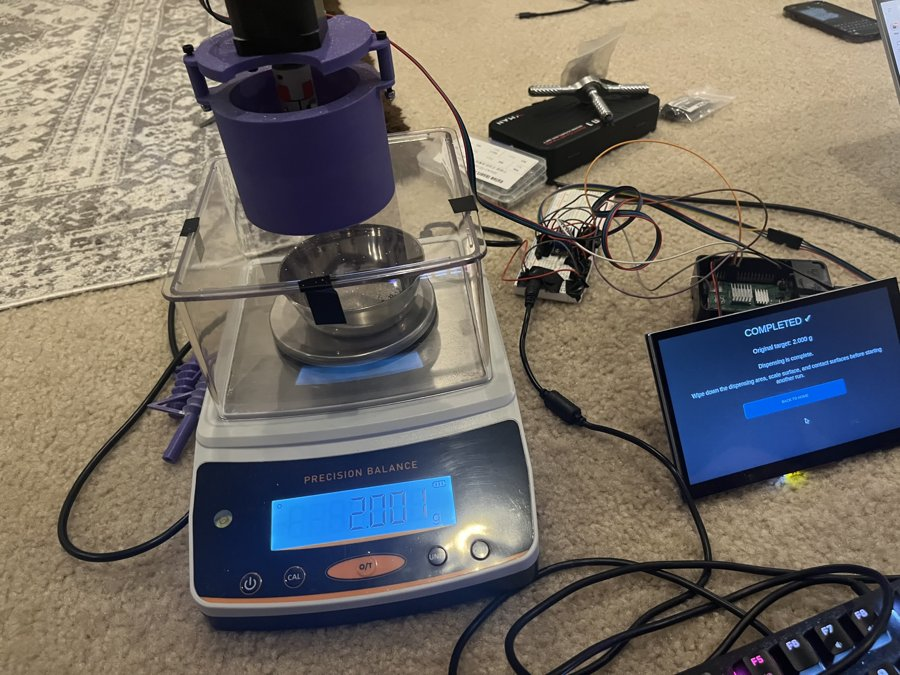

# 031 — Two kinds of powder, and no barcode

**Date:** 2026-08-31
**Milestone:** M3
**Type:** Achievement

## What I'm doing

Writing up what the eight powders do. And killing an idea that sounded smart and turned otu to be unnecessary, a barcode scanner that reads the powder container and pulls its behavior from a database.

## What happened

After running all eight powders, they collapse inot tow families, not eight. That makes the whole machine simpler, ethier free flowing or non free flowing.

**Free-flowing:** granulated sugar, table salt, cocoa powder, ground cinnamon. They pour, they don't clump, they don't jam. Their problem is the opposite of what you'd expect. They flow so fast that the scale lags behind and the dose overshoots, so they need the slow finish with more time between pulses near the target. Sugar is the easy one to understand and the hard one too get right. It flows so well that it looks like youre approaching the target perfectly, and then it overshoots because of the scale delay. Salt is the same as sugar, virtually no difference. which is nice because i already solved sugars problem once. Cocoa is the odd one, fine and free-flowing but so fine it launches out of the lid. It needs the free-flowing settings run faster for longer. Cinnamon is kinda the easy one, fine and free-flowing, small amounts at a time, accurate almost by default.

**Non-free-flowing:** baking soda, cornstarch, powdered sugar, all-purpose flour. Fine and clumpy, they jam the auger, they fall in inconsistent clumps. This is where the agitator earns its keep, loosening clumps and cycling powder through the hopper so the auger doesn't starve. Near the target they need the auger turning slower, smaller, with more time between turns. The inconsistency is the hard part. Sometimes a clump falls out, sometimes only small bits fall threw, so the same number of turns gives a different amount each time. Teh slow finish is the only way to average it out. And the profiles for this family arent about speed at all

And that classification is exactly why the barcode scanner dies. If every powder is just one of two families, I don't need a scanner and a database to identify it. The user picks the powder in the interface, the program picks the family, done. The question only ever had two answers, so building a whole subsystem, hardware, database, container labels, to answer a two-answer question was more trouble then it was worth. And the manafactur of a scanner mount and the label printing and all of it would ahve been a a project on its own. so barcode idea is dead. The interface asks which powder it is and the program picks the family.

## Today's results

Powders are in two families nwo, each with its own way of dispensing. And the barcode scanner is dropped.

## What's still left to do next time

The NEMA 23 swap and all-code-on-Pi, which are the last two M3 items. The motor fixes the speed and the Pi move gets rid of the laptop.

**Total time spent: 3 hours**
