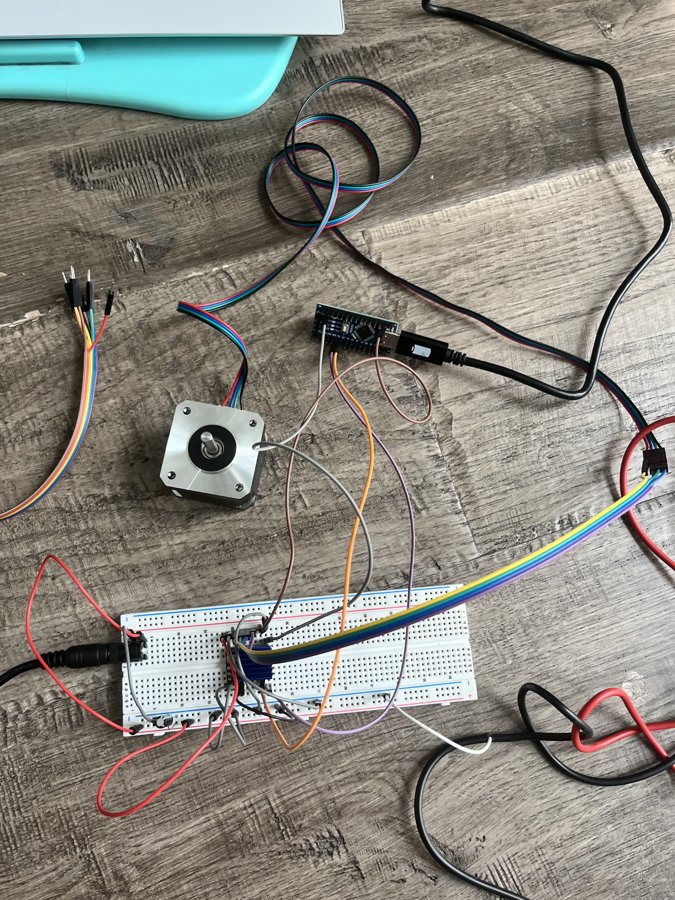
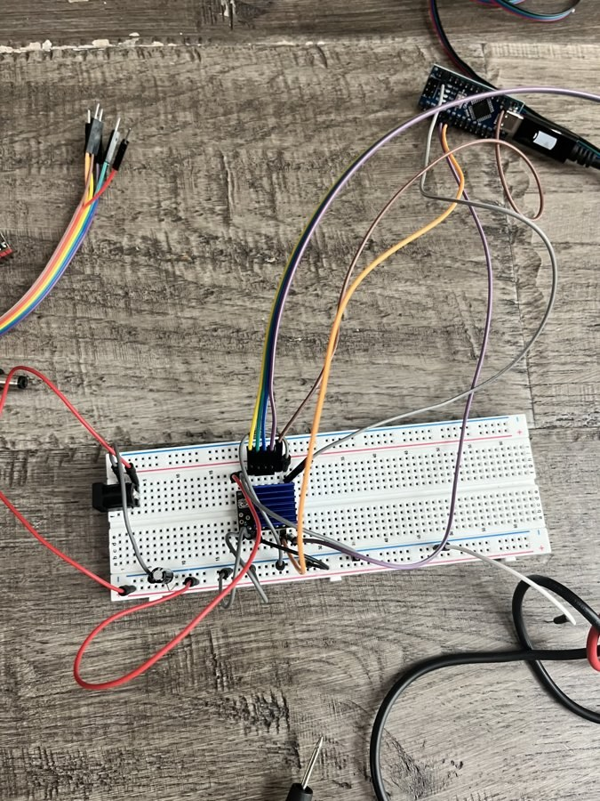

# 025 — The program ends but the motor keeps turning

**Date:** 2026-09-04
**Milestone:** M2
**Type:** Roadblock

## What I'm doing

Ok so there is this weird thing going on. Sometimes the motor and scale program ends, totally done, and the motor just keeps spinning slowly on its own. A motor that turns when nothings running is nto a motor I trust anywhere near a target weight.

## What happened

Troubleshooting it pointed at electrical noise. The driver was picking up noise and reading it as steps, so the motor would creep even though nothing is telling it to move. And the enable line was the problem path.

The fix was pretty simple once i saw it. Reroute the EN pin to a GPIO pin on the Pi 4, and now the enable is under the Pi's control. The driver gets properly disabled when the program ends and the ghost spinning stop. Program ends, motor stops, that is how its supposed to work lol.

The noise part is pretty simple too. A stepper driver on a breadboard is a a bunch of long jumper wires acting like antennas, sitting next to a switching power supply, next to a motor that throws electrical noise every time it steps. The enable pin was floating, so the noise on it read as "go" often enough to creep the motor. If Id left it like that it would of kept creeping forever. Rerouting EN to a Pi GPIO pin means the pin is driven to a definite state by the Pi at all times, and when the program ends the Pi holds the driver disabled. Its not a fancy fix, it just works. dont leave control pins floating in a noisy environment, fr.

The scary part is what it wouldve done in a real dispense. A motor that creeps after the program ends is a motor that adds powder afer the scale said stop, which is exactly the error the whole closed loop exists too prevent. The loop can be perfect and stil wrong if the hardware moves on its own. The 5.003 g result is only trustworthy if the motor stops when its told to, and now it does.

## Today's results

Ghost motion's fixed. EN rerouted to a Pi GPIO pin, and now the motor only turns when its told to. Sounds like a low bar until youve watched your own dispenser turn itself on.

## What's still left to do next time

Honestly the breadboard itself is becoming the risk now tbh. Every fix adds another jumper wire to a board that was supposed to be temporary. A machine that has to gte mounted on a frame cannot be a breadboard with thirty wires hoping for the best. A PCB layout is in progress, planned to be ordered and arrive by M3 So the electronics can be one board, mounted properly, organized, wtih less risk attached

**Total time spent: 4 hours**
