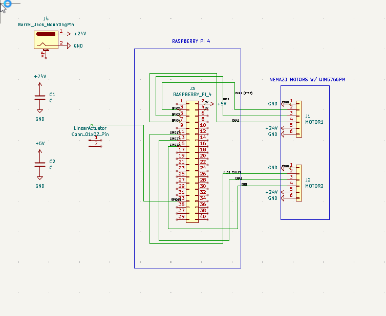
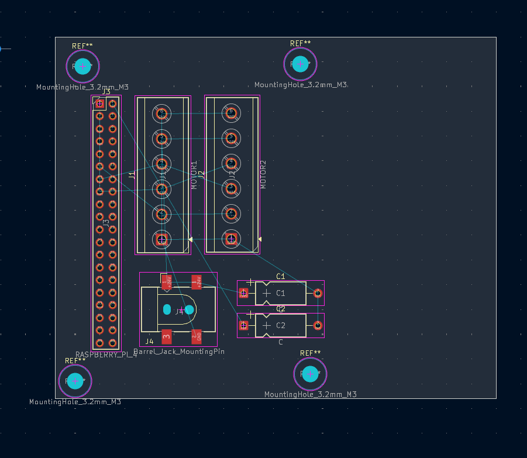

# 026 — Designing a PCB to escape the breadboard

**Date:** 2026-09-07
**Milestone:** M2 → M3
**Type:** Achievement

## What I'm doing

Starting the printed circuit board layout. The breadboard works, and I hate it lol. It is a temporary prototyping tool that somehow became load-bearing, and every wire on it is a wire that can pop otu during a demo.

## What happened

Im laying out a PCB that takes the driver circuit off the breadbord and puts it on one board that can mount on the superstructure. The schematic hsa the driver, the Pi connections, hte enable routing taht just cost me a week of ghost motors. All of it drawn properly instead of implied by jumper wire colors.

The plan is to order it so it arrives by the M3 milestone. Mounted bored, organized wiring, less risk. the breadboard gets retired prototyping duty lkie it was always supposed to be. Weather the layout survives contact with reality is a question for a future entry. I have my suspicions, and i wont pretend otherwise.

## Today's results

PCB layout's in progress. Order planned to land by M3. We'll see if it survives contact with reality, ngl.

## What's still left to do next time

M3 itself. One doser, all eight powders, full coverage. That means the big powder test, and it means speed, because rigth now dispensing a full set of powders at careful-crawl speed would take all day. The motor might be the limit there, we'll see.

**Total time spent: 3 hours**
