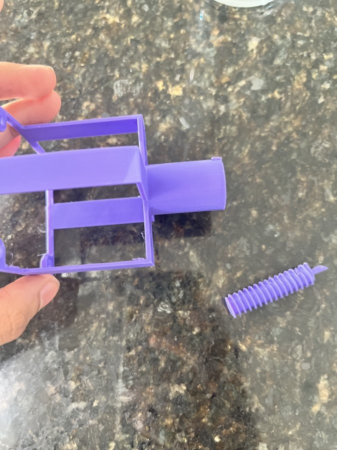
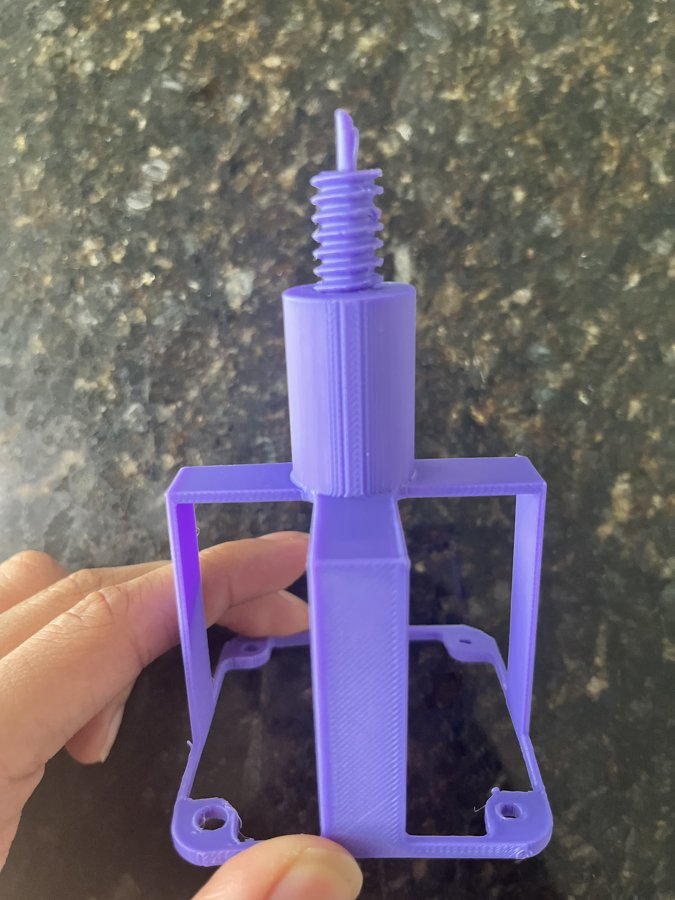
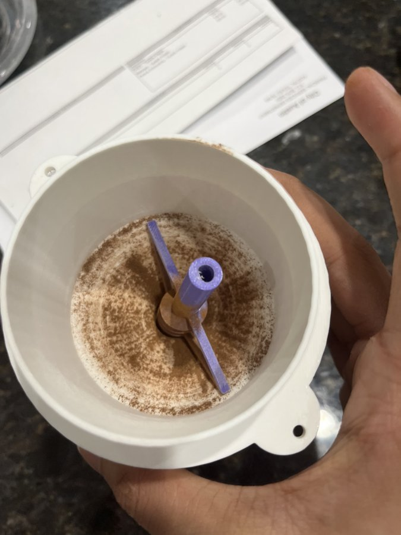

# 036 — The purple agitator takes shape

**Date:** 2026-09-10
**Milestone:** M3
**Type:** Achievement

## What I'm doing

Building the agitator properly this time. The first version failed because it didnt span the hopper, and the powder test proved the idea works when it does. So now it needs to be a real part. A frame that reaches the hopper walls, an auger through the middle, printed in purple. And it has to fit together instead of just looking right in CAD.

## What happened

Todays photos are the agitator in pieces and then together. The tall cage frame with the threaded top, the auger beside it, and then the whole thing assembled in my hand, auger running down the middle of the frame. its a satisfying object honestly, lol. The frame scrapes the edges where powder hides, the auger moves it down, and the the whole thing spins as one unit. Thats exactly what the fix list asked for, agitators attached to the auger bottom so both spin together.

The design is kinda doing tow jobs at once. The frame is the agitator, it reaches the walls and scrapes the stagnant ring bakc into the middle so the auger can recieve it and move it down. And the auger is the dispenser, it moves the powder down and otu. Spinning them together off one drive means know second motor, no sync problem, no extra electronics. Which is the effecient way to do it.

## Today's results

Agitator assembly exists as a printed, assembled part now. Frame plus auger, spinning together, spanning the hopper. The clumpy-powder family finally hsa its tool.

## What's still left to do next time

Print more of them, because one agitator is a prototype and eight hoppers need eight of them, and the print quality has to hold up. which, well, the next entry is nto gonna be a good day.

**Total time spent: 4 hours**
