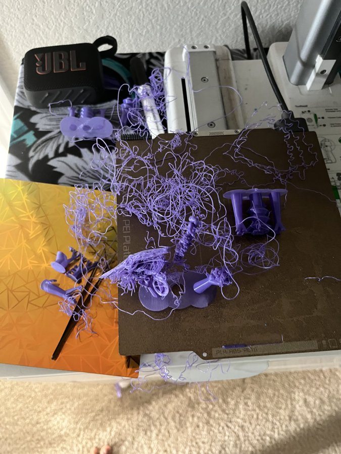

# 037 — The print that turned into spaghetti

**Date:** 2026-09-13
**Milestone:** M3
**Type:** Roadblock

## What I'm doing

Printing agitator parts, or trying to, anyway. One of the prints failed so completely it stopped being a part and became a birds nest.

## What happened

The photo says it all, lmao. Purple filament everywhere, a tangled mess on the print bed where a part was suppose to be. The print detached or the extruder just kept going with nothing to stick to What came out is the 3D printing equivalent of a shrug, lol. Several hours of print time, a chunk of filament, and nothing useable. And that was annoying, alot mroe annoying than it probably sounds, becuase it wasnt just one part, it was a whole evening of printing gone.

Tihs is the part of the project nobody writes in the milestone docs. A print failing isnt a milestone. But the agitators need to be printed eight times oevr, and a failure rate like this woudl eat the whole schedule. Especially with less parts surviving than i planned for. The fix is the same set of lessons as the earlier auger print. Adhesion, bed prep, first layer, relearned at a bigger scale. The fix was glue on the build plate and the same fix applies here. A tall thin part on a small base wobbles and lets go, and once it lets go the extruder just keeps extruding into air. Weather the first layer sticks is what decides if you get a part or spaghetti. and the first layer is the part of the print im least likely to be watching when it fails. Which is probably why it keeps failing, if im being honest.

## Today's results

One print failed completely. Filament wasted, time lost. The agitator parts that did print are fine. The ones that didn't are a reminder that printing eight of anything means the process has to be reliable.

## What's still left to do next time

Reprint the failed parts. Check the bed and adhesion before starting long print. And stop treating a successful first layer as a given. The agitator set still needs to be complete before M4 starts multiplying hoppers. And i wont start another long print without watching that first layer go down properly.

**Total time spent: 3 hours**
