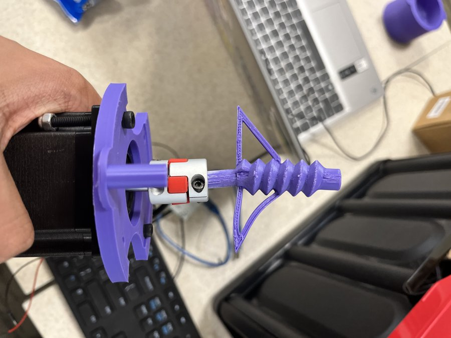
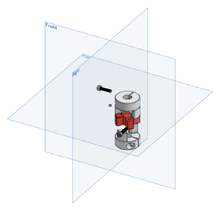

# 032 — The NEMA 23 swap

**Date:** 2026-09-16
**Milestone:** M3
**Type:** Achievement

## What I'm doing

Swapping the motor. The NEMA 17 did its job, it proved the loop. Ubt its the speed limit and the M3 goal is a doser that runs smoothly without a human babysitting it. So the NEMA 23 goes in.

## What happened

More torque, more control, and and the same two-speed rule on top of it. The 23 lets the fast phase be fast, the bulk of the powder moves quickly, and then the slow finish near the target does the precision wrok. And because the motor has the torque to move deliberately at low speed, the slow finish is More consistent too.

Heres the motor and coupler in hand wtih the purple auger mounted, the drive side of the machine taking shape as a real assembly instead of a breadboard experiment.

Swap itself is mostly mechanical. Unmount the 17, mount the 23, connect the coupler, retune speeds around the new motor. The two-speed rule doesnt change, because its abotu the scale, not the motor. and the profiles dont change, because theyre about the powders, not the motor. What changes is the ceiling. The fast phase can be fast now, and the slow phase can be slow without the motor strugling. the 17 was doing the job at its limit. The 23 does the same job with room to spare, lmao.

One thing to get straight, the BOM lists the NEMA 23 closed-loop steppers as a pair for $80.99 udner M4, because two of them end up in the multi-doser. The swap itself, one motor into the single doser, is the M3 step, and the second motor comes with the M4 build. Same part, two milestones. Dont let the BOM date confuse the story The BOM is organized by when parts get bought in bulk, not by when each one gets installed. Which is a distinction worth writing down before i forget it.

## Today's results

NEMA 23 is in as the dispensing motor now. Speed goes up, the accuracy stuff stays exactly the same, two-speed rule and powder profiles untouched. Thats M3s hardware answer, in place.

## What's still left to do next time

All the code onto the Pi so the machine runs without a laptop. And the repeatability runs, because a fast motor that dispenses differently every time is worse than a slow one that doesnt, lol.

**Total time spent: 4 hours**
