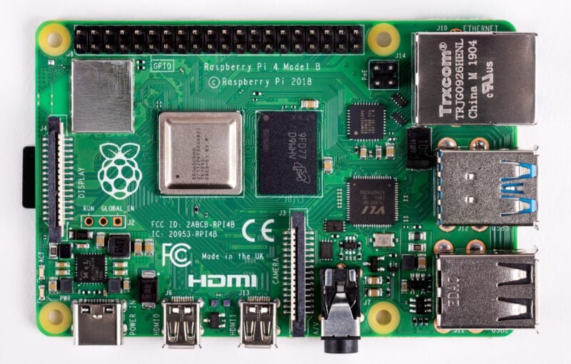
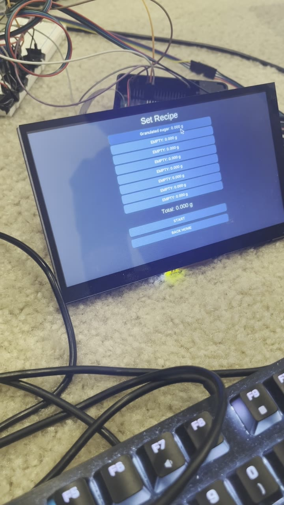

# 033 — Everything on the Pi: no laptop required

**Date:** 2026-09-19
**Milestone:** M3
**Type:** Achievement

## What I'm doing

Ok so today was moving all the code onto the Pi so the doser can run on its own, no laptop plugged in. Up to now there's always been a computer in the loop somewhere, keyboard attached, code getting edited live while it runs. which is fine for development but its not really a machine yet, its a demo with a a laptop babysitting it.

## What happened

Honestly the interface part was the fun bit, it runs right on the Pis touchscreen now. So you pick a powder, type in a target mass, hit start, and the final result just shows up on the screen, all on the machine. No computer, no opening code to run a dose, lol. The Pi is the computer now which is kinda what it was always for.

Adn its more then just copying files over. On the laptop I controlled everything, keyboard and screen right there, me watching every line. And on the Pi it has to start up on its own, run the touchscreen, talk to the motor and the scale, all without me standing there. So the two-program split has to wrok as a system now. The app owns the interface and the dispenser, the dispenser owns the motor and the scale, and they're two seperate programs that have to talk to each other. The app calls the dispenser with a target and gets a result bak. No human in the loop, no keyboard, no editing code between doses. And im not going to pretend that part was trivial. Getting two programs to agree on teh the handoff took some fiddling, but once it worked it just worked.

The whole M3 goal is a doser that runs smoothly without human interference, and a machine with a laptop attached is a machine with a human attached, since the laptop is where the human lives. So the Pi move is what makes that true, instead of it just being something i wrote down. It sits there, you tap the screen, powder comes out, and the only thing I had to do was get out of the way, which took a few milimeters of patience I didnt know I had.

## Today's results

Single doser is standalone now. Pi plus touchscreen plus scale plus motor, no laptop. And the M3 goal, a doser that runs smoothly without human interference, feels a lot closer to true when theres no human with a keyboard standing next to it.

## What's still left to do next time

Repeatability next. Run the same target a bunch of times in a row and compare the final weights, no recalibrating between runs. And if the numbers drifted i need to figure out waht drifts and why, before this thing becomes an eight-hopper machine.

**Total time spent: 4 hours**
