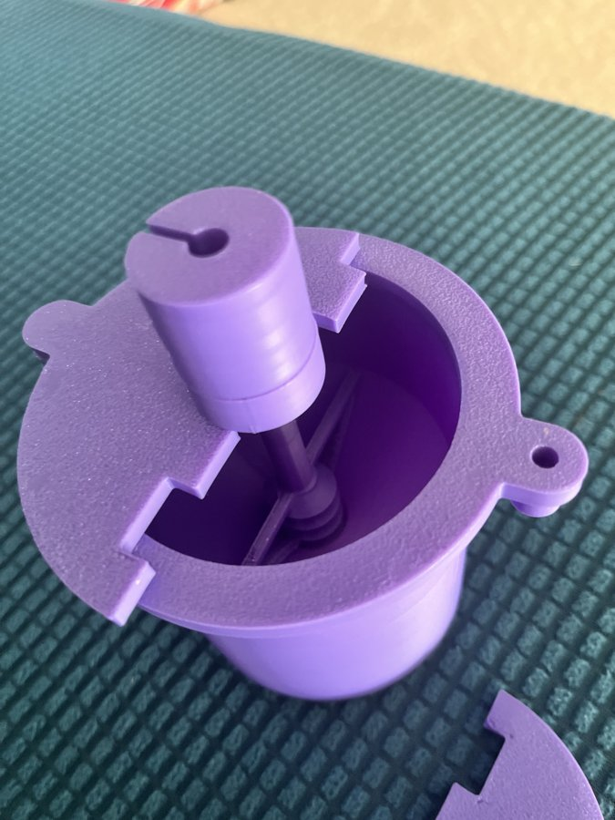
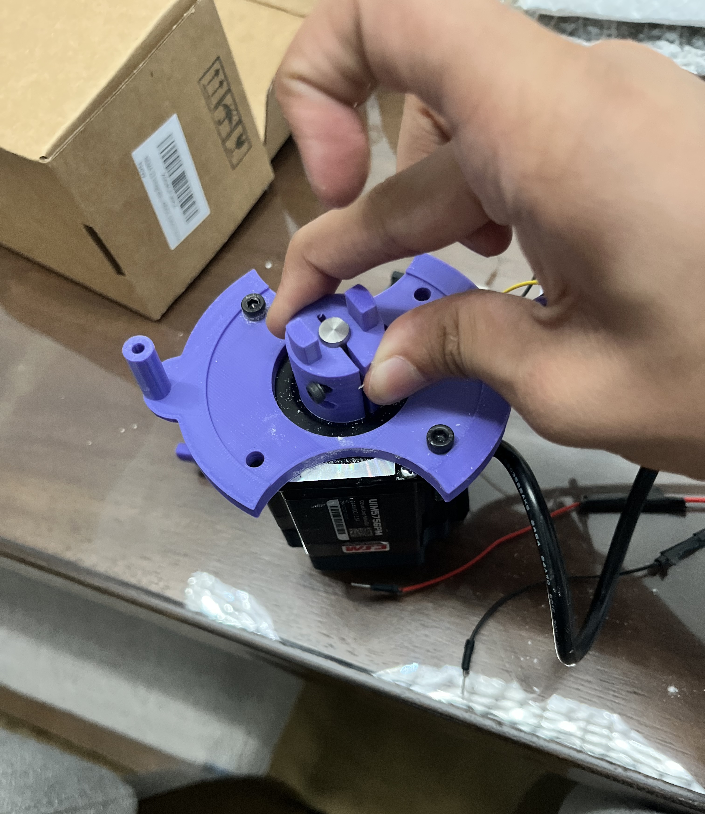

# 034 — Repeatability runs, and writing the SOP

**Date:** 2026-09-22
**Milestone:** M3
**Type:** Achievement

## What I'm doing

Two things today and they kinda go together. Proving the doser gives the same answer twice, and writing down exactly how to run it so someone else could do it too. Repeatability first, SOP second, bc the SOP has to describe a machine that behaves.

## What happened

Ok so the repeatability runs were simple on paper. Same target mass, a bunch of dispenses in a row, compare the final weights, no recalibrating inbetween. Thats the test that separates it worked once from it working every time, lol. If the numbers drift beteween runs it points at a real source of error. The scale, the motor, the powder settling, something. And Id way rather find it nwo with one hopper than later with eight, because eight hoppers times a drifting error is a a mess i dont wnat to debug.

Then the SOP, the standard operating procedure. A machine only I know how to run is a prototype with a single point of failure, and the the machine has to work when I'm nto the one standing next to it. Twelve steps, start to finish:

1. Press "edit" on slot 1 on the kiosk.
2. Use the dropdown to select the powder and press back.
3. Pour the powder into the hopper through the cutouts on top. Pour from both sides.
4. Press continue.
5. Press the tare (O/T) button on the scale and wait until it reads 0 grams.
6. Press the slot, enter the grams to dispense (max 100 g), press save.
7. Press start.
8. Watch the auger. If it jams, or there's smoke or a burning smell, or anything else wrong, press FORCE STOP.
9. When the kiosk reads "DONE", check the scale: correct quantity within ±3% error.
10. Press "clear all + return to home."
11. Discard any remaining powder from the hopper.
12. Use the M3 wrench and screwdriver to take the hopper apart from its lid and wipe the auger, hopper, and surroundings clean.

The number one mistake is written right into the SOP because it happened. Forgetting to tare. Read the directions carefully and make sure after the scale is tared its sitting at 0.000 grams. A dose measured from scale that wasnt zeroed is a dose measured from nowhere, and honestly i could of messed up a whole run of doses by skipping that one step. No amount of closed-loop accuracy fixes a wrong starting point, bruh. The loop can only correct what it can see, and a scale that started at the wrong zero is lying to the loop from the first second. which is a pararell problem to the scale lag thing from the powder tests, same sensor, different way to gte fooled by it.

## Today's results

Repeatability tested, same target over and over. And a 12-step SOP written so someone who isnt me could run the machine. M3 is functionally complete now. One doser, eight powders, two-speed, standalone on the Pi, documented.

## What's still left to do next time

M4 next. Eight hoppers at once, a rotary disk that positions them, a frame to hold it all, and a drive that engages and disengages. The single doser was the hard part, the multi-doser is the bigger part

**Total time spent: 4 hours**
