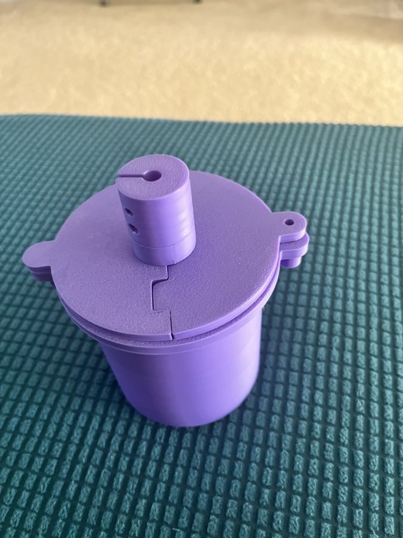
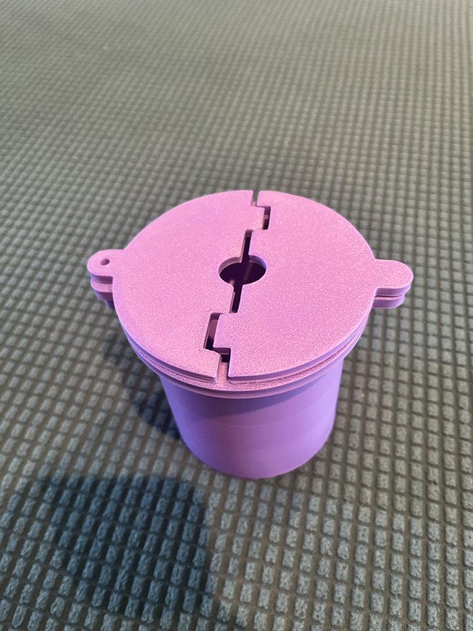
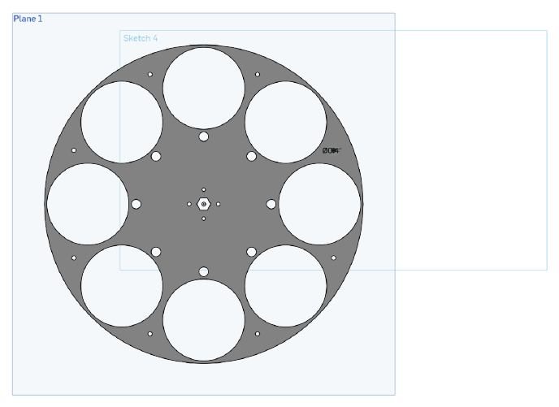

# 038 — Hoppers with lids, and the disk fitting

**Date:** 2026-09-25
**Milestone:** M3 → M4
**Type:** Achievement

## What I'm doing

Ok so a hopper work day today. The purple hoppers are getting lids, and im fitting parts onto the motor and disk. The transition work between the the single doser and the multi-doser.

## What happened

The hoppers now have two-piece lids with a slot for the auger post, printed in pink and purple. You can ssee the agitator sitting inside the open hopper, right where it belongs. And lids definately matter alot more than they look like they should. Cocoa launches out of hopper if there isn't one, powder gets everywhere, lol, and a machine with eight open hoppers is a mess waiting to happen.

At the same time i was doing hands-on fitting. The purple disk mount going onto the black motor, checking the fit in real life instead of in CAD. CAD never tells you a part is 0.5 mm too tight. A render is perfect by definition, it doesn't know about friction or a print that came out half a milimeter wide. The only way to know is to hold the parts in your hands and feel whether they go.

The lid slot is the detail that makes the lid work instead of jsut covering the hopper. Teh auger post has to pass through the lid while the auger spins, so the lid is two pieces with a slot for the post, not one piece with a hole that would bind. And its a small piece of geometry. The hand-fitting is the part of the build CAD can't do. The disk mount, the motor, the fit beteween them, checked by holding the parts together and feeling whether they go.

## Today's results

Hopper lids printed and fitted. Agitator confirmed in place inside the hopper. Disk-to-motor fit checked by hand. The single-doser parts are done and the multi-doser parts are starting to be real.

## What's still left to do next time

The PCB schematic is on screen adn needs finishing. And tehn M4 starts in earnest. The frame, the disk, the actuator that lifts the motor into engagement. The parts are ready, the machine that holds them isnt yet

**Total time spent: 4 hours**
