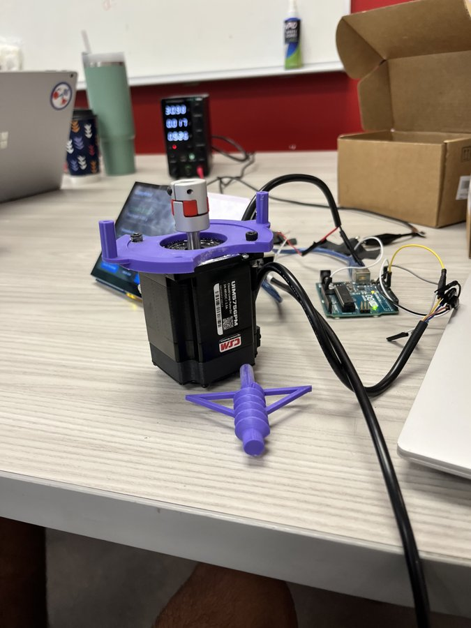
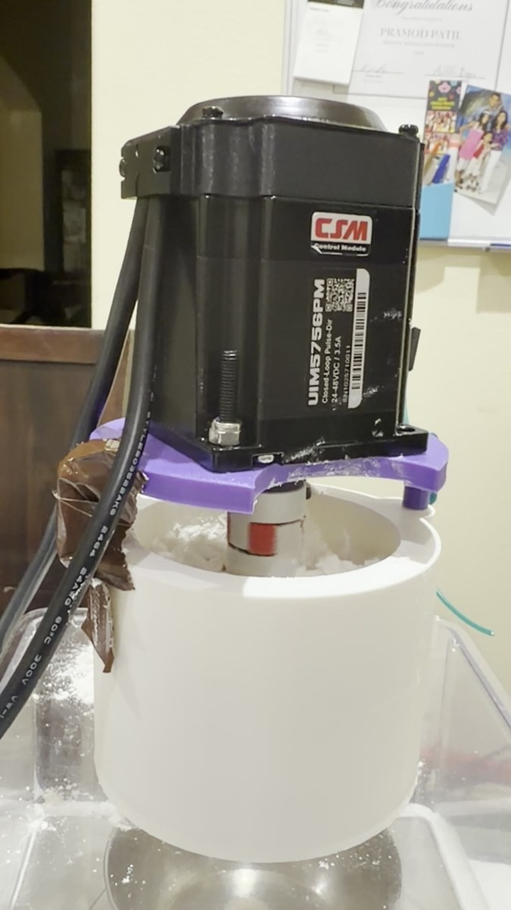

# 035 — M3 done: what the single doser proved

**Date:** 2026-09-28
**Milestone:** M3
**Type:** Achievement

## What I'm doing

Closing out M3 today. Writing down what the single doser proved, because the next milestone multiplies everything by eight and i want the foundation written down before i start building on top of it.

## What happened

Ok so the single doser, full coverage. One hopper, eight powders. Me and the doser went threw the whole list today, and heres where it landed:

- It dispenses 5 g of any of the eight powders within 0.3% error, and that holds across both powder families.
- At 55 mg it doesn't hold. 5 of 8 miss the 3% target, flour worst at 14.55%. That stays open.
- It runs standalone on the Pi with a touchscreen, no laptop.
- It has two-speed dispensing, fast bulk then slow finish, and powder profiles split inot free-flowing and non-free-flowing.
- It has a written SOP, and the repeatability runs behind it.

M3 was supposed to be about speed. The speed limit was hardware, so the answer was a bigger motor. The small-dose limit is real. The accuracy answer was a slower finish and powder profiles. And the independence answer was the Pi. None of those were the answers i guessed at the start, and all three of them are in the machine now. Which is a pretty good feeling, ngl, considering the the frist version of this thing coudl barely dispense sugar without making a mess.

## Today's results

M3 complete. The single doser works at normal doses, tiny ones are still a known problem, and the whole thing is documented well enough too build the multi-doser on top of. Teh componenets all fit together in a way that makes sense now, which wasn't true a month ago. felt Great to write that down.

## What's still left to do next time

M4 next. Eight hoppers, one disk, one shared drive, a frame, and the disk concept from way back comes bakc, except now it has to be real, with a motor that engages one hopper at a time and frame that holds everything square. And the loose ends form M3, the small doses, are still sitting there waiting. They arent going anywhere, lmao.

**Total time spent: 2 hours**
