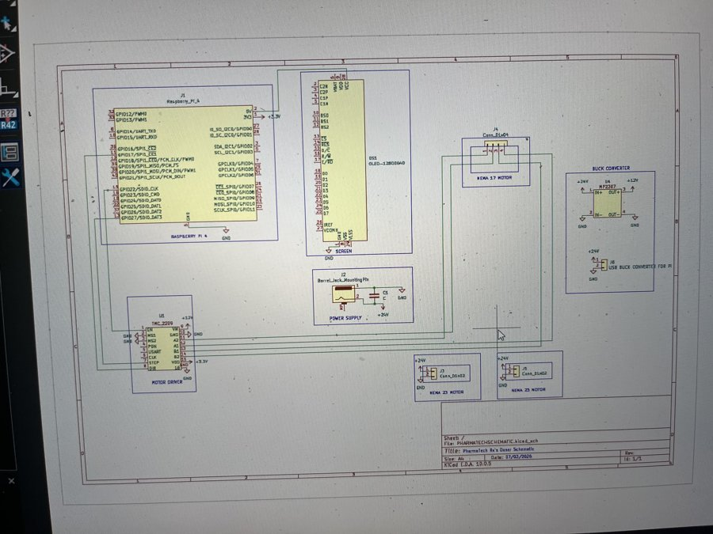
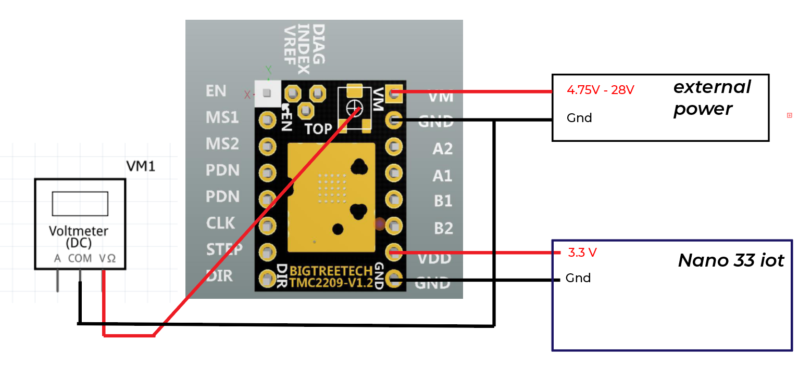

# 039 — The PCB schematic, on screen

**Date:** 2026-10-01
**Milestone:** M2 → M5
**Type:** Achievement

## What I'm doing

The PCB schematic, finally on screen in full. i started the layout a while back to escape the breadboard, and this is the design as it stands. Teh driver circuit, the Pi connections, the whole electronics system drawn as proper schematic instead of a pile of jumper wires.

## What happened

The screen shows the schematic in the design tool. All the blocks laid out, traces being routed. And this is the board thats supposed to replace the breadboard, mount on the superstructure, and make the electronics organized and reliable instead of a wire nest that falls apart if you lok at it wrong.

Drawing the schematic is the part that forces you to undertsand your own circuit. On the breadboard the enable reroute was one wire moved from one hole to another. But on the schematic the enable line has to be drawn from the Pi GPIO pin to the driver EN pin, with everything in between visible. If i draw it wrong it will effect the whole board and i pay for it in a two-week shipping delay. A board doesnt forgive sloppy thinking the way a breadboard does, because you can't just move a trace with your fingers. Thats the risk of the PCB route and it's a real one. The breadboard is ugly and it works and and the PCB would be clean and it might not work, lol. But the machine cant live on a breadboard, not with a frame and a disk and eight hoppers and a demo to survive. So the board gets designed anyway, and im the one who has to live with the traces once theyre copper.

## Today's results

PCB schematic complete on screen, layout in progress. The electronics have a designed home nwo, even if taht home eventually changes

## What's still left to do next time

M4 next, omg. The frame, the disk, the actuator. And the electronics story pauses here and the mechanical story takes over. And theyll meet again later wehn everything has to live on the Same machine.

**Total time spent: 3 hours**
