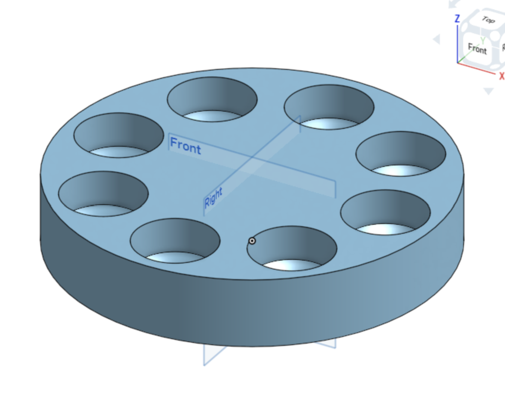
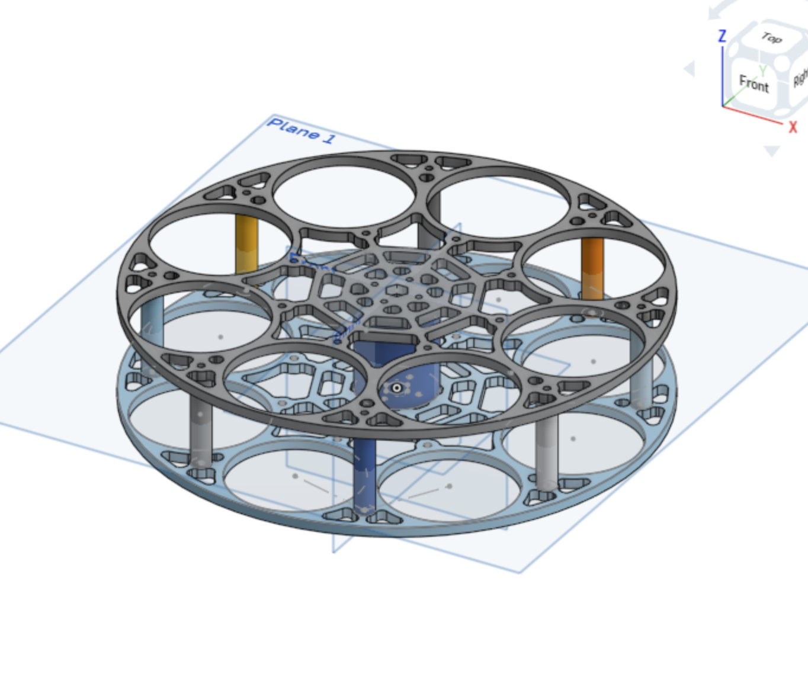
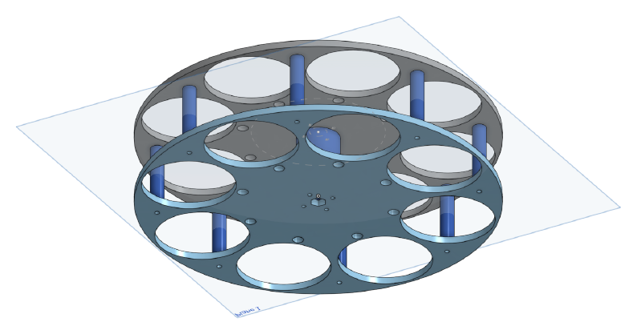
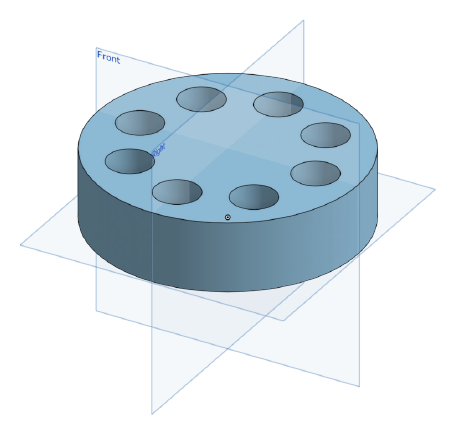

# 040 — The disk concept becomes real CAD

**Date:** 2026-10-05
**Milestone:** M4
**Type:** Achievement

## What I'm doing

M4 now. Expanding the single doser into a multi-doser that can dispense multiple powders in one continuous run. And the rotary disk concept has beeen around since the start, a sketch and a rough model, and now it has to become high-fidelity CAD. Because this is the part everything else hangs off.

## What happened

The single doser was designed with this in mind from the start. Which is why the transition is smoother tehn it has any right to be. The disk i sketched early on is now a proper model. Eight pockets, one for each hopper, arranged in a circle. The first iteration is a solid disk with eight holes. The final iteration is lighter, a two-tier lattice structure, because a solid disk that size is heavy, slow to print, and a waste of filament.

Two tiers instead of one solid disk. Because a solid disk eight hoppers wide is big print, a lot of filament, a lot of weight hanging on the disk motor, and most of the material is doing nothing. The middle of the disk doesn't hold powder, the Pockets do. So the two-tier version keeps the pockets and the structure that holds them and dropped the rest. Less filament, faster print, lighter to spin. And the lattice looks like engineering instead of a hockey puck. The trade is print complexity. A lattice is harder to print cleanly than a solid slab, and if it warps or starts to loose alignment the pockets dont line up with the actuator. Ubt the weight saving is worth it, because the disk motor has to stop this thing at exact positions, and a lighter disk is easier to stop exactly.

The other thing that makes this transition smooth is that the single doser was designed for it. The hopper, the auger, the agitator, the motor mount, all of it was built as a unit that could be copied eight times around a circle. and the early concept sketch already had the disk with the hoppers on it. So making it real is mostly a matter of drawing the sketch properly. Exact pocket positions, exact spacing, exact center. The hard thinking was already done early on, and the componenets all lined up the wya they wree supposed to. Which arent things i get to say very often, lol.

## Today's results

Rotary disk in high-fidelity CAD. First iteration and final iteration. Eight hoppers, one disk. And the multi-doser finally has a shape, lmao.

## What's still left to do next time

The hard question the disk creates is how does one motor drive eight hoppers. Eight motors would be expensive and huge. And the answer is gonna be one motor that moves between dosers. Which means an actuator, a coupler, and a whole new set of problems.

**Total time spent: 4 hours**
