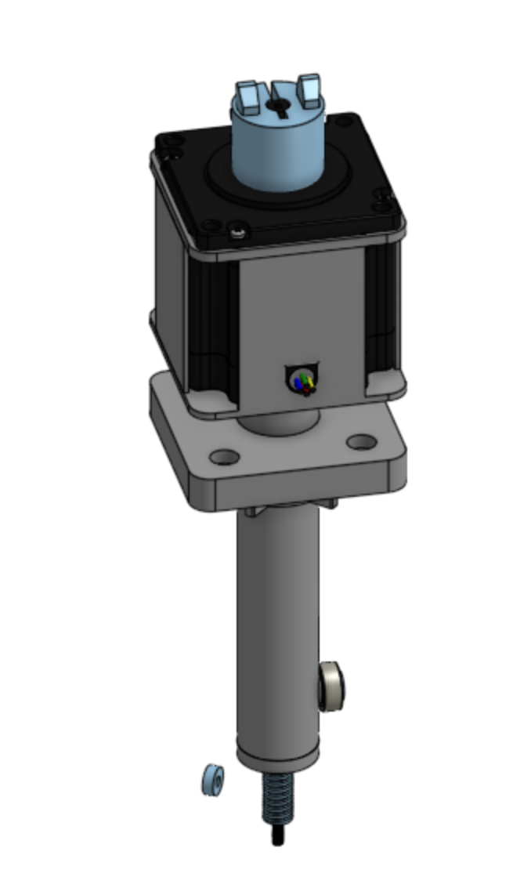
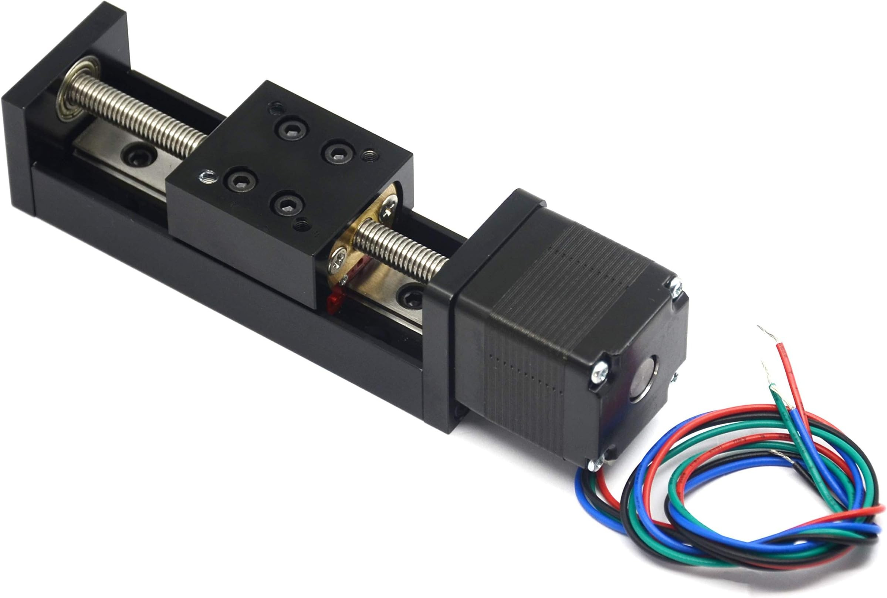
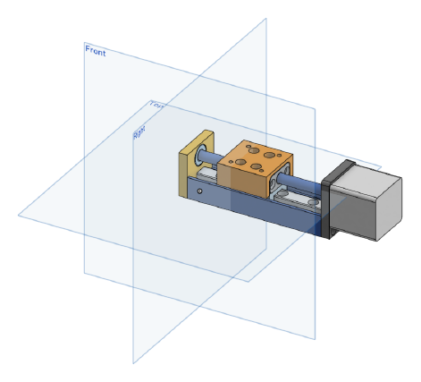

# 041 — The actuator: bought, not built

**Date:** 2026-10-08
**Milestone:** M4
**Type:** Achievement

## What I'm doing

Ok so the problem is the transition. One motor has to run eight dosers, so it needs to lift up while the disk spins to the next hopper, then come back down and and grab that auger. And that up and down part is a linear actuators job.

## What happened

At first the plan was to build the actuator ourselves, then i did the cost math and it fell apart. Building a linear actuator from parts costs mroe then just buying one. and the bought one is a known thing, a mini linear rail with a lead screw and a small stepper, 50 mm of travel. Which is exactly the lift the motor needs to clear the coupler and come back down. And turns out building it ourselves woudl've cost way to much for something i could just order, lol.

So we bought it instead. The BOM stil has it marked pending at $49.96, the oen item on the list that never got checked off as bought in the sheet. Which is either an accounting gap or the actuator arriving faster than the spreadsheet. Thats my best guess anyway Either way the actuator is a purchase, not a build, and honestly im fine with that, fr. The interesting engineering in tihs machine is the dispensing, and reinventing a lead screw doesnt make the powder dispense any better.

The cycle it makes possible is disk spins to the next hopper, actuator lowers the motor down onto the auger, motor dispensed, actuator lifts the motor back up, disk spins to the next hopper, repeat, eight times, one continuous run. The actuator is the part that makes one motor, eight dosers true instead of just slogan. Because without the lift the motor is either stuck engaged with one hopper forever or dragging across all eight. The 50 mm of travel is the clearance that lets the disk spin freely. The lead screw is what makes the lowering repeatable. The motor comes down to to the same place every time, which is the only way the coupler has a chance. It has to recieve the motor shaft the same way every single time.

## Today's results

Drive-engagement method decided. Linear actuator lifts the motor up while the disk rotates, lowers it to engage the selected doser. Actuator purchased, not built, on cost.

## What's still left to do next time

The coupler. Lifting the motor up and down is easy. Getting it to reconnect to the auger every single time, at whatever angle the auger stopped at, is the problem nobody warned me about. And its about to stop all progress.

**Total time spent: 2 hours**
