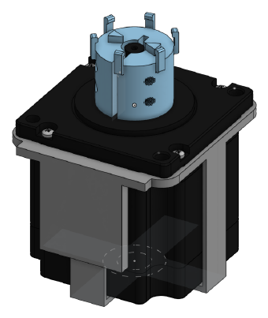
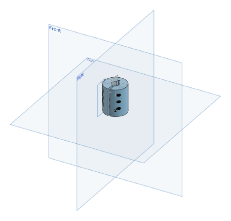
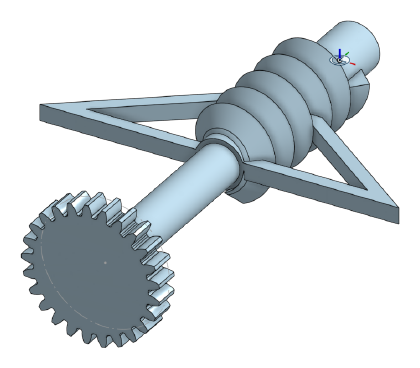

# 042 — The coupler that only worked at one angle

**Date:** 2026-10-11
**Milestone:** M4
**Type:** Roadblock

## What I'm doing

Fixing the connection beteween the motor and the auger. Which has turned into the biggest roadblock of M4. The actuator lifts and lowers fine. The problem is what happens when it lowers.

## What happened

The frist coupler design only connected if the auger happend to be sitting at one very specific angle. And if it wasnt, and it almost never was, the motor would come down and not engage. and nothing could dispense. No tests, no progress on hardware or software. The whole machine held hostage by a connection that needed luck, bruh. And if the auger wasnt at that one angle, yuor out of luck.

This was a major roadblock because it blocked everything downstream. I couldnt test the disk. I couldnt test the actuator cycle. I couldnt test multi-powder runs. Because the motor couldnt reliably grab the auger it was supposed to turn. A machine that cant connect its motor to it's load cant dispense anything. And i had a very expensive machine that couldnt do anything for a while. Which is not a great feeling when the whole milestone is waiting on one connection, lmao.

The fix, the fix came after a lot of approaches. And the images show some of them. Attempt after attempt, idea after idea, test prototypes, different geometries. All of them mine, all of them trying to solve the same problem from a different direction. The answer that stuck was to line the motor coupler with serrated teeth that align with the auger coupler at any angle. Teeth, not a keyway. However the auger stopped, the teeth find each other and engage.

Teath work and a keyway doesn't because of what the auger does when it stops. It stops wherever it stops. A keyway needs the auger at one exact angle. Which means the machine has to rotate the auger to that angle before every engagement. Which means more code, more time, more ways for it to fails. Teeth need the auger at any angle, because tehre are enough teeth aroudn the circle that one of them is always close to aligned. And the lowering motion itself pushes them into engagement. And the connection finds itself instead of needing to to be found.

## Today's results

Serrated-teeth coupler works. Motor engages the auger at any angle. The roadblock is gone and the machine can run multi-doser tests now. Which isnt something i could say yesterday.

## What's still left to do next time

The frame, the disk, the actuator, the motor, and eight hoppers all need something to hang from. And that something is 3030 aluminum extrusion and a saw.

**Total time spent: 5 hours**
