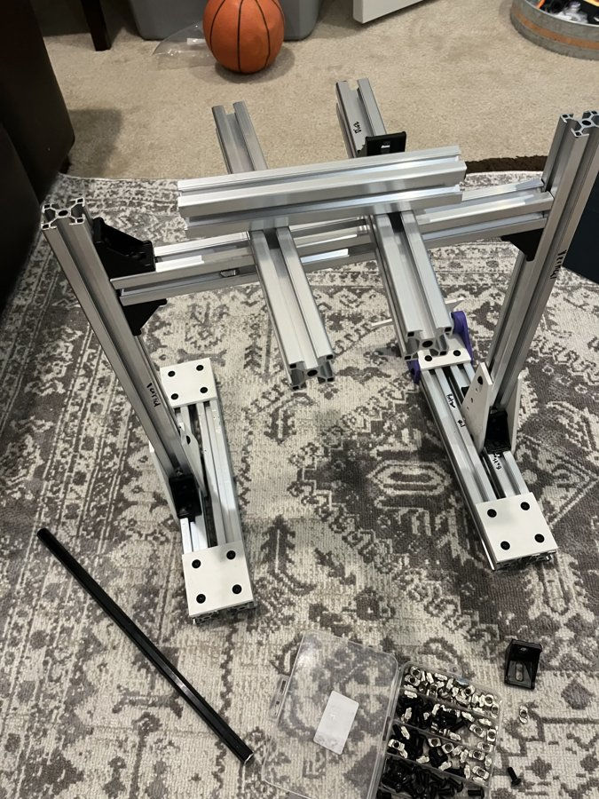
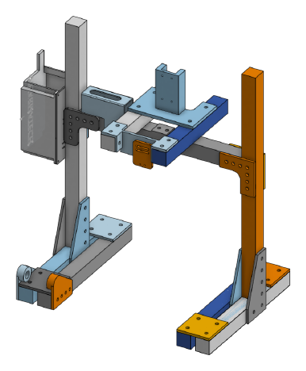

# 043 — Sawing 3030 extrusion for the frame

**Date:** 2026-10-14
**Milestone:** M4
**Type:** Achievement

## What I'm doing

Building the superstructure. The frame everything hangs from. The machine outgrew the desk and the breadboard era, it needs a real frame, square and rigid. Disk in the center, actuator above the dispensing position, electronics on the side. Thats the whole job today.

## What happened

First tihng I needed was 3030 aluminum extrusion. Cut it with an electric saw, put it together with connectors and T-nuts. The photo from today is the frame going together on the floor, silver extrusions and black brackets, a saw nearby. The unglamorous middle of a build. Everything is measurement and cutting and re-measuring, becuase the disk has to be centered and the actuator has to line up with the slot positions or nothing works. I should of known the measuring would eat most of the day.

The frame is also about fitting in its envelope. The machine has to fit, thats constraint. Extrusion works for that because its strong and modular and you can move a bracket when you remeber the actuator is 2 cm off. Instead of rebuilding the whole thing. Thats why I went with extrusion instead of wood or printed parts. The machine is still changing so the frame has to change with it. Unbolt a bracket, move it, done lmao

so today is mostly a tape measure and a saw and checking the same dimensoin three times. The disk has to be centered, the actuator has to sit above the dispensing slot, the scale has to sit under it, the the screen has to be reachable, and the whole thing has to stay square while i cut and bolt it together on the floor. A frame thats a degree out of square is a disk that doesn't line up with its actuator, and a disk taht doesn't line up doesn't dispense. Not the glamorous part of the build lol. alot of this project is lkie that.

## Today's results

Frame under construction. 3030 extrusion cut and assembled, disk position centered, actuator position set above the dispensing slot. The machine has a skeleton nwo.

## What's still left to do next time

Mount everything on it. Disk in the center, actuator to the side above the set doser position, Arduino and perf board and Pi on the side with the wires in a printed cover. Then the first full assembley. Then the part where i find out waht doesn't fit.

**Total time spent: 5 hours**
