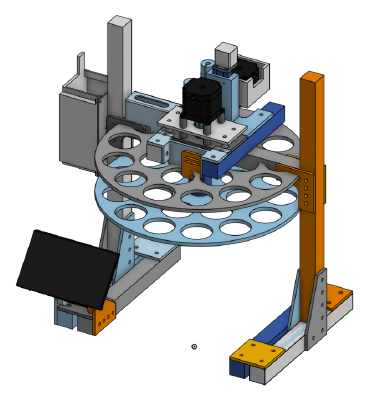
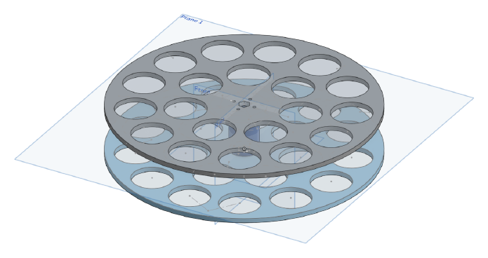
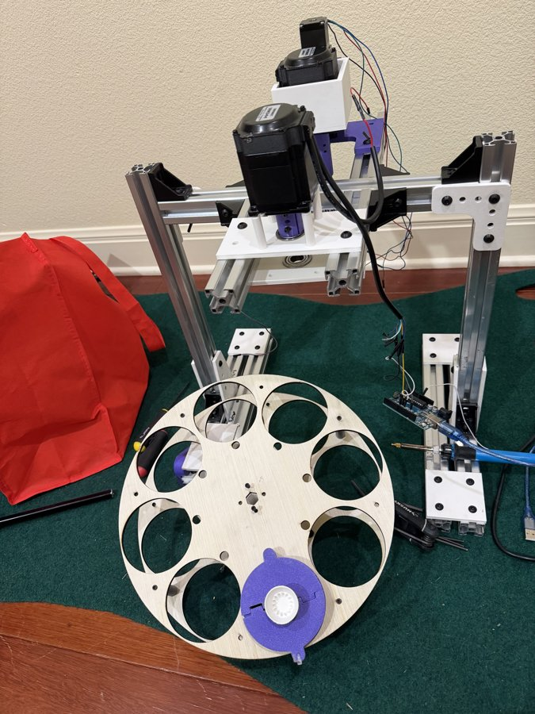

# 044 — Frame and disk, together

**Date:** 2026-10-17
**Milestone:** M4
**Type:** Achievement

## What I'm doing

Putting the disk on the frame. The frame is built, the disk is designed, and today they stop being seperate projects adn start being one machine.

## What happened

The rotary disk is mounted in the center of the extrusion frame. Photos from today show it form a couple of angles, the disk hanging in the frame with the purple mounts and the motor hardware starting to appear around it. First time the machine looks like the CAD. Which is weird after months of the CAD being the only version that looked finished. honestly it kind of caught me off guard how much it already looks like a machine, ngl.

The white disk itself is a big print. Eight pockets. theres a photo from a few days later of it sitting on the frame wtih the purple hub in the middle, which is the version that gets used. the printed one is solid and real and heavier than the CAD suggested. The disk in the CAD was light and lacy. The printed oen isnt light and lacy. Which isnt a detail the frame minds tho, but the disk motor will have opinions about later.

The weight matters becuase the disk doesnt just sit their. It has to spin and stop at exact positions, eight of them, and stop precisely enough that the actuator comes down onto the right hoppr. A heavier disk has more momemtum, which means more overshoot, which means the positioning code has to work harder. The CAD said light and lacy, the print says solid and heavy. And if the frame was even a little out of square i couldnt get nothing to line up, so im glad the measuring paid off. The motor will be the judge. The judge hasnt ruled yet.

## Today's results

Disk mounted in the center of the frame. The multi-doser has a body nwo. The remaining work is everything that attaches to that body.

## What's still left to do next time

The disk print itself, the actuator mounting, and the full assembly. Also the wiring, which is going to be an all-night job. i can already feel it coming, lol.

**Total time spent: 4 hours**
