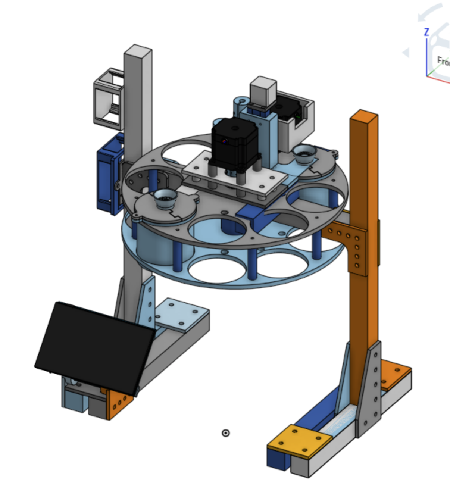
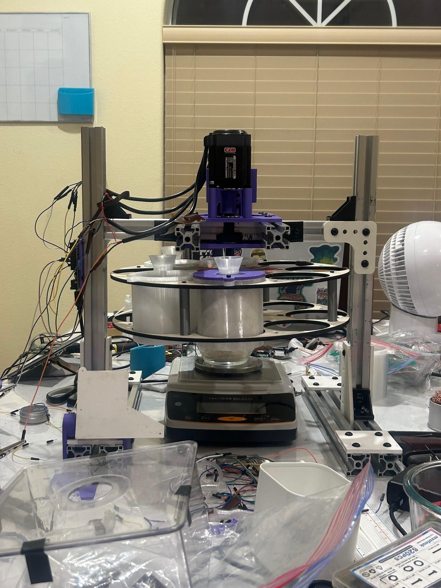
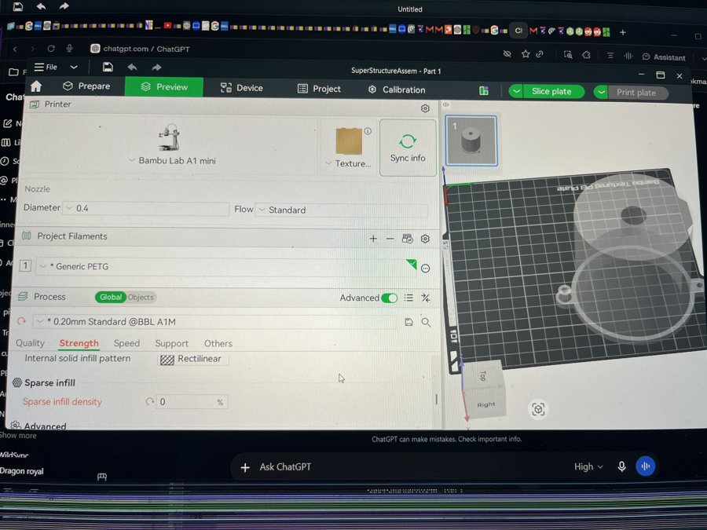

# 045 — First full assembly

**Date:** 2026-10-20
**Milestone:** M4
**Type:** Achievement

## What I'm doing

First full assembly. Everything on the machine at once. Frame, disk, actuator, motors, screen, scale. The cad said it all fits. Today finds otu whether the CAD was right.

## What happened

The disk print is running, you can see it in the slicer on sceen. Eight pockets, sparse infill, the big white disk that the whole machine rotates around. And the assembly is coming together in the photos, the full CAD with the orange actuator column, the disk in the middle, the screen at the base, and then the real thing on the desk at night. Wires everywhere, disk in place, motors mounted. The machine existing in three dimensions for first time. And it wont look tihs New agian for a while, lmao.

The CAD and the real thing side by side. The frame holds the disk, the actuator column stands where the CAD said it would, the screen sits at the base, right where it was suppose to be. The motors are mounted. Everything the CAD promised is their, in three dimensions, on the desk, at night, with wires everywhere because the wiring hasn't happened yet and the wires are stil a pile instead of a system. And i keep coming back to how strange it is to see it as a a real object instead of a model.

and the disk positioning question is already waiting. The working notes from this week have the disk motor at 6,400 steps per revolution, divided by 8 slots, 800 steps per slot, with the idea of taking the shortest path between slots instead of spinning one direction. Encoders were considered and rejected as too complicated when basic geometry could do the job. That approach is whats being tried right now. Its going to change. The final code doesn't trust steps at all, it counts detents with a switch. But today the assembly is the achievement, and the positioning is tomorrow's problem. i know it's going to fight me lol. It just hasn't started yet.

## Today's results

First full assembly exists. CAD and real, side by side. The machine is a machine. What isn't done is the wiring, the code that moves the disk, and the part where it dispenses eight powders in a row without me standing tehre. So it's not done, it's just real now.

## What's still left to do next time

The wiring session, all of it, in one go, overnight if it has to be. The electronics have to move from the desk onto the machine, and the disk has to learn where it is. Which is a code problem i already know is gonna fight me. And an effecient fix is not going to come from just staring at it.

**Total time spent: 6 hours**
