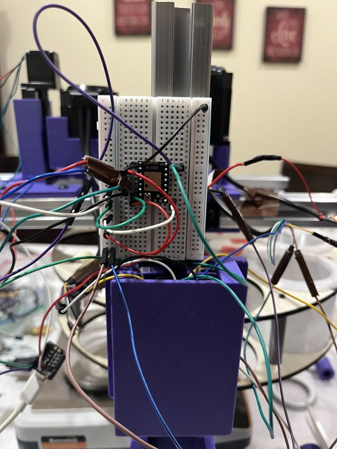
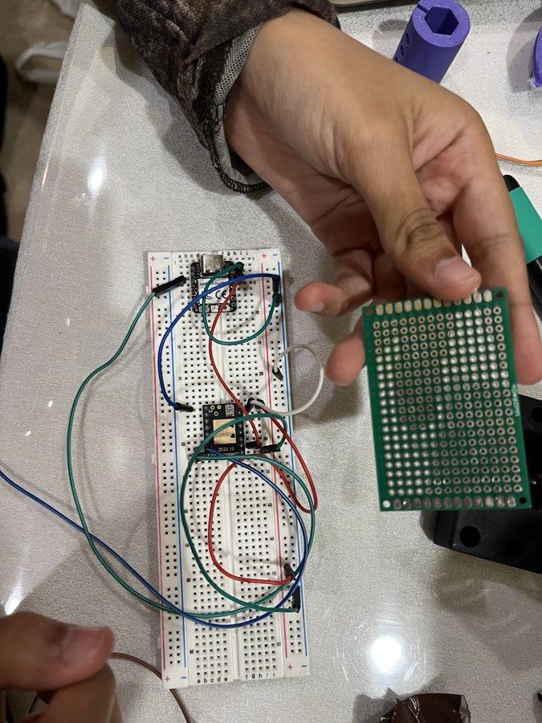
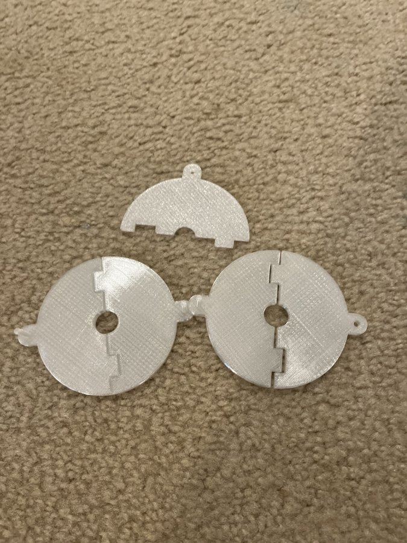

# 046 — The all-night wiring session

**Date:** 2026-10-23
**Milestone:** M4 → M5
**Type:** Achievement

## What I'm doing

Wiring the whole machine. Not a bench test, not a subsystem, the whole tihng. Motors, actuator, disk, Pi, Arduino, scale, screen, all of it, onto the frame, in one session that runs through the night.

## What happened

The photos from tihs session are from the middle of the nite, and they look like it. The breadboard is mounted on a blue box on the the machine with wires going in every direction. theres a perf board in hand, a driver board in hand, disk segments on the carpet. And the machine is slowly turning from a mechanical assembly into an electrical one, bruh. And the amount of wires coming off that breadboard was honestly kind of insane.

This is the session where the M4 and M5 documents both get written, because the work crosses midnight and the write-ups land the next day. And the machine that comes out of this night is the machine that the rest of the project is about. Eight hoppers, one shared drive, an actuator, a disk, adn electronics that are, for now, a breadboard and a prayer. and dont let the prayer part fool you, it works.

The wiring is the part of the build that doesnt photograph well and matters most. Every motor needs power and control, the actuator needs its own driver, the Pi needs to talk to the Arduino, the Arduino needs to talk to the drivers, the scale needs its serial line, the screen needs its connection. None of it is hard on its own Lal of it at once, at 3 AM, on a machine thats still being assembled around you, is the job. the breadboard is mounted on a blue box on the machine because there isn't a better place for it yet. And the wires go in every direction becuase the wire covers haven't been printed yet. Thats M5's job. Tonight's job is just everything connected, everything alive. im not gonna pretend it looked good lol. It just worked. Which at 3 AM is the same thing.

## Today's results

Machine wired end to end, overnight. Motors, actuator, Pi, Arduino, scale, screen, all connected on the frame. And M4's mechanical work and M5's electronics work meet in this session. Which is a wierd issue i was worried about for weeks and it just happened, slowly, wire by wire.

## What's still left to do next time

M5 proper. The stepper code has to get fast, the electronics have to get organized, and the disk has to learn where it is. And the wiring works, now it has to work well, which is a whole different thing. And their is still a pile of wire to tidy before any of that counts as done.

**Total time spent: 8 hours**
