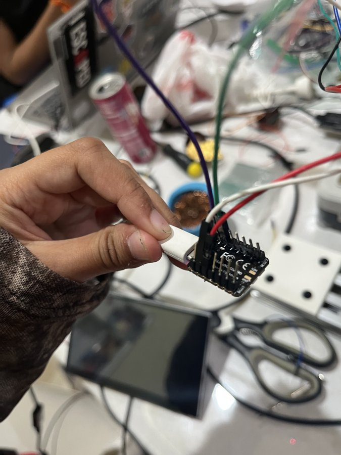
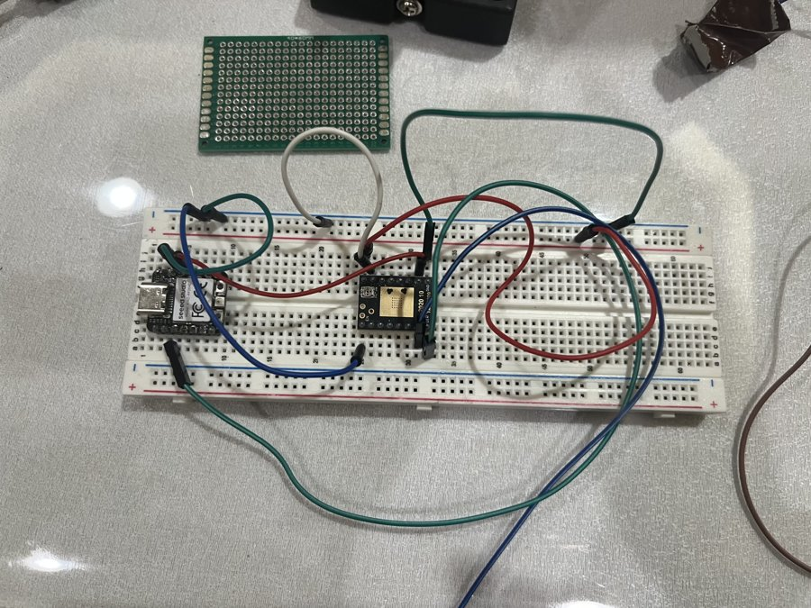

# 047 — My step code is the bottleneck, not the motor

**Date:** 2026-10-26
**Milestone:** M5
**Type:** Roadblock

## What I'm doing

M5, fine-tuning and optimizing. The machine is built and wired, and now it's about making it fast. Motor speed has been an issue since M3. And the frist version of the stepper code is where the problem lives.

## What happened

The first version of the stepper code used basic Arduino commands to send step pulses at increasing speed. Simple, readable, and too slow, tbh. And the code itself became the bottleneck instead of the motor. The motor could go faster, the pulses just couldnt get to it fast enough, becuase the Arduino was spending its time running the pulse commands instead of pulsing. The code is doing the pulsing and pulsing is the slow part.

Last time the hardware was the limit and I blamed the software. i use to think the motor was always the slow part, but this time the software really is the limit. And the fix has to be in how the pulses are generated, not in how fast I ask for them. The basic pulse commands work by having the main loop do everything. Set the pin high, wait, set it low, wait, reapet. And every step costs the processor time, and the processor can only do one thing at a time. so the fastest the motor can go is the fastest the loop can run. That's the ceiling, and it's a low one.

If I'd kept tuning speeds and acceleration values, I'd have stayed under the same ceiling. And the ceiling isn't a number in the code, it's the way the code generates pulses. So tuning numbers was never going to fix it, the pulses hda to come form somewhere else. And once I saw that it was kind of obvious, lmao. Which is annoying lol, because I spent a while tuning numbers befor I saw it. And an effecient fix was sitting right there the whole time.

## Today's results

Diagnosis. Version 1 stepper code is too slow because basic Arduino pulse commands can't generate steps fast enough. And the motor isnt the limit here, the code is. Which is backwards from what I expected. But at least now I definately know waht to fix.

## What's still left to do next time

Version 2. Generate the pulses with a hardware timer built into the chip, so the pulses come from the timer, not from the main loop. And the motor gets tested against it's real limits instead of the code's limits. And the code stops being the thing in the way.

**Total time spent: 3 hours**
