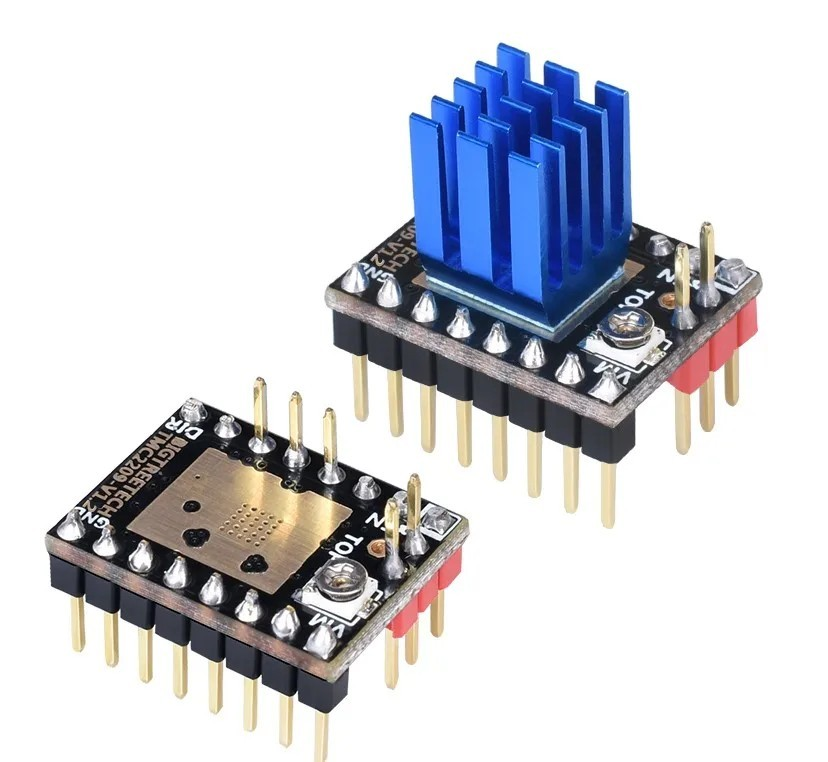
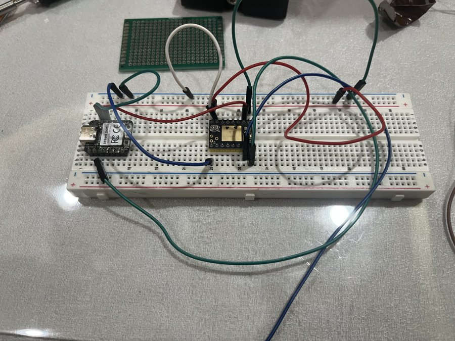

# 049 — Version 3: fault checking and type-in speeds

**Date:** 2026-10-29
**Milestone:** M5
**Type:** Achievement

## What I'm doing

Version 3 of the stepper code. Tow things this time, fault checking, and typing in a speed to test it right away instead of re-uploading every time. And both of them are about the same thing, making the motor testable.

## What happened

Fault checking first. If the driver catches a stall or too much current, the code records exactly what speed it happend at. And thats way more useful than just knowing the motor stopped Now I know it stalled at this speed under this load, and that's actual data I can use, not a shrug. And the driver board is the part that reports it, so version 3 is really the code listening to the hardware for once.

Tehn the type-in speed testing. Before this, testing a new speed meant rewriting the code and re-uploading it to the Arduino every single time. That would of gotten old fast, and honestly it made me skip tests I should've run. And now I just type in a number and it run. Minutes per test down to seconds, and the motor gets characterized instead of me guessing at it. Guessing was the old method and it wasnt working, lol.

Ok so both of these are really about the same thing, making the motor testable. fault checking tells me where it fails, type-in speed let me find that spot fast. And without the first one I'm guessing about limits, and without the second one I'm too slow to map them. And once I know the limits I can run the machine fast without breaking it. And the componenets didn't change at all, the driver is the same Driver, the motor is the same motor, only the code gto smarter. Which is the cheapest upgrade in the whole project, ngl.

## Today's results

Version 3 done. Fault checking that records the exact speed of a stall or overcurrent, plus type-in speed testing wtih no re-upload. And the motor code feels like a tool now instead of a problem. Which is a good feeling after a whole day of it being a problem.

## What's still left to do next time

Electronics organization. The code is fast and the machine is wired, but the wiring is stil a breadboard and a prayer. And the PCB plan needs a verdict, because i cant keep putting that decision of. The machine needs a real answer for where its electronics live.

**Total time spent: 4 hours**
