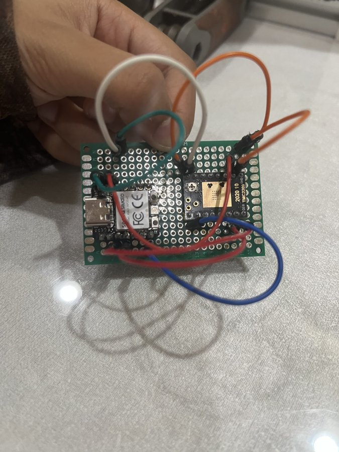

# 050 — The PCB is scrapped, the perf board fails

**Date:** 2026-11-01
**Milestone:** M5
**Type:** Roadblock

## What I'm doing

Deciding the electronics, finally. The PCB schematic has just been sitting there, the breadboard has been doing the job, and the machine needs a real answer for where its electronics live. And im done putting that off.

## What happened

The custom PCB is scrapped. We looked into building one to replace the breadboard and organize the Pi connections and motor controls so everything would be easier to mount and mantain, but we kept iterating and and never finalized a design. And at some point you just have to call it, the board isnt happening. And the machine needs electronics now, not a perfect board eventually. And that's the decision, even if it stings a little after all that schematic work.

So, perf board. A breadboard is to big to mount and too messy, so a perf board seemed like the middle ground. Smaller, mountable, soldered instead of jumperd. And the perf board failed to connect, the connections just didn't work. And after all that soldering, were back to square one on electronics packaging, lmao, and then the- Which is a frustrating place to be when you thought you were past it.

The answer in the end is going back to a breadboard, but a half breadboard, one I can keep adapting with a modular design, mounted in a 3D-printed custom mount. Its not pretty. The breadboard works, the perf board doesnt, and the PCB doesnt exist, so the breadboard is what stays. a mechanism that doesnt work doesnt get kept just because I already spent tmie on it. It gets replaced by the one that does work, even if it's uglier. And the connections on the perf board were pararell to nothing, they just didnt connect. Which is abotu as final as a verdict gets.

Honestly this is the same thing as the thread from early on, bruh. The PCB had a schematic, weeks of work, and a plan to arrive by M3. The perf board had an evening of soldering. Neither of them works, and the tihng that works is the thing I started with, the breadboard I was trying to escape. And letting go of the PCB is the same call as letting go of the thread. a mechanism that doesn't work doesn't get kept just because I already spent time on it. It gets replaced by teh one that does work, even if it's uglier.

## Today's results

Custom PCB scrapped, design never finalized, perf board tried, failed to connect, and the electronics go back to a half breadboard in a printed mount. Picked because it works and I can adapt it, not because it's pretty. And im fine with that. Pretty was never the requirement.

## What's still left to do next time

Mkae the breadboard look like it belongs on the machiene. Printed wire covers, an Arduino cover, a breadboard mount, and all the wires secured to one extrusion, so the machine doesn't look like a science fair project with its guts out. The electronics work, now they have to look like they work.

**Total time spent: 4 hours**
