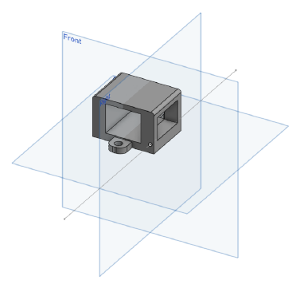
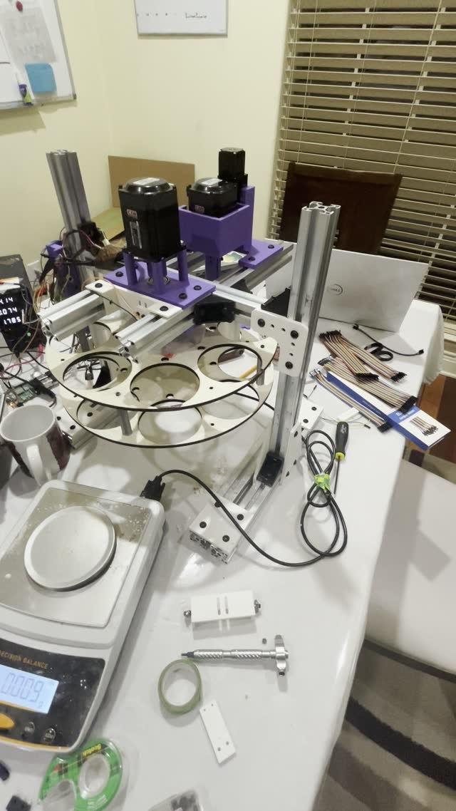

# 051 — Wire covers and one clean extrusion

**Date:** 2026-11-05
**Milestone:** M5
**Type:** Achievement

## What I'm doing

Ok so, cleaning up the machine. The electronics work, the motors are fast, the disk turns, and the whole thing still looks lkie a wiring explosion. And M5's last job is making the machine look finished. Which is a real job.

## What happened

Printed parts to rescue. which is the theme of this whole project, when something needs to exist, print it. Custom wire covers, an Arduino cover, a breadboard mount, all printed to fit teh machine. And the wires get secured to the side and consolidated to one extrusion, so instead of cables going everywhere theres one clean run down one piece of frame. one run, one extrusion, nothing dangling.

Its not just cosmetic. Exposed wires get snagged and pulled and unpluged, and a machine that has to dispense eight powders in a row can't have a wire come loose because someone brushed past it. And the covers and the consolidation wree reliabilty work. A wire in a cover can't be snagged, a wire secured to one extrusion can't be yanked from three directions, and a breadboard in a printed mount can't slide off the machine mid-dispense. And the machine stops being one accidental tug away from a failure, lmao. And that's worth more than looking good, even though it also looks good. And alot of the reliability in this project has been exactly this kind of unglamorous work.

The other thing the cleanup does is make the machine demo-able, the demo is two weeks away. And a machine with its guts otu reads as unfinished to an audience no matter how well it works. A machine with covers and one clean wire run reads as a prodcut. The work is the same either way, but the audience can only see the outside, so the outside has to show the machine is finished. And for once it does.

## Today's results

Electronics organized. Printed wire covers, Arduino cover, breadboard mount, wires secured and consolidated to one extrusion. And the machine looks like a machine and it stops being one accidental tug away from a failure. Which is the result i care abotu, ngl.

## What's still left to do next time

Next up. The final code, the disk learning were it is, and the demo. The machine is built, wired, fast, and tidy, and nwo it has to prove it can run a whole recipe by itself.

**Total time spent: 4 hours**
